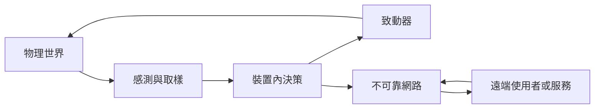
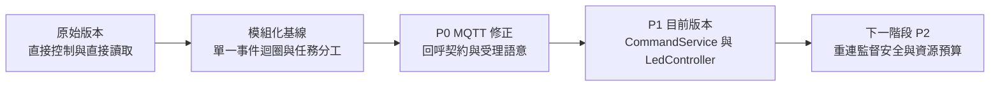
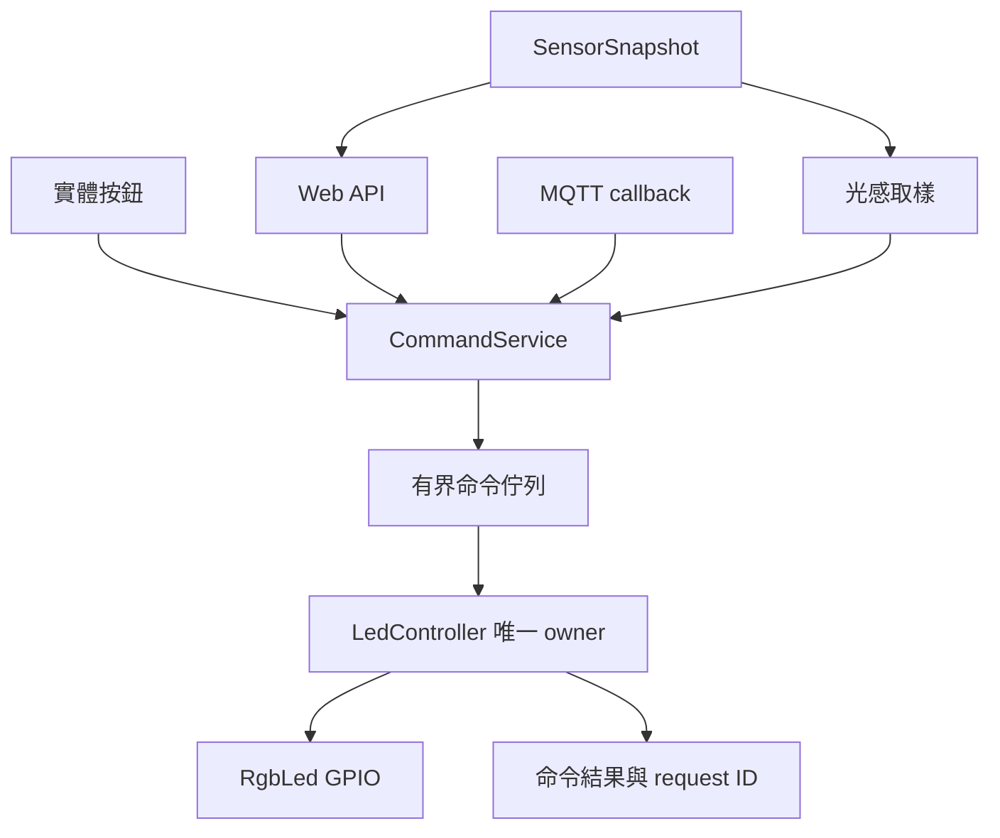
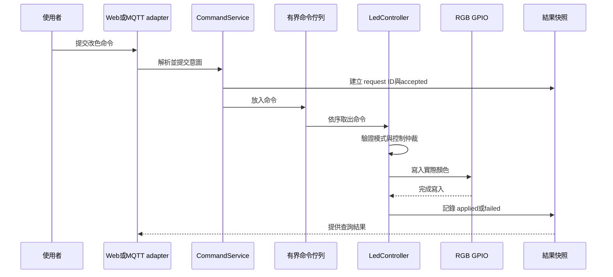

# 物聯網軟體架構演進：從直接控制到可驗證的裝置系統

> 本文件以本專案的 ESP32／MicroPython 系統為案例，說明架構如何因為缺點而演進。重點不是背誦 `MQTT`、`uasyncio` 或某個框架，而是從物理世界、有限資源、不可靠網路與多來源控制推導出必要的軟體結構。
>
> 文件中的「目前實作」以 `main.py`、`tasks.py`、`hardware/`、`communication/`、`services/`、`web_server.py` 與目前測試為準。P1 已完成桌面 fake hardware／fake MQTT／HTTP TestClient 驗證；尚未宣稱 ESP32 實機、真 Broker、外部訂閱者或硬體電氣驗證通過。

## 1. 先看核心問題：這不是把 Web 程式縮小

純軟體系統通常處理「資料進來、程式計算、資料出去」。物聯網系統還要處理：



因此，物聯網的正確性至少包含四層：

1. **程式正確：**資料結構、狀態轉移與錯誤處理符合規則。
2. **時間正確：**不把過期資料當新資料，不把「稍後執行」當成「已完成」。
3. **資源正確：**RAM、Flash、CPU、網路頻寬、電力與佇列容量不被無限制消耗。
4. **物理正確：**GPIO、ADC、I2C、SPI、按鈕、感測器與 LED 的行為符合實際接線和電氣條件。

最重要的差異是：**遠端回覆成功，不等於物理動作已完成；感測器回傳一個數字，也不等於這個數字可信。**

## 2. 演進總覽

本專案的演進不是「一次改成大型平台」，而是每一輪只處理一個最危險的架構缺口。



| 階段 | 原本的主要缺點 | 因應改進 | 得到的優點 | 狀態 |
|---|---|---|---|---|
| S0 原始版本 | 按鈕、Web、光感可能直接寫 LED；查詢可能直接讀感測器；命令與完成混在一起 | 先建立問題清單與責任邊界 | 功能可快速展示，但競爭和故障不可解釋 | 歷史基線 |
| S1 模組化基線 | 檔案分開了，但共享狀態與控制權仍可能混合 | 以 `hardware`、`communication`、`tasks`、`web_server`、`main` 分層 | 可替換部分元件，能看見資料流與生命週期 | 已存在，仍有缺口 |
| S2 P0 MQTT | `mqtt_as` 同步呼叫 callback，但應用層使用非同步 callback；連線與發佈結果被誤報 | callback bridge、保存 handler、檢查 `wait_connected()`、分離 accepted／published | MQTT 入站命令真正進入程式；HTTP 不再把受理誤稱完成 | 已完成 |
| S3 P1 控制與感測 | 多來源仍需要共同規則；感測失敗值不應覆蓋好資料 | `CommandService`、`LedController`、`SensorSnapshot`、bounded queue、request ID | 單一 LED owner、AUTO／MANUAL 仲裁、last-good 品質、命令可追蹤 | 已完成 |
| S4 P2 長時間運作 | 重連重新訂閱、任務健康、安全與資源預算仍不完整 | supervisor、連線狀態機、身份授權、限流與量測 | 從「能跑」提升為「長時間可維持、可恢復、可證明」 | 待實作／需實機驗證 |

### 2.1 每一輪演進的判斷順序

學生分析一個 IoT 系統時，應按以下順序提問：

1. **誰讀取物理世界？**讀取頻率、失敗時的值與資料新鮮度是什麼？
2. **誰可以改變物理世界？**是否只有一個 owner？多個來源衝突時誰決定？
3. **這個請求現在處於哪個階段？**已收到、已排隊、已套用、已觀測，還是失敗？
4. **如果網路、感測器、顯示器或任務失效，哪些功能仍應可用？**
5. **如何證明設計有效？**桌面測試證明什麼，實機測試還缺什麼？

## 3. S0：原始版本——先讓硬體動起來

### 3.1 原始做法

最初的教學程式通常採用直覺式流程：按鈕事件直接呼叫 LED 方法，Web 路由直接改 LED，光感任務看到低光就直接閃燈，HTTP 查詢需要資料時直接讀 DHT 或 ADC。這種做法對第一次展示很有效，因為程式短、結果立即可見。

```text
Button task  ────────────────> RGB LED
Web route    ────────────────> RGB LED
Light task   ────────────────> RGB LED
Web route    ────────────────> DHT / ADC
MQTT callback───────────────> application or GPIO
```

### 3.2 技術點一：直接控制為什麼很快，但不能成為長期架構

- **是什麼：**每個入口都直接呼叫硬體物件，不經過共同的命令或狀態模型。
- **為什麼：**最少的程式碼可以快速驗證 GPIO、按鈕、感測器與網頁是否接通；這是教學初期合理的垂直切片。
- **做什麼：**建立第一個可觀察的端到端閉環：輸入事件、程式處理、硬體輸出。
- **怎麼做：**先讓單一功能通過，例如按鈕按下後 LED 改色；接著記錄每一條直接讀／寫路徑，不把臨時直連誤認為架構完成。

**缺點：**當按鈕、Web、MQTT 與光感同時要求 LED 時，最後一次寫入者可能覆蓋前一次決策；程式沒有地方可以回答「為什麼最後是這個顏色」。

**得到的教訓：**直接控制適合做硬體 smoke test，不適合承擔多來源控制、故障恢復與命令追蹤。

### 3.3 技術點二：物理 I/O 不是普通函式呼叫

- **是什麼：**GPIO、ADC、I2C、SPI、PWM 和 DHT 都是有時序、失敗模式與硬體前提的 I/O 操作。
- **為什麼：**同一個函式在桌面 fake driver 上可能立即成功，在 ESP32 上卻可能遇到抖動、忙碌、斷線、電氣雜訊或不支援的腳位。
- **做什麼：**把硬體限制帶入抽象設計，而不是只把硬體名稱換成類別名稱。
- **怎麼做：**將直接 I/O 收斂在 `hardware/`；在上層使用資料、命令與快照；記錄 GPIO／ADC／電源／接線／韌體版本，並把實機驗收和桌面測試分開。

## 4. S1：模組化基線——把改變限制在責任邊界

### 4.1 為什麼要分層

原始程式的第二個問題不是「檔案太少」，而是任何改動都可能碰到所有東西：換 RFID 驅動需要改任務；換 Web 框架需要改控制規則；改 LED 行為需要搜尋所有入口。

目前基線分為：

| 層級 | 主要責任 |
|---|---|
| `hardware/` | 直接接觸 GPIO、ADC、I2C、SPI、PWM 與感測器 |
| `communication/` | WiFi、時間與 MQTT 的通訊轉接 |
| `services/` | 命令邊界、LED 控制與感測快照 |
| `tasks.py` | 協同排程、週期讀取與事件協調 |
| `web_server.py` | HTTP 路由與資料轉換，不自行建立另一套控制規則 |
| `main.py` | 組裝物件、注入相依性、啟動與關閉生命週期 |

### 4.2 技術點三：分層與相依方向

- **是什麼：**把「硬體怎麼做」、「應用規則怎麼決定」與「外部介面怎麼傳送」分開。
- **為什麼：**如果政策依賴某個 GPIO 或某個 HTTP 框架，桌面測試、硬體替換與協定變更都會一起受影響。
- **做什麼：**限制變更範圍，讓同一個應用規則可由按鈕、Web、MQTT 或 fake adapter 使用。
- **怎麼做：**`main.py` 建立具體物件；adapter 將外部輸入轉成內部資料；service 決定政策；hardware driver 只執行 I/O。這不是強迫大型 Clean Architecture，而是先固定「誰可以知道什麼」。

**得到的優點：**學生可以從資料流追蹤問題，而不必在每個入口複製修正；測試可以用 fake hardware 驗證政策。

**仍未解決：**模組化本身不會自動產生唯一狀態 owner。檔案分開，仍可能有多個檔案寫同一個 LED。

### 4.3 技術點四：單一 `uasyncio` 事件迴圈與協同多工

- **是什麼：**在單一執行緒中，以協程輪流執行感測、按鈕、顯示、Web、MQTT 與控制工作。
- **為什麼：**ESP32 的教學裝置工作多半是低速 I/O；協同多工比多執行緒更容易觀察共享狀態與資源成本。
- **做什麼：**讓多個功能共存，同時避免每個功能建立一個重量更高的執行緒。
- **怎麼做：**長時間任務在等待 I/O 或計時時 `await`；禁止在事件迴圈內做不可控的長時間同步工作；為每個輪詢週期、警示持續時間與發佈等待設計上限。

**核心風險：**協同多工不是平行執行。任何不讓出控制權的程式都會阻塞按鈕、Web 與其他任務；因此「有 `async` 關鍵字」不等於「不會阻塞」。

## 5. S1 的第一個架構缺口：感測資料與控制規則混在一起

### 5.1 技術點五：取樣、去彈跳、濾波與遲滯

- **是什麼：**把連續、雜訊或抖動的物理輸入轉成較穩定的事件或狀態。按鈕去彈跳處理機械接點抖動；ADC 遲滯使用不同的觸發／解除門檻。
- **為什麼：**如果每一次讀值變化都直接觸發控制，按鈕一次按下可能變成多次命令，光感門檻附近可能反覆閃爍。
- **做什麼：**降低不必要的命令、減少 LED 輸出切換，讓控制結果符合人對事件的理解。
- **怎麼做：**按鈕使用穩定時間與等待釋放；光感使用 `trigger < reset` 的雙門檻；每次取樣記錄時間與來源，控制任務只在狀態真正跨越門檻時提交命令。

**得到的優點：**物理噪聲不再直接放大成軟體事件。**仍需注意：**遲滯不是萬用濾波器，門檻必須依感測器、接線、光源與裝置位置實機校準。

### 5.2 技術點六：`SensorSnapshot` 與 last-good 資料

- **是什麼：**由感測任務集中更新一份 RAM 快照，保存 value、valid、quality、age、error 與 sample sequence；其他模組只讀快照。
- **為什麼：**DHT 讀取可能失敗，ADC 也可能暫時無效。把 `-1`、`0`、舊值與「尚未量測」混成同一個數字，會導致 UI 和控制規則做出錯誤判斷。
- **做什麼：**分離「最近一次可用值」與「目前是否健康」，讓 Web、OLED、MQTT 與控制使用同一份資料語意。
- **怎麼做：**`hardware/sensors.py` 保留 last-good；`services/sensor_snapshot.py` 保存品質與年齡；Web `/api/data` 不直接觸發感測器；光感值未知時不提交低光警示命令。

**得到的優點：**感測器失敗不會覆蓋最後可信資料；使用者可以看見資料過期或錯誤，而不是把錯誤值當真值。

## 6. S2：P0 MQTT 修正——先修通訊契約，不先擴大功能

### 6.1 原始 MQTT 缺點

原始路徑有四個不同層次的錯誤：

1. `lib/mqtt_as.py` 以同步方式呼叫 `subs_cb(topic, msg, retained)`，但應用層 callback 宣告為非同步函式；產生的 coroutine 可能未被等待。
2. `subscribe()` 收到 callback 卻沒有保存或派送，入站命令因此斷路。
3. MQTT 任務忽略 `wait_connected()` 的結果，逾時後仍可能繼續宣稱已連線。
4. HTTP `POST /api/publish` 只設定事件就回傳「已發布」，把本地受理誤稱成 Broker 或訂閱者已完成。

### 6.2 技術點七：adapter 與外部函式庫 callback 契約

- **是什麼：**adapter 把外部函式庫的 callback 形式轉成應用層能正確處理的內部入口。
- **為什麼：**外部函式庫的呼叫時機、參數數量與同步／非同步性是實際契約，不是依函式名稱猜測的細節。
- **做什麼：**讓入站 MQTT payload 真正到達命令處理路徑，並把函式庫差異關在 `communication/mqtt_client.py`。
- **怎麼做：**建立符合 `mqtt_as` 三參數的同步 callback bridge；保存訂閱 handler；解析既有 `led:4`／`led=4` 格式後交給應用服務；不在 callback 直接寫 GPIO。

**得到的優點：**MQTT adapter 修正不會複製一套 LED busy／queue／優先權規則；協定錯誤可以由 fake MQTT 測試先抓出。

### 6.3 技術點八：accepted、published、applied 不同

- **是什麼：**把命令或發佈生命週期拆成不同可觀察階段：收到／受理、正在處理、已套用、已發布、失敗或不可用。
- **為什麼：**HTTP 回應很快，但 LED 動作、MQTT 發佈或遠端訂閱者處理可能尚未完成；QoS 0 也不提供所有訂閱者已消費的證明。
- **做什麼：**避免 UI 顯示一個比實際證據更強的成功訊息。
- **怎麼做：**命令 API 回傳 `202` 和 request ID 表示已受理；結果查詢再回傳 `accepted`、`applied` 或 `failed`；MQTT 發佈另追蹤 `publishing`、`published`、`failed`，但不把 `published` 說成所有訂閱者已處理。

## 7. S3：P1 控制架構——讓 LED 有唯一決策者

### 7.1 為什麼 LED 是最適合的架構案例

LED 同時受到四種來源影響：

- 實體按鈕：使用者想循環換色。
- Web：瀏覽器送出命令。
- MQTT：遠端系統要求改色。
- 光感：低光時啟動警示，完成後應恢復使用者原本的狀態。

若四者都能直接寫 GPIO，任何一個來源都能覆蓋另一個來源。P1 的核心不是增加更多 LED API，而是建立唯一 owner 和可解釋的狀態。



### 7.2 技術點九：狀態擁有權與單一寫入者

- **是什麼：**一個共享資源由一個元件負責決定狀態並執行寫入；其他元件只能提交意圖或讀取結果。
- **為什麼：**沒有 owner 時，競爭條件不只發生在多執行緒；在單一事件迴圈中，兩個協程交錯也會讓最後寫入者改變結果。
- **做什麼：**把 LED 的優先順序、警示期間拒絕規則、恢復規則和 GPIO 寫入集中管理。
- **怎麼做：**`CommandService` 接收並驗證命令；`LedController` 維護 queue、仲裁與 rendering；初始化後只有 `LedController.run()` 應寫 `RgbLed`；按鈕、Web、MQTT、光感不直接操作 GPIO。

**得到的優點：**能回答「誰可以改」、「何時拒絕」、「完成後恢復什麼」；也能用 fake LED 驗證規則，而不必每次接真實 LED。

### 7.3 技術點十：desired、enabled、applied 三種狀態

- **是什麼：**`desired` 是使用者希望的顏色，`enabled` 是是否允許正常輸出，`applied` 是目前實際寫到 LED 的顏色／遮罩。
- **為什麼：**`off()` 如果同時清除顏色和熄燈狀態，低光警示結束後就不知道該恢復什麼；「使用者選擇白色」也不能等同於「LED 現在一定是白色」。
- **做什麼：**把暫時覆蓋、正常狀態與硬體輸出分開。
- **怎麼做：**使用者換色更新 `desired`；正常關閉只改 `enabled`；警示保存進入前的 desired／enabled，完成後依模式恢復；`LedController` 每個 frame 統一計算並寫入 `applied`。

### 7.4 技術點十一：AUTO／MANUAL 與控制仲裁

- **是什麼：**控制模式是狀態模型的一部分。`AUTO` 允許光感低光警示；`MANUAL` 不允許光感覆蓋使用者命令。
- **為什麼：**「自動」和「手動」不是介面上的文字，而是對同一個控制衝突的決策規則。
- **做什麼：**使使用者能預期光感何時有權介入，也避免自動控制在手動操作後立刻改回去。
- **怎麼做：**命令經 `CommandService` 驗證後進入 `LedController`；MANUAL 下光感事件被拒絕或不提交；AUTO 下警示保存原狀態、執行有限次數、完成後恢復；設定由 `config.py` 的 `LED_CONTROL_MODE` 指定。

## 8. S3 的可靠性細節：命令不是一個布林值

### 8.1 技術點十二：命令、事件與查詢要分開

- **是什麼：**命令要求系統改變狀態；事件描述已發生的事；查詢讀取目前狀態。三者的生命週期與可靠性不同。
- **為什麼：**把「按鈕被按下」、「要求 LED 改色」和「LED 已套用顏色」都叫作 event，會失去因果關係與完成語意。
- **做什麼：**建立可追蹤的輸入、處理與結果邊界。
- **怎麼做：**按鈕／Web／MQTT／光感先形成命令意圖；`CommandService` 產生遞增 request ID；`LedController` 回報結果；Web 和測試查詢結果，不自行猜測硬體狀態。

### 8.2 技術點十三：bounded queue、背壓與 request ID

- **是什麼：**bounded queue 是有固定容量的工作佇列；背壓是在容量不足時拒絕、丟棄或合併輸入；request ID 是一次命令的關聯識別。
- **為什麼：**無界佇列會把突發流量轉成 RAM 耗盡；單一 Event 只能表示「有事發生」，不能知道發生幾次、哪一次完成。
- **做什麼：**將過載變成明確且可測的結果，而不是讓裝置慢慢失控。
- **怎麼做：**`CommandService` 建立 request ID；`LedController` 使用有界 queue 與有限結果紀錄；滿載時回拒絕；測試檢查 request ID 遞增、queue 不無限成長、命令完成或拒絕可追蹤。

**取捨：**保留每一筆命令、只保留最新命令、或拒絕新命令都可能合理；選擇取決於命令是否可合併和是否允許遺失，不是 queue 越大越好。

### 8.3 技術點十四：單調時間與牆上時間

- **是什麼：**單調時間用來計算經過多久；牆上時間用來顯示日期與時間。
- **為什麼：**NTP 校時可能讓日期跳動；若用牆上時間計算警示 5 秒或 debounce，時間回撥會讓狀態機提早或延後。
- **做什麼：**使持續時間、逾時、重試與事件 age 不受校時跳變影響。
- **怎麼做：**LED 警示、按鈕去彈跳、命令 timeout 使用 `ticks_ms`／單調差值；OLED 日期使用 NTP 後的牆上時間；快照同時保存 sample sequence 和 age。

## 9. Web、MQTT 與本地控制：多個入口，一個應用規則

### 9.1 技術點十五：adapter 不應自行決定控制政策

- **是什麼：**Web、MQTT 和按鈕是不同輸入 adapter；它們只負責解析來源格式、驗證基本欄位並呼叫共同服務。
- **為什麼：**如果 Web 有一套 busy 規則、MQTT 有另一套優先權、按鈕又直接改 GPIO，系統會出現三種互相矛盾的 LED 行為。
- **做什麼：**讓不同介面共享相同的授權、模式、佇列、request ID 和拒絕語意。
- **怎麼做：**所有 LED 入口都進 `CommandService`；`CommandService` 再交給 `LedController`；adapter 不複製仲裁邏輯。HTTP wire format 與既有 `led:4`／`led=4` MQTT 格式可以保持相容，但內部命令模型應統一。

### 9.2 技術點十六：Web 快照與操作狀態分流

- **是什麼：**感測展示使用 `SensorSnapshot`；LED 操作狀態使用 `LedController` 的輕量 RAM 快照；兩者不應依賴同一個慢感測回應。
- **為什麼：**網頁查詢若每次觸發 DHT 或 ADC，慢感測器會延遲按鈕提示和控制結果；感測成功也不能延長 LED 狀態的有效期限。
- **做什麼：**讓使用者看到的控制提示反映命令服務，而不是被感測取樣拖慢。
- **怎麼做：**`/api/data` 只讀感測快照；LED status 使用 `no-store`、逾時和明確未知狀態；各通道一次只保有一筆在途請求，完成後再排下一筆；前端顯示受理不取代後端 busy／權限檢查。

## 10. 配置與部署：IoT 的「可執行」包含檔案系統

### 10.1 技術點十七：配置與秘密分離

- **是什麼：**公開範例提供 GPIO、門檻、模式與 placeholder；私人 `config.py` 保存實際 WiFi profile、密碼與裝置校準。
- **為什麼：**把密碼提交到版本庫會擴大洩漏；把公開範例直接上傳又會破壞裝置連線或校準。
- **做什麼：**讓程式可重現、秘密不公開、每台裝置仍可使用自己的設定。
- **怎麼做：**非機密欄位同步到 `config.example.py`；私人 `config.py` 保持 Git ignored；部署時上傳本機私人配置，不以範例覆蓋；文件只說明欄位和驗證方式，不列出秘密。

### 10.2 技術點十八：部署清單是架構的一部分

- **是什麼：**MicroPython 裝置需要正確的根目錄、套件路徑、函式庫、HTML、字型與韌體內建模組；Git 中存在的檔案不等於裝置一定能 import。
- **為什麼：**桌面 Python 可能從工作目錄或安裝環境找到套件，ESP32 只有 Flash 檔案系統和韌體提供的模組。
- **做什麼：**把「程式碼可以執行」提升為「指定裝置檔案系統可以啟動」。
- **怎麼做：**固定 `boot.py`、根目錄程式、`hardware/`、`communication/`、`services/`、Microdot、MQTT、OLED、RFID、字型與 Web assets 的相對路徑；排除 `tests/`、封存目錄、`__pycache__` 和未使用替代函式庫；上傳後逐一測試 import 和檔案讀取。

## 11. 從能跑到可長時間運作：目前尚未完成的 P2

P1 解決核心命令和感測資料語意，但完整 IoT 系統還需要處理長時間運作。以下是下一階段的設計方向，不應寫成目前已完成的功能。

### 11.1 技術點十九：連線狀態機與重新訂閱

- **是什麼：**將 WiFi、MQTT、訂閱與可用性分成可觀察的狀態，而不是只有一個 `_connected` 布林值。
- **為什麼：**TCP 連線恢復不代表 MQTT topic 已重新訂閱；短暫網路失敗也不代表本地 LED 和按鈕必須停止。
- **做什麼：**區分本地功能可用、Broker 可用、命令 topic 已訂閱與遙測可發佈。
- **怎麼做：**建立連線世代、重連退避、重新訂閱確認、超時與最後成功時間；本地控制不依賴 Broker；Web 顯示未知或過期狀態時暫停不安全操作。

### 11.2 技術點二十：任務監督、降級與安全輸出

- **是什麼：**監督必要任務的存活、進度與錯誤；故障時讓系統進入明確的降級狀態。
- **為什麼：**協程可能捕捉錯誤後退出，主事件迴圈仍然活著；使用者看到裝置在線，實際上感測或控制服務已停止。
- **做什麼：**區分必要服務和可選服務；必要服務失效時告警或重啟；關機和例外時將 LED、PWM、網路資源置於安全狀態。
- **怎麼做：**每個任務回報 heartbeat／最後進度；supervisor 設健康期限；OLED 故障不應停止本地 LED；永久錯誤不能無限高速重試；實機以拔線、感測器錯誤和重啟測試。

### 11.3 技術點二十一：安全不是最後加一個密碼欄位

- **是什麼：**安全包含信任邊界、身份、認證、授權、傳輸保護、秘密管理、資源限制和更新回復。
- **為什麼：**目前 HTTP 無認證、MQTT 使用公開 TCP 1883 和共用 topic；同網段或 Broker 使用者可能改變裝置狀態。
- **做什麼：**限制誰能讀、誰能控制、誰能更新，以及惡意或錯誤輸入能消耗多少 RAM／CPU。
- **怎麼做：**先畫資料流和信任邊界；為裝置和使用者建立身份；對命令做 schema、長度、速率與權限檢查；依韌體 RAM、時間與憑證能力評估 TLS；若使用 gateway，清楚標示裝置到 gateway 的獨立信任邊界；OTA 必須具備簽章、版本確認與 rollback，不能只下載檔案。

## 12. IoT 與純軟體架構的核心差異

| 面向 | 純軟體系統常見抽象 | 物聯網系統必須額外回答 |
|---|---|---|
| 狀態 | 記憶體、資料庫或服務狀態 | 感測到的狀態是否代表物理世界？是否過期、校準或失真？ |
| 輸入 | API payload 通常可重播 | 感測器有噪聲、抖動、漂移、斷線與電氣限制 |
| 輸出 | 寫入資料或回傳結果 | GPIO／馬達／繼電器可能造成不可逆或有安全風險的物理動作 |
| 完成語意 | 函式返回通常接近操作完成 | 命令可能只被受理、已排隊、已寫入或尚未得到物理回授 |
| 時間 | 服務端時鐘與 timeout | 必須分離單調經過時間、NTP 牆上時間、取樣 age 與實體延遲 |
| 資源 | 可透過擴容或重試處理突發 | RAM、Flash、電池、頻寬與 CPU 固定，必須有界和降級 |
| 網路 | 可能假設可靠內網或可重試 | 斷線、延遲、重複、亂序與重連是正常狀態，不是例外中的例外 |
| 部署 | 作業系統、套件管理器提供依賴 | 檔案路徑、韌體 API、GPIO、電源、接線與板型一起決定可用性 |
| 測試 | 單元／整合／端到端測試 | 還要測韌體、電氣、感測器、無線、RF、時間與長時間運作 |
| 更新 | 重新部署服務通常可回復 | 錯誤更新可能使裝置無法開機，必須設計版本確認與 rollback |
| 安全 | 主要保護資料與服務 | 還要保護物理環境、控制權、裝置身份與資源消耗 |

### 12.1 最核心的一句話

純軟體常問：**「資料處理正確嗎？」**

物聯網還必須問：**「在什麼時間、以什麼可信度、由誰授權、用多少資源，對哪個物理裝置做了什麼事？如果回覆遺失，實際世界現在是什麼狀態？」**

## 13. 一個命令的完整生命週期

用 LED 改色說明從輸入到物理輸出的架構邊界：



這個流程說明三個不能混用的概念：

- `accepted`：服務已接受請求，不代表 LED 已改色。
- `applied`：controller 已完成其可觀測的 GPIO 寫入；若硬體沒有回授，不代表 LED 光學輸出一定符合預期。
- `failed`：服務知道這次命令沒有完成，並應提供原因或錯誤分類。

## 14. 學生應該如何分析任何 IoT 專案

### 第一步：畫出物理閉環

列出每個 sensor、actuator、電源、接線、取樣週期與失敗方式。不要從框架名稱開始。

### 第二步：畫出資料與命令流

標示誰產生資料、誰保存快照、誰提出命令、誰仲裁、誰寫硬體、誰回報結果。凡是同一個 actuator 有兩個以上寫入者，就要提出 ownership 問題。

### 第三步：寫出不變條件

例如：

- LED 初始化完成後只有一個 owner 可以寫 GPIO。
- MANUAL 模式不由光感覆蓋使用者命令。
- 感測失敗不以錯誤值覆蓋 last-good。
- 命令佇列容量有上限，滿載有明確拒絕語意。
- HTTP 受理不宣稱物理動作已完成。

### 第四步：為每個失敗選擇策略

判斷是保留舊值、拒絕新值、重試、降級、停止、重啟或交給人工處理。不能用「加 retry」取代故障分類。

### 第五步：定義證據邊界

把證據分成：

1. 靜態分析：import、責任與資料流存在。
2. 桌面測試：政策、狀態轉移、fake hardware／MQTT 行為正確。
3. 裝置測試：MicroPython import、Flash 路徑、GPIO、感測器和電源正確。
4. 系統測試：WiFi、真 Broker、瀏覽器、斷線重連與長時間運作正確。

上一層不能自動取代下一層。33/33 桌面測試通過，不等於 ESP32 的 GPIO、WiFi 或真 Broker 已驗證。

## 15. 目前版本的結論與下一步

目前 P1 架構已從「多個入口直接控制」演進為：

```text
感測器 → SensorSnapshot → 展示／控制決策
按鈕／Web／MQTT／光感 → CommandService → LedController → RGB LED
```

得到的核心優點：

- LED 有單一硬體 owner，控制衝突可解釋。
- `desired`、`enabled`、`applied` 分離，低光警示可以恢復原狀態。
- AUTO／MANUAL 是可測的控制政策，不只是 UI 文字。
- 感測資料有 last-good、quality、age 與 error，不再把錯誤值當真值。
- 命令有 request ID、有界佇列與結果語意，不把受理當完成。
- Web、按鈕、MQTT 與光感共用同一個命令邊界。

仍需完成或由實機驗證的部分：

- MQTT 斷線後重新訂閱與完整連線狀態。
- 任務 supervisor、健康期限、降級與 watchdog 策略。
- HTTP／MQTT 身份、授權、TLS、秘密輪替與資源限流。
- MicroPython 檔案路徑、板型 GPIO、電源、感測器與長時間運作。
- 真 Broker、外部訂閱者、瀏覽器與斷線重連端到端驗證。

**架構演進的底層邏輯不是持續增加元件，而是每一次把一個不可解釋的失敗，改造成有責任者、有狀態、有界限、有證據的行為。**

## 16. 延伸閱讀與程式對照

- `IOT_ARCHITECTURE_TECH_TREE.md`：由第一性原理展開 32 個技術點，採「使用前提、使用情境、是什麼、為什麼、做什麼、怎麼做」格式。
- `SYSTEM_ARCHITECTURE.md`：目前程式目錄、資料流、部署結構、限制與實機檢核順序。
- `LED_SINGLE_OWNER_GUIDE.md`：LED 單一 owner、命令仲裁與驗收情境。
- `LIGHT_LED_ALERT_GUIDE.md`：低光警示、AUTO／MANUAL 與感測資料品質。
- `ChangeLog.md`：P0 MQTT 與 P1 核心服務的變更原因、影響與驗證證據。
