# 多個來源控制一個三色 LED：先懂問題，再懂單一擁有者

這份講義不是要證明「這一定是最好的設計」，而是先把目前遇到的問題、目前採用的解法，以及解法背後的理由講清楚。使用者目前回報實機操作狀況良好；這是目前已觀察到的結果，不代表所有時序、網路、硬體、壓力與故障情境都已完整測試。

本講義的範圍是四種需求共同使用一個 RGB LED：

1. 實體按鈕 1 要求 LED 換下一個顏色。
2. 網頁按鈕 1 要求 LED 換下一個顏色。
3. 光線太暗時，系統要求 LED 紅色閃爍五次，完成後回到原本狀態。
4. 實體或網頁按鈕 3 要求 LED 綠色閃爍三次，完成後回到原本狀態。
MQTT 的 `set_color` 現在也經由 `MqttManager` 的同步 callback bridge 送入 `CommandService`，再交給同一個 `LedController`；本文件只記錄桌面 fake MQTT／fake GPIO 已驗證的 adapter 路徑，未宣稱真 Broker 與 ESP32 實機端到端通過。

## 閱讀路線：先用生活比喻，再看案例與程式

第一輪先讀第 0 節：只回答「問題是什麼、為什麼會亂、我們採用什麼規則」。第二輪讀第 1～5 節：把比喻對回角色、資料和正常／警示案例。第三輪讀第 6～10 節：理解競爭、網頁狀態、`busy`／`armed` 與實際使用限制。最後才讀附錄，查命令欄位、容量、狀態機、HTTP 狀態與部署。

先記住一句話：

> **所有來源都可以提出要求，但一個 LED 同一時間只能有一個真正的操作者。**

所有案例預設系統已完成初始化、服務正常、佇列未滿。為方便比較，先假設 LED 已由先前操作選成藍色 1 且亮燈；這不是開機預設，實際 owner 初始色碼為白色 7。案例命令 ID 用 10、11 表示，僅為示範，裝置 ID 依實際 `submit` 次數遞增。圖中的先後順序是推演條件，不是保證每次排程相同。

## 0. 先說我們到底解決了什麼問題

### 0.1 一盞燈，四種要求

把 LED 想成教室門口的一盞「任務燈」。它只有三個顏色開關：紅、綠、藍；硬體在同一個瞬間只能呈現一個輸出。

現在有四個提出要求的人：

| 提出要求的人 | 他想做什麼 | 這是短動作還是暫時效果？ |
|---|---|---|
| 實體按鈕 1 | 換到下一個顏色 | 短動作 |
| 網頁按鈕 1 | 換到下一個顏色 | 短動作 |
| 光照感測器 | 太暗時紅閃五次 | 暫時效果，結束後要恢復 |
| 實體／網頁按鈕 3 | 綠閃三次 | 暫時效果，結束後要恢復 |

問題不是「LED 不會亮」，而是**多人同時要使用同一個東西**。例如：

1. 按鈕說：「換成下一色。」
2. 光感說：「太暗了，現在必須紅閃。」
3. 網頁又說：「我要換色。」

這三個要求可能在很接近的時間抵達，但不一定在同一個程式瞬間執行。

### 0.2 舊機制為什麼會亂

舊機制像是三個孩子都可以直接伸手改同一盞燈：

- 一個孩子開始紅閃。
- 另一個孩子趁中間的黑暗階段把燈改成綠色。
- 紅閃的程式以為最後應該恢復藍色，又把燈改回藍色。
- 網頁看到的狀態可能比裝置實際狀態晚，或收到舊回應後又把畫面改回去。

最後可能看到這些錯亂：

- 紅閃還沒完成，就插入了換色。
- 紅閃完成後恢復到錯的顏色。
- 網頁以為現在可以按，但後端其實仍在紅閃，或反過來。
- 一個要求已經被接收，但尚未真正執行，後來卻被另一個要求蓋掉。
- 使用者按住按鈕，紅閃結束後系統誤以為這是新的按下。

所以我們要處理的不是單一 GPIO 指令，而是四個互相連在一起的問題：

1. **誰可以碰 LED？**
2. **同時來的要求怎麼排順序？**
3. **紅閃中的暫時畫面，如何不破壞平常狀態？**
4. **畫面看到的狀態，如何不冒充真正的控制權？**

### 0.3 我們希望永遠成立的規則

用國中生能檢查的句子寫，就是：

- 同一時間只允許一個 LED 操作者真正寫入三個 GPIO。
- 提出要求不等於已經完成。
- 紅閃是暫時表演，不是新的平常顏色。
- 紅閃一旦被接受，就要從「接受的那一刻」開始擋住新的換色。
- 已經做完的換色不能被後來的紅閃假裝沒發生。
- 紅閃中按住按鈕，不會在紅閃結束時偷偷補做一次；要放開後重新按。
- 網頁提示可以延遲或暫時未知，後端的 `submit`／`busy` 檢查才是最後決定者。

## 0.4 再說我們的解法：一個受理窗口、一張待辦單、一位 LED 工作員

新的機制像學校辦公室：

1. 按鈕、網頁、光感測器都不能直接碰燈。
2. 它們把要求交給同一個受理窗口：`CommandService.submit()`。
3. 受理窗口判斷「現在能不能接」，並發一張收據 `receipt`。
4. 普通換色要求放進有限的待辦清單 `queue`。
5. 只有一位 LED 工作員 `LedController.run()` 依序處理待辦單。
6. 工作員最後才使用工具 `RgbLed.write()` 寫入 GPIO。

紅閃與綠閃共用一條效果規則：

- 任一效果被接受時，受理窗口立刻把 `busy`／`reserved` 設為真。
- 尚未執行的普通換色要求被標記為 `rejected / alert_started`，不會在效果後偷偷補做。
- 效果開始時，工作員記住原本的正常顏色與亮滅狀態。
- 紅閃五次或綠閃三次完成後，工作員恢復原本狀態。
- 只有恢復輸出完成後，才解除 `busy`。

這樣做的重點不是「讓所有要求都成功」，而是讓每一次接受或拒絕都有**可解釋的理由**，讓 LED 不會被多個流程同時改寫。

## 0.5 根據第一性原理建立技術樹

第一性原理就是先不背套件名稱，先問「物理世界和程式世界有什麼不能違反的事實」：

- 一個 LED 在同一瞬間只有一組 GPIO 輸出。
- 多個要求可能在不同時間抵達。
- 暫時閃爍效果需要持續一段時間，不是一次函式呼叫就完成。
- 感測器、按鈕、網路與瀏覽器都可能延遲或失敗。
- 使用者需要知道要求是「還沒接」、「已接但未做」、「已做完」還是「被拒絕」。

由這些事實推導出技術樹：

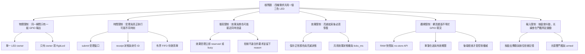

## 0.6 技術樹逐點解釋：每個元件為什麼存在

### A. 物理限制 → 單一 owner

**比喻：**三個人可以報告問題，但教室只有一支粉筆；不能讓三個人同時寫黑板。

**程式：**`LedController.run()` 是唯一 LED owner。按鈕、光感、Web、MQTT 只透過 `CommandService.submit()` 提交命令，不直接呼叫 `RgbLed.write()`。

**解決什麼：**避免不同任務各自以為自己是最後一個操作者，造成紅閃、恢復、換色互相覆蓋。

### B. 多個要求 → `submit()` 受理窗口

**比喻：**所有人先到辦公室登記，不可以自己跑進器材室開燈。

**程式：**`CommandService.submit()` 產生 request ID，交由 `LedController.submit_command()` 同步檢查命令種類、顏色範圍、模式、busy、停止狀態與佇列容量。

**解決什麼：**所有來源使用同一套規則，避免按鈕、Web、光感各自判斷出不同結果。

### C. 受理與完成不同 → receipt 與命令 ID

**比喻：**拿到號碼牌只表示櫃台收件，不表示事情已辦好。

**程式狀態：**`accepted`、`executing`、`executed`、`rejected`、`failed`、`cancelled`。

**解決什麼：**HTTP 202 或 `accepted` 不再被誤說成「LED 已經換色」。來源可用命令 ID 再查結果。

### D. 要求有先後 → 有界 FIFO queue

**比喻：**普通要求排進一條有固定長度的隊伍，隊伍滿了就明確說「現在不能再排」。

**程式：**普通命令最多保留 8 筆，依先進先出處理；結果歷史最多保存 16 筆。

**解決什麼：**不讓要求無限堆積，也不靜默遺失；系統能回覆 `queue_full`。

### E. 閃爍是特別事件 → 預約與拒絕政策

**比喻：**表演一開始，教室先停止一般活動；不能說「我剛剛排隊，所以表演中也要換燈」。

**程式：**`low_light_alert` 或 `green_flash_alert` 被 `submit()` 接受時就設定 `_reserved = True`，並清除尚未執行的普通命令。

**解決什麼：**關閉「效果已被接受但 owner 還沒排到它」的時間縫隙；紅閃與綠閃採先接受者完成、後來者以 `busy` 拒絕。

### F. 正常狀態與暫時效果分開

**比喻：**平常教室使用藍色桌牌；火警時拿出紅色警示牌。警示牌收起後，要放回原本桌牌，不是把紅色警示牌當成新桌牌。

**程式：**

- 正常狀態：`_desired_color`、`_enabled`。
- 暫時效果：`_effect`，保存顏色、亮滅階段、完成次數與原本狀態。
- 實際輸出：`RgbLed.write()` 當下寫出的紅色、綠色或全滅。

**解決什麼：**紅色 4 與綠色 2 都只是效果期間的暫時輸出，不會破壞正常狀態。

### G. 閃爍需要時間 → 狀態機與 frame

**比喻：**每 20 ms 回來看一次手錶，不代表每次看手錶就切換 LED；只有該亮 300 ms 到了，才進入下一階段。

**程式：**owner 每 20 ms 執行 `_step()`，用 `ticks_ms()`／`ticks_diff()` 判斷目前亮或滅的階段是否到期；每輪最多推進一個階段。紅閃與綠閃共用同一個狀態機，只由固定效果規格決定顏色與次數。

**解決什麼：**效果不使用長時間阻塞等待，也不因排程延遲一次跳過多個階段。300 ms 是設定值，不是實機精準保證。

### H. 網頁看到的不是控制權 → 快照、結果查詢與後端權威

**比喻：**走廊公告可能晚一點更新；真正能不能使用器材，仍由器材室管理員判斷。

**程式：**

- `/api/led/status` 讀取 owner 的 RAM snapshot。
- `/api/led/commands/<id>` 查命令結果。
- 網頁狀態通道與慢速感測資料通道分開。
- 單次請求失敗時可暫時保留未過期快照；過期後顯示未知並停用操作。
- 後端 `submit()` 的 busy 檢查永遠高於前端按鈕外觀。

**解決什麼：**避免慢感測回應、舊 HTTP 回應或網頁錯誤提示改寫真正的 LED 控制判斷。

### I. 按鈕不是一個瞬間 → 去彈跳與拒絕記憶

**比喻：**門鈴被按住，不代表每一毫秒都有人按了一次；而且效果中按下的要求不能因為後來效果結束就偷偷變成新要求。

**程式：**`Button` 先確認穩定按下；`button1_task` 與 `button3_task` 在去彈跳期間以 `CommandService.busy` 記住拒絕狀態，忙碌時不提交命令，並等待放開後才回到下一次按下。

**解決什麼：**防止按鈕抖動與「效果中按住，效果結束後自動補執行」的錯誤。

### J. 光線不是開關 → 雙門檻與 armed

**比喻：**不要在 2000 附近一下說暗、一下說亮；進入黑暗與離開黑暗使用不同門檻。

**程式：**目前模組為 ADC 越高越暗；ADC `> 2000` 才可能觸發，ADC `<= 1500` 才重新設定 `armed=true`。`busy` 和 `armed` 是兩件事。

**解決什麼：**避免光線在門檻附近晃動時連續產生紅閃要求，也避免把「LED 現在可操作」誤當成「光感已允許再次觸發」。

## 0.7 目前證據能說什麼，不能說什麼

目前可以說：

- 使用者回報目前實機操作狀況良好。
- 桌面 fake hardware 測試涵蓋 owner、佇列、警示競爭、恢復、按鈕、Web 結果、PIR 與 RFID 等部分情境。
- 目前機制的每個主要結果，都能用「受理順序、owner 執行順序、狀態與拒絕原因」解釋。

目前不能說：

- 所有 ESP32 板型與 GPIO 接線都適用。
- 所有 WiFi、MQTT、瀏覽器、多頁面與長時間壓力情境都通過。
- 實機每次都在 200 ms 內更新。
- 這就是唯一或最好的仲裁機制。
- 桌面測試通過等於完整實機驗收。

所以本階段的目標是**先把問題和目前解法講懂、講一致**。是否存在更簡單、更可靠或更適合未來需求的機制，應在這個共同理解上再比較。

## 0.8 已實作需求：實體與網頁按鈕 3 綠閃三次

本節原為架構延伸提案；先完成實體按鈕，現在網頁儀表板也提供相同的按鈕 3：

> **實體或網頁按鈕 3 被按下時，LED 綠色閃爍 3 次，完成後恢復原本狀態。**

目前 RGB 色碼中，綠色是 2、紅色是 4。因此兩種效果可以寫成：

| 效果 | 觸發來源 | 顏色 | 次數 |
|---|---|---:|---:|
| `low_light_alert` | 光照感測器 | 紅色 4 | 5 次 |
| `green_flash_alert` | 實體／網頁按鈕 3 | 綠色 2 | 3 次 |

這不是新增第二個 LED 控制者，而是新增一個要求來源與一個固定效果規格：

```text
按鈕 1 ─────┐
網頁按鈕 1 ─┤
光感 ───────┼→ 同一個 LedController → 同一個 RGB LED
按鈕 3 ─────┤
網頁按鈕 3 ─┘
```

### 0.8.1 先決定兩種效果同時發生時的規則

建議所有閃爍效果都屬於同一個「效果／警示」類別：

- 正常狀態可以接受紅閃或綠閃。
- 紅閃中按下按鈕 3：拒絕綠閃，原因為 `busy`。
- 綠閃中光線變暗：拒絕紅閃，原因為 `busy`。
- 不插入第二個效果。
- 不排隊等待第二個效果。
- 不打斷目前的效果。
- 不建立巢狀恢復狀態。

採用「先接受的效果先完成，後來的效果拒絕」比建立紅閃／綠閃優先權更簡單。若讓綠閃打斷紅閃，就必須再記住紅閃目前第幾次、被打斷後是否繼續，以及綠閃完成後要恢復哪一層狀態；目前需求沒有必要增加這些狀態。

### 0.8.2 正常狀態按下按鈕 3

假設 LED 原本是藍色 1：

```text
LED 正常顯示藍色 1
  → 按鈕 3 穩定按下
  → button3_task 提交 green_flash_alert
  → LedController 立即設定 reserved=true
  → 保存藍色 1 與原本亮滅狀態
  → owner 執行綠色／全滅三次
  → 恢復藍色 1
  → busy=false
```

| 階段 | 正常狀態 | 實際 LED 輸出 | busy |
|---|---|---|---|
| 按下前 | 藍色 1 | 藍色 1 | false |
| 已受理 | 藍色 1 | 仍可能是藍色 1 | true |
| 綠閃進行中 | 藍色 1 | 綠色 2／全滅 0 | true |
| 完成後 | 藍色 1 | 恢復藍色 1 | false |

綠色 2 是暫時輸出，不會把正常顏色改成綠色。

### 0.8.3 綠閃中按下按鈕 3

按鈕 3 應沿用按鈕 1 的輸入生命週期：

1. `wait_press()` 進行去彈跳。
2. 以 `reject_if=lambda: controller.busy` 檢查效果是否進行中。
3. 若已 busy，設定 `press_rejected=true`。
4. 不提交新的綠閃命令。
5. 等待按鈕放開。
6. 必須重新按下，才有下一次機會。

因此按住按鈕到綠閃結束，也不會在綠閃結束後偷偷補做一次。

### 0.8.4 程式整合點

| 檔案 | 已實作內容 | 沒有新增的東西 |
|---|---|---|
| `config.example.py` | 新增 `BUTTON3_PIN = 16` | 不新增 LED GPIO |
| `main.py` | 建立 `Button(config.BUTTON3_PIN)`，把它傳給新任務 | 不建立第二個 `LedController` |
| `tasks.py` | 新增 `button3_task`，只負責去彈跳、忙碌按壓消耗與提交 `green_flash_alert` | 不直接呼叫 `RgbLed.write()` |
| `services/command_service.py` | 提供唯讀 `busy`，讓按鈕在去彈跳期間記住效果已占用 | 不複製仲裁規則 |
| `services/led_controller.py` | 增加固定效果規格並讓紅閃／綠閃共用效果狀態機 | 不新增第二個 owner 或事件迴圈 |
| `hardware/led.py` | 不需要修改 RGB 位元輸出 | 不增加第二組硬體控制流程 |
| `index.html` | 新增網頁按鈕3，向既有`POST /api/led/commands`提交`green_flash_alert`，並依`active_effect`區分紅閃／綠閃提示 | 不直接操作GPIO或在瀏覽器自行計時完成效果 |
| `web_server.py` | 沿用既有通用命令與結果查詢端點，不需新增路由 | 不把前端停用當控制權 |
| `tests/test_led_owner.py`、`tests/test_socket_web_server.py`、`tests/test_led_polling.cjs` | 驗證效果快照、Web命令內容、按鈕停用、結果查詢與完成恢復 | 不以實機操作取代桌面回歸測試 |

效果規格集中在固定表，而不是建立任意優先權框架；tuple 依序是顏色、次數、亮毫秒、滅毫秒、是否記入低光警示歷史：

```python
_EFFECTS = {
    'low_light_alert': (
        4,
        getattr(config, 'LIGHT_ALERT_BLINK_COUNT', 5),
        getattr(config, 'LIGHT_ALERT_ON_MS', 300),
        getattr(config, 'LIGHT_ALERT_OFF_MS', 300),
        True,
    ),
    'green_flash_alert': (2, 3, 300, 300, False),
}
```

外部來源只能提交已知的效果名稱，不能任意傳入顏色、次數或時間。綠閃不增加網頁既有的低光紅閃事件計數。

### 0.8.5 測試契約

新增效果的桌面測試保持以下契約：

1. 正常狀態按按鈕 3，綠閃三次後恢復原色。
2. 原本是紅色、綠色或熄燈時，效果都恢復正確的原狀態。
3. 綠閃期間按按鈕 1，換色被拒絕。
4. 綠閃期間再次按按鈕 3，第二次綠閃被拒絕。
5. 紅閃期間按按鈕 3，綠閃被拒絕。
6. 綠閃期間光線變暗，紅閃被拒絕。
7. 效果尚未開始但已被接受時，新的普通換色也不能插入。
8. 綠閃中按住按鈕，效果結束後不自動補做。
9. 連續快速按按鈕 3，不建立效果佇列。
10. GPIO 寫入失敗時，owner 正確標記錯誤並執行安全清理。
11. 網頁按鈕3只提交固定效果名稱，受理後查詢receipt；紅閃、綠閃或連線狀態未知時，按鈕1與按鈕3都停用。

### 0.8.6 這個實作證明了什麼

加入按鈕 3 實際只需要：

```text
新增按鈕
→ 使用既有 Button 抽象
→ 提交新的效果命令
→ 交給同一個 LedController
→ 使用同一個 busy／reserved 政策
→ 使用同一個狀態機完成與恢復
```

因此目前架構的擴充點是清楚的。新增需求沒有重新設計 LED 控制系統，也沒有回到多個任務直接搶同一個 GPIO 的舊問題。

這個例子仍然沒有證明架構是唯一或最佳方案；它只證明在「另一個固定的 LED 效果」加入時，目前責任分界可以被重用。

## 1. 先認識五個角色

把這個系統想成「多人提出要求，由一個工作者操作燈」，不是「每个人都拿一支GPIO開關」。

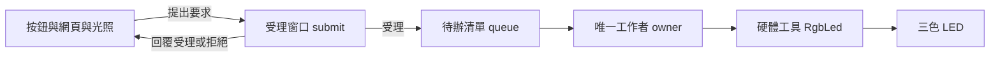

| 生活角色 | 程式對應 | 負責 | 不負責 |
|---|---|---|---|
| 提出要求的人 | button1_task、Web handler、light_sensor_task | 偵測輸入、提交命令 | 推進色碼或寫GPIO |
| 受理窗口 | CommandService.submit → LedController.submit_command | 判斷是否接單、給ID、預約警示 | 執行閃燈 |
| 待辦清單 | LedController._queue | 保留待執行命令 | 自己執行或決定政策 |
| 唯一工作者 | LedController.run→_step→_apply | 改正常狀態、推進警示、渲染 | 讀實體按鈕或ADC |
| 操作工具 | RgbLed.write | 色碼轉為三個Pin.value | 仲裁、排隊或保存警示 |

**submit和owner不是兩個LedController物件。** `main()`只建立一個`LedController`與一個`CommandService`；所有來源共用CommandService，owner task執行LedController.run。submit是同步方法，在哪個來源task呼叫，就在該來源task的執行脈絡完成；run是獨立owner task。圖把「受理」與「執行」畫成不同角色，是為了分清工作，不代表兩個服務或額外task。

受理方法可以更新佇列、收據與預約旗標；「只有owner改狀態」特指LED正常色碼、效果執行與GPIO，不是禁止受理窗口管理它自己的資料。

**先確認：按鈕提出cycle時，LED是否已經換色？答案：還沒有。**

## 2. 分清楚命令、狀態、收據

| 資料 | 回答什麼問題？ | 範例 | 存在哪裡？ |
|---|---|---|---|
| 命令 | 想做什麼？ | cycle：前進一色 | _queue裡的tuple |
| 正常狀態 | 平常應顯示什麼？ | 色碼1、亮燈 | `_desired_color`、`_enabled` |
| 警示狀態 | 現在暫時做什麼？ | 第2次紅亮 | _effect字典 |
| 收據receipt | 這筆要求處理到哪裡？ | ID10、accepted | _results，執行時也由queue/effect引用 |
| 實際輸出 | 此刻GPIO顯示什麼？ | 紅色4或全滅0 | RgbLed與GPIO |

警示中可能同時存在「正常色碼=藍1」和「實際輸出=紅4」；不矛盾，前者是完成後要回到的狀態。若把紅閃寫回正常色碼，按鈕循環與恢復就會混淆。

```python
# 提出要求，還不執行GPIO
reply = command_service.submit('cycle', 'button1')
# reply示例：{'id': 10, 'kind': 'cycle', 'source': 'button1',
#             'status': 'accepted', 'reason': None}
```

submit在內部建立receipt，把`('cycle', None, receipt)`放進_queue，也把**同一個receipt字典**放進_results。owner更新這個字典時，結果紀錄也隨之更新；來源得到的reply則是`dict(receipt)`副本，不會自動變更。要取得新結果，呼叫`result(10)`或結果API。

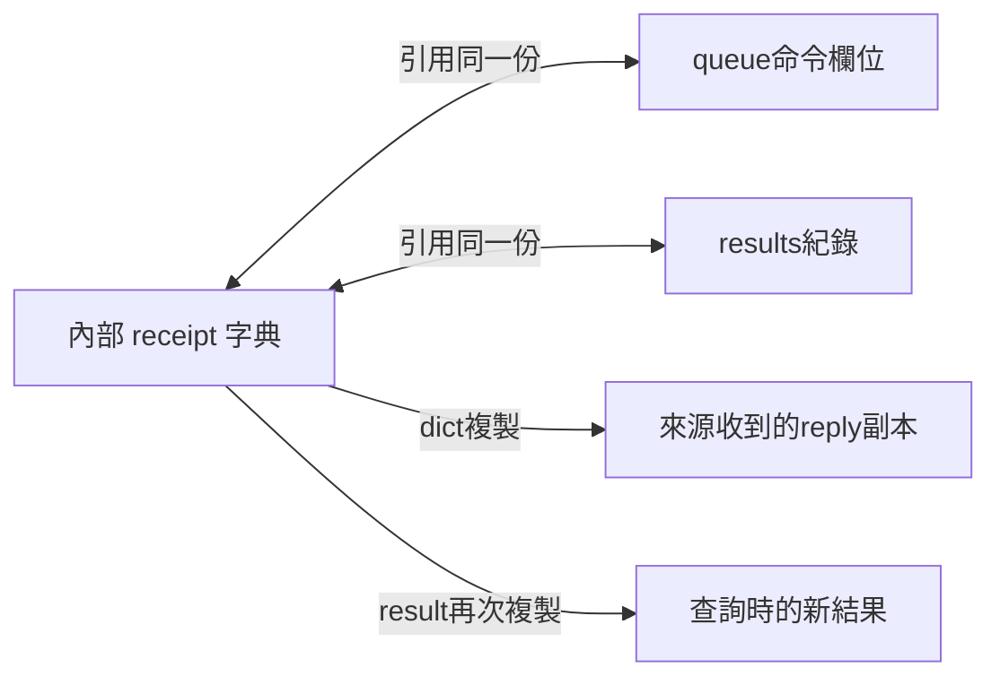

**accepted表示接單，不是已執行。** 警示可能在owner执行前到达，讓已接單的普通命令變成rejected。後面的案例會實際走過這件事。

取出命令時，queue中的tuple消失，但receipt仍由results引用，所以結果沒有一起消失。警示則暫時還由effect引用。results只保留最近16筆，舊紀錄被移除後，若其他地方也沒有引用，才可被回收；沒有把這些資料存入Flash。一般cycle的executing→executed之間没有await，查詢通常看不到那個短暫中間狀態；警示的executing則持續約3秒。

## 3. 開始前，main如何把角色接起來？

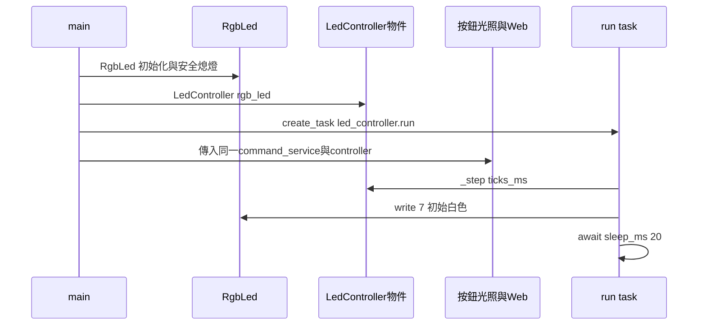

`main()`先await initialize_system取得硬體，再建立`LedController`與`CommandService`並安排owner task；物件裡有空_queue、空_results、reserved=false、desired_color=7、enabled=true、effect=None。Web透過`web_server.command_service = command_service`取得同一個命令入口；按鈕、光照與MQTT透過任務參數取得。

create_task是安排owner執行，不代表當行指令立即寫GPIO。owner取得排程後才首次渲染白色；初始化期間的熄燈由硬體建構函式保障。從此各來源不再直接write。

## 4. 案例一：正常時按下實體按鈕1

**初始條件：**LED藍1、busy=false、queue空。目標是按一次變成綠2。

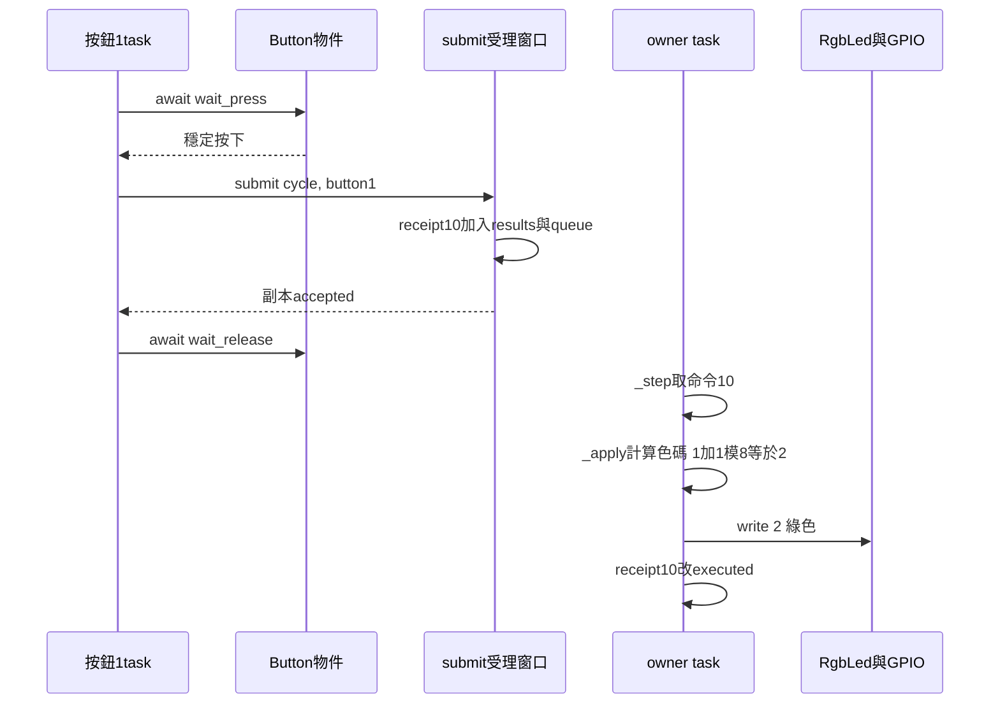

| 步驟 | 哪個程式在執行？ | 呼叫／資料變化 | 是否碰GPIO？ |
|---|---|---|---|
| 1 | tasks.button1_task | await button1.wait_press；按下後提交 `CommandService.submit('cycle', 'button1')` | 只讀按鈕GPIO |
| 2 | hardware.button | 依 `BUTTON_DEBOUNCE_MS` 穩定判定按下／釋放；不預先取得LED控制權 | 只讀按鈕GPIO |
| 3 | button1_task→submit | kind='cycle'、source='button1'、value預設None | 不碰LED |
| 4 | submit | 建receipt10，queue=[cycle10]，回accepted副本 | 不碰LED |
| 5 | owner.run→_step | pop最早命令，_apply推進1→2，enabled=true | 尚未 |
| 6 | owner→RgbLed.write(2) | 2的三個位元為010，寫R=0、G=1、B=0 | 是，唯一owner |
| 7 | owner | receipt10.status='executed'，queue空 | 無新寫入 |

按鈕task等待放開，不是在等LED命令完成。owner与按鈕task都在各自await處讓出排程。图中的wait_release開始後owner執行是一種可能順序；按鈕也可能更早放開，不影響命令已經受理。

| 時點 | queue | 正常色碼 | LED輸出 | receipt10 |
|---|---|---|---|---|
| 按下前 | 空 | 1 | 藍1 | 尚未產生 |
| submit完成 | cycle10 | 1 | 藍1 | accepted |
| owner完成 | 空 | 2 | 綠2 | executed |

**關鍵問題：為何按鈕不自己算下一色？** 因為按鈕與Web若各讀改寫會把狀態責任分散。兩者都只提交cycle，owner便能依序推進兩次；即使同一輪處理，也不合併相對變更。

## 5. 案例二：光照高於低光觸發閾值

**初始條件：**LED藍1、armed=true、busy=false、queue空；本次read取得ADC=2300。

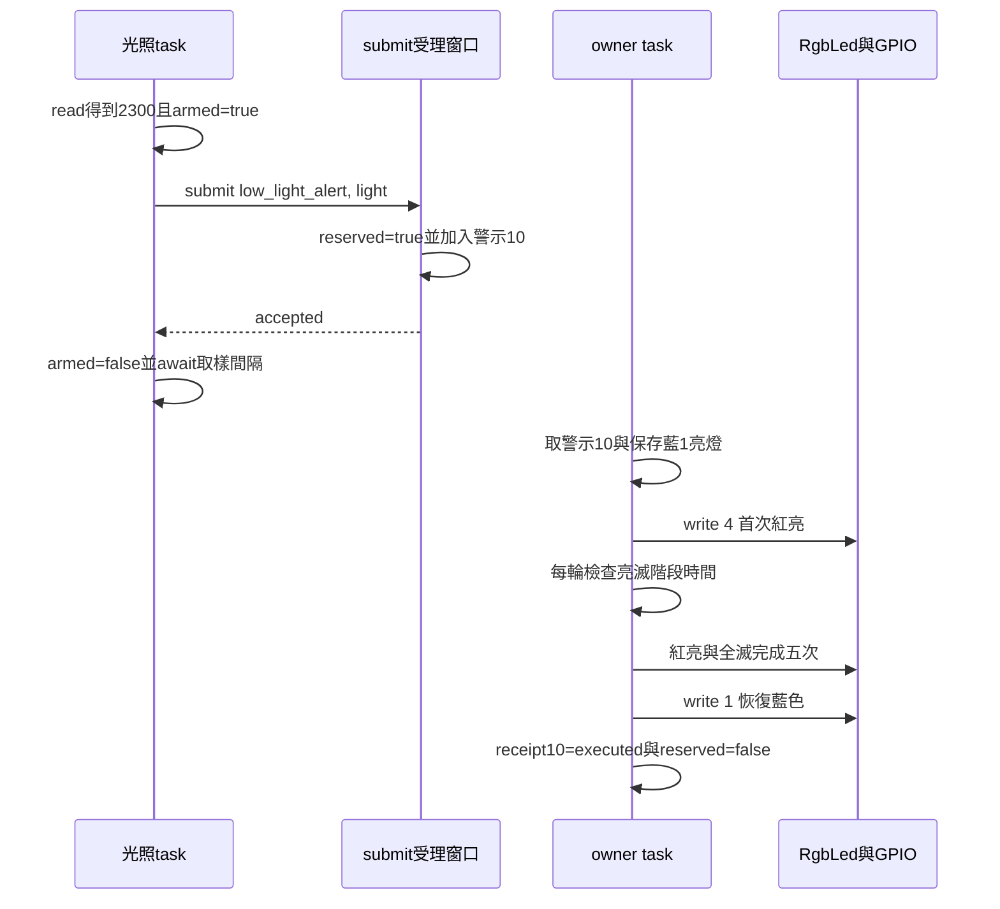

1. `tasks.light_sensor_task`拿到brightness=2300；啟用警示、非busy，且2300>2000、armed=true，才提交`submit('low_light_alert', 'light')`。
2. submit先把_reserved設true，再放警示命令，回accepted。這時還沒開始閃，但新改色已被禁止。
3. 光照task看到受理成功才armed=false。這個變數留在該task的迴圈中，並不由owner管理。
4. owner的_apply在取警示時建立_effect，saved=(1,true)，phase_on=true、completed=0、started=本輪ticks_ms；300ms與五次來自config。
5. _step決定實際輸出紅4。正常色碼始終是1，所以警示亮滅不影響色碼循環。
6. 第五次熄滅階段也結束後，owner恢復saved，清除effect，write(1)成功，再標executed與reserved=false。

| 時點 | armed | busy | 正常色碼 | effect | 實際輸出 |
|---|---|---|---|---|---|
| 偵測前 | true | false | 1 | None | 藍1 |
| 警示已受理、尚未執行 | false | true | 1 | None | 藍1 |
| 第一次紅亮 | false | true | 1 | phase_on=true | 紅4 |
| 第一次熄滅 | false | true | 1 | phase_on=false | 全滅0 |
| 第五次熄滅結束並恢復 | false | false | 1 | None | 藍1 |

busy與effect不是同一個判斷：**busy涵蓋預約到恢復的整段時間；effect只在owner已開始警示後存在。** 這是避免受理後、執行前的空隙被改色插入的關鍵。

### 為何每20ms執行一次，卻是每300ms亮滅？

每20ms只是「回來檢查一次」，不是每輪切換。_step用ticks_diff(now, started)比較本階段時間，未滿300ms就保持輸出；滿了才切階段。硬體write也會忽略相同輸出，避免每轮重寫相同GPIO。

| 理想相對時間 | phase／completed | 輸出 |
|---|---|---|
| 0ms | 亮／0 | 第1次紅亮 |
| 300ms | 滅／0 | 全滅 |
| 600ms | 亮／1 | 第2次紅亮 |
| 2400ms | 亮／4 | 第5次紅亮 |
| 2700ms | 滅／4 | 全滅 |
| 3000ms | 第5輪完成，effect=None | 恢復藍色 |

這是理想推演；實際排程延遲會延長階段，每輪不補跳多個階段，避免肉眼少看到閃爍。

## 6. 案例三：按鈕與低光照「同時」發生

**先不要問誰贏，先問：警示受理當下，按鈕命令已执行，還是仍在queue？** 單一事件迴圈仍依序執行同步片段；人感覺同時按下、遮光，不代表兩段程式同一時刻寫GPIO。

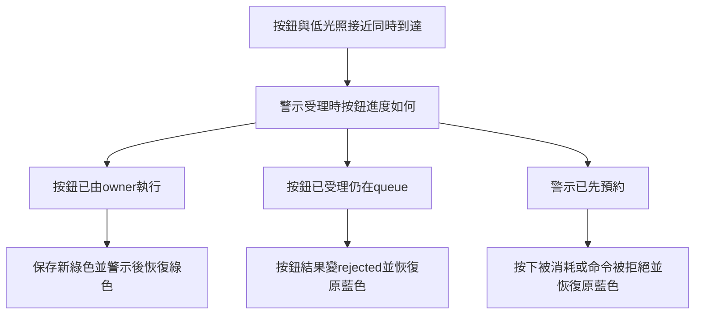

### 6A. 按鈕先完成，才受理警示

初始藍1。按鈕命令10已完成，因此警示11保存的是綠2；不能撤銷已執行的操作。

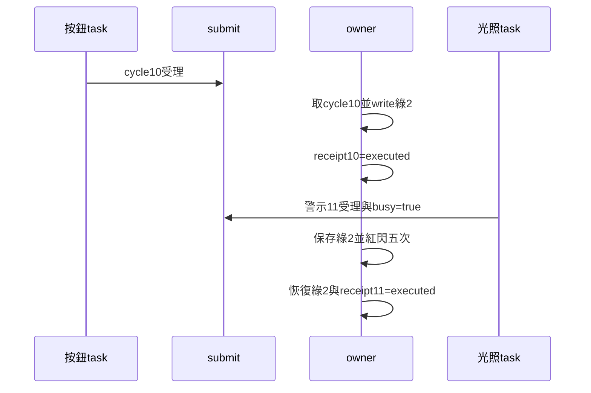

| 最終正常色碼／輸出 | 命令10 | 警示11 |
|---|---|---|
| 綠2 | executed | executed |

### 6B. 按鈕先受理，但owner尚未執行

這是最容易誤解的情況：**accepted之後仍可能rejected。** 此時正常色碼仍是藍1，並未變綠。

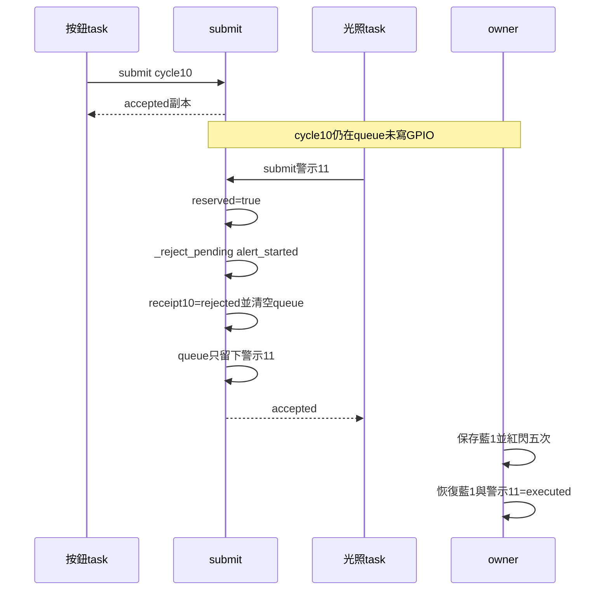

| 時點 | queue | 正常色碼 | 命令10的內部收據 |
|---|---|---|---|
| 按鈕受理後 | cycle10 | 1 | accepted |
| 警示受理後 | alert11 | 1 | rejected，reason=alert_started |
| 警示完成 | 空 | 1 | 保留拒絕結果，不补執行 |

按鈕先前拿到的reply副本仍寫accepted，不會自动變rejected；結果需用result(10)確認。若來源是Web，前端的命令結果輪詢就會顯示未完成與alert_started，而不誤稱已切色。

### 6C. 警示先受理，按鈕後來

submit受理警示時就busy=true。按鈕即使先於首次紅亮按下，也應拒絕。

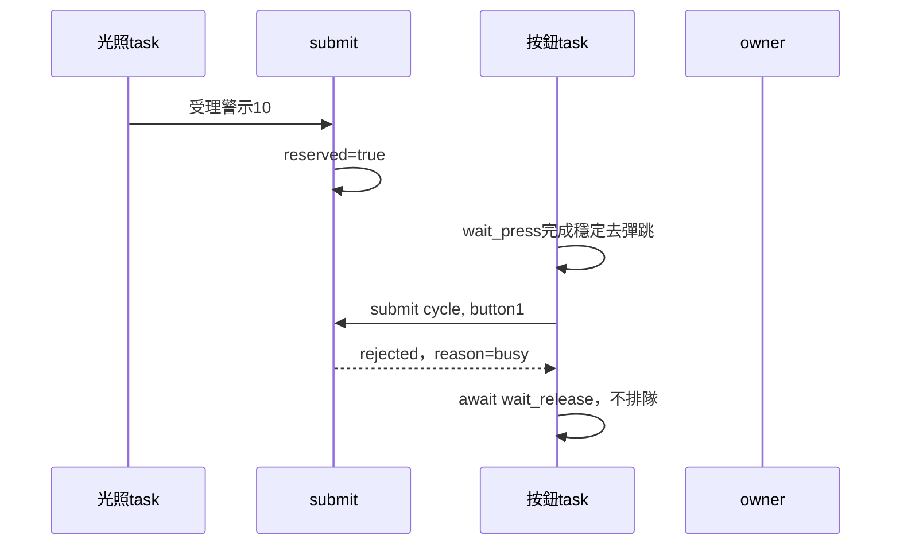

這條路徑會產生一筆被拒絕的按鈕 receipt，因為來源在按下後仍會提交 cycle，而共同命令入口的 busy 檢查是最後權威。如果來源先提交、警示才開始，警示也會把尚未執行的普通 receipt 改為 `rejected / alert_started`。兩條拒絕路徑都不寫 GPIO，也不排隊。

**課堂總結：同時到達不一定結果相同，但每個結果都可由受理與執行的先後順序解釋。**

## 7. 案例四：紅閃第三次時按下實體按鈕

**初始條件：**警示執行中、busy=true、正常狀態仍藍1，當下輸出可能紅4或全滅0。此案例目標是證明「不会插入綠色，也不延後補執行」。

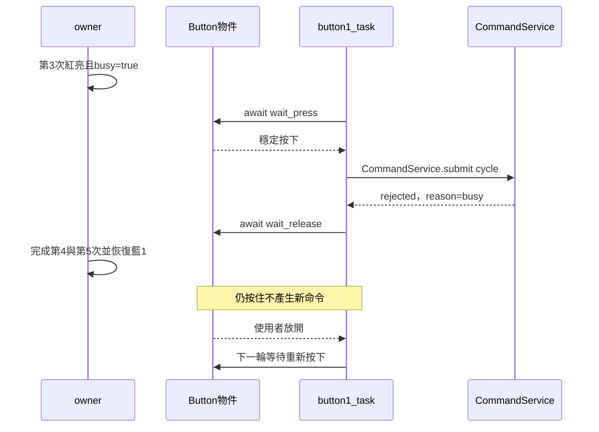

1. `button1_task`等待穩定按下後呼叫`CommandService.submit('cycle', 'button1')`；`LedController`在警示預約或執行中會回覆`rejected / busy`。
2. `button1_task`記錄受理結果並等待放開；被拒絕的按下不建立延後命令，queue不新增資料，正常色碼不變。
3. 即使按住到警示結束，也不因busy解除而補提交；必須放開後重新按下。
4. 非忙碌時重新按下，命令才會被CommandService接受，owner之後把藍1變綠2。

| 階段 | 按鈕 | busy | 是否有新cycle | LED |
|---|---|---|---|---|
| 第3次紅閃 | 按下 | true | 沒有 | 繼續紅／滅 |
| 警示恢復 | 仍按住 | false | 沒有 | 藍1 |
| 放開 | 釋放 | false | 沒有 | 藍1 |
| 重新按下 | 新按下 | false | accepted，等待owner | 隨後綠2 |

去彈跳接近結束時警示剛好完成，這次按下仍依 submit 當下的 busy 結果處理，不會因稍後 busy=false 而補提交；放開後必須重新按下。這是輸入生命週期政策，不是單靠 owner 佇列就能自動完成。

## 8. 把同樣規則套到網頁按鈕

網頁按鈕停用是使用者提示，不是資源控制的保障。LED 狀態現採獨立快速輪詢，仍可能受網路或排程延遲影響；舊頁面或其他HTTP客戶端仍可能送出POST，後端submit的busy檢查才是權威。

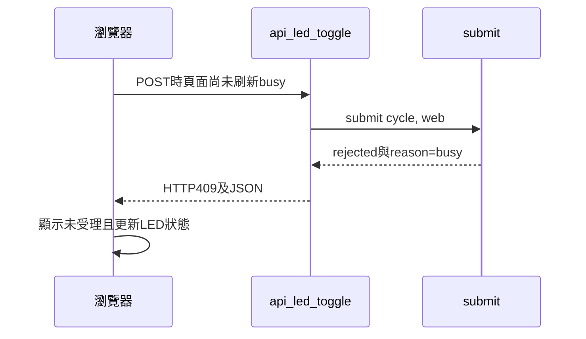

正常時POST回202與ID，不等待owner完成。`index.html`的按鈕1呼叫`/api/led/toggle`提交`cycle`；網頁按鈕3呼叫既有`/api/led/commands`提交固定`green_flash_alert`。共用流程查`GET /api/led/commands/ID`，區分executed、rejected、failed、cancelled；綠閃使用200 ms間隔、最多12次查詢，避免用50 ms頻率持續查詢約1.8秒的效果。

實體按鈕需要消耗按下／放開生命週期；Web按鈕則需要HTTP受理狀態與結果查詢。兩者都只能提交命令，不能以任何前端停用機制取代owner的busy仲裁。

> 閱讀版本提示：8A、8B說明快速通道的第一版；其中「單次查詢失敗立即停用」已由8C的有效期限判斷取代。分流與後端仲裁仍保留。

### 8A. 提示需要自己的快速資料通道

2026-10-07 使用者回報，實機紅閃開始約2秒後網頁才顯示警示、停用按鈕，隨即因警示已完成又顯示可操作。這表示畫面不是同步的控制狀態，不能因此推論後端允许插入改色。原網頁將LED顯示綁在每秒/api/data，且setInterval可能產生重疊請求；舊回應可能較晚抵達。這是已確認的程式風險，尚未量測本次2秒延遲各部分的比例。

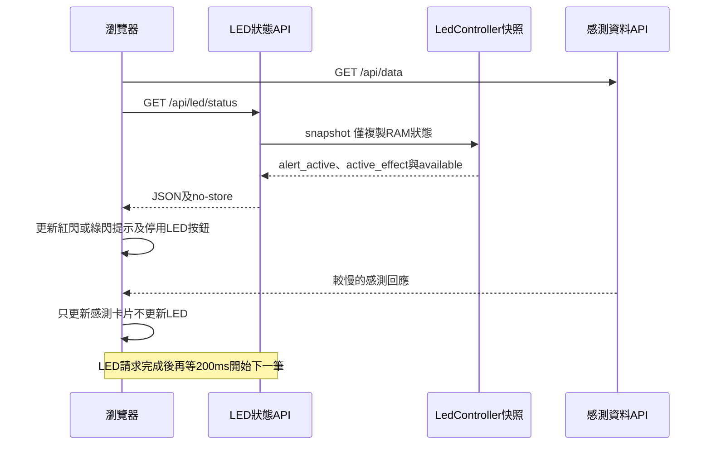

- **快速端點：**`web_server.api_led_status`只呼叫`command_service.snapshot()`，不讀ADC、DHT、RFID或GPIO；回`Cache-Control: no-store`。`/api/data`仍含LED副本供相容，但新前端不使用它更新LED。
- **前端分流：**pollLedStatus→updateLedStatus取得快速快照，完成後等200ms再取；pollSensorData→updateData完成後等1000ms再取，兩個通道分開運作。200ms不是保證反應上限，仍加上HTTP與排程時間。
- **不重疊：**LED一次只保有一個ledStatusRequest，多個呼叫共用該Promise；感測也有pending檢查。不用setInterval持續新增未完成請求，避免舊感測回應把新的LED提示覆蓋。
- **逾時：**LED狀態請求1秒未完成就Abort，顯示狀態未知並停用按鈕；Promise.race讓已逾時請求的晚到回應不再渲染。下一筆成功才恢復。沒有把未知當成可操作。
- **拒絕仍有效：**POST回409時立即顯示警示；命令提交與busy政策未改。切色結果查詢後改刷新快速LED通道，不等待整份感測資料。

這是較快的輪詢，並非server push，也不會提前預知尚未取得的狀態。若ESP32有同步耗時操作阻塞事件迴圈、WiFi延遲或瀏覽器背景節流，快速端點也會延遲；需另行量測，不宣稱本次已確認或修正所有根因。快照是取樣當下的資訊，畫面仍是最終一致而非與GPIO零延遲同步。

桌面測試以延遲的fetch驗證慢感測不擋LED、舊感測不重新啟用按鈕、單筆在途、逾時Abort、晚到回應忽略與恢复；實際Microdot路由測試確認狀態端點不調用ADC並回no-store。部署本次修正只需更新web_server.py與index.html，重啟ESP32重新載入HTML，再在瀏覽器強制重新整理。

### 8B. 為何這次改善有效：把控制提示與感測展示分開

2026-10-07 使用者重新部署後回報「現在的即時反應效果蠻好的」。這是實機使用感受的確認，沒有提供毫秒量測或多瀏覽器壓力測試；不要將它解讀為所有情況皆在200ms內完成。

**先從需求出發：**溫溼度卡片稍晚更新，通常不影響下一步操作；「現在能不能按LED按鈕」卻直接影響使用者的判斷。兩者需要的資料新鮮度不同，因此不應只能等待同一份回應。LED owner已經把busy狀態保存在RAM，畫面只需要查這份控制狀態，不需要為了知道busy而重新讀取感測器。

#### 前後架構比較

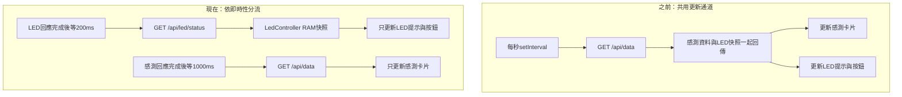

| 比較項目 | 之前 | 現在 | 改良原因 |
|---|---|---|---|
| 更新頻率 | LED與感測一起每秒發起 | LED完成後200ms，感測完成後1000ms | 按鈕是否可操作需要更快提示 |
| LED資料來源 | 整份/api/data中的led副本 | /api/led/status的owner快照 | 控制提示不必等整份感測回應 |
| 發起下一筆的方式 | setInterval不等前一筆完成 | await完成後用setTimeout安排下一筆 | 避免慢回應時累積重疊請求 |
| LED畫面的寫入者 | 每筆感測回應都能更新 | 只有LED狀態通道更新，409亦可立即提示busy | 避免舊感測副本改寫新的控制提示 |
| 狀態取得失敗 | 感測失敗也影響LED提示 | LED自己逾時或失敗才將操作暫停 | 分開兩個通道的失敗影響 |
| 執行權限 | owner的submit檢查busy | 同樣由owner檢查busy | 快速提示改善操作感受，控制政策仍在後端 |

#### 之前為何容易顯示得太晚？

第一個等待是**輪詢的取樣間隔**。假設剛查完時還沒紅閃，隨後警示開始，頁面須等下一次查詢才可能得知。第二個等待是HTTP傳輸與伺服器處理；整份/api/data還包含其他資料處理，LED提示隨著整份回應抵達。這兩種等待相加，就可能看見警示時已接近結束。不能只因每秒發一次就認為每秒一定收到新畫面。

另一個風險是**回應順序與狀態新鮮度**。setInterval只負責定時發起，不保證前一筆已完成。例如先前查到「可操作」的回應延後抵達，就可能覆蓋稍後取得的「紅閃中」。這是舊設計允許發生的風險，並非已量測證實本次實機一定發生。即使沒有亂序，共用慢通道仍會拖延提示。

原先共用端點的優點是程式較短、請求較少，適合所有欄位更新需求接近、資料取得很快的簡單展示頁。當控制提示對時效更敏感時，這種耦合就成為缺點。

#### 用一次紅閃走過新流程

1. 光照task提交`low_light_alert`，`CommandService.submit()`把警示預約旗標交由`LedController`保存；從這一刻起busy成立，新的改色要求會被拒絕。owner之後按狀態機輸出紅閃。
2. 瀏覽器pollLedStatus呼叫updateLedStatus。若已有ledStatusRequest，直接共用它，不另開第二筆；否則fetch GET /api/led/status。
3. `web_server.api_led_status`呼叫`command_service.snapshot()`，產生包含`alert_active`、`available`等欄位的新字典。JSON是取樣時的副本，沒有轉移GPIO控制權，也沒有改動owner。
4. updateLedStatus取得JSON，showLedStatus以alert_active顯示紅閃提示，並以ledRequestPending、available、alert_active決定disabled。這裡停用的是網頁LED控制按鈕；實體按鈕的拒絕仍由原有後端機制處理。
5. 同時，較慢的/api/data即使帶著舊led欄位抵達，updateData也只更新感測卡片，因此不能把LED提示改回可操作。
6. 紅閃結束、原色恢復後，下一份LED快照的alert_active變成false；若沒有在途改色命令且服務可用，畫面恢復可操作。不是由前端自行倒數推測紅閃結束。

**資料怎麼產生與消失？**owner的控制狀態長期存在RAM並隨執行改變；每次snapshot產生獨立副本，再序列化成HTTP JSON。瀏覽器解析成當次物件並把值寫入DOM，不保存快照歷史；物件無引用後可由垃圾回收釋放。在途Promise完成後清除引用與逾時計時器，再安排下一輪。若1秒未完成，AbortController要求中止請求，Promise.race結束本輪並停用按鈕；該輪晚到的資料不再進入showLedStatus。中止瀏覽器等待不等於取消ESP32上的LED命令。

#### 背後的觀念與以後的使用原則

這個設計運用**分離關注點、依時效分流、單筆在途與取樣快照**。畫面呈現的是最近一次成功取得的狀態，屬於最終一致；後端仍是權威，因此再快的查詢也不能取代submit檢查。畫面延遲包含「等待下一輪＋傳輸＋伺服器排程與處理＋瀏覽器渲染」，200ms只設定完成後的等待時間。

往後本專案優先採用這個方式呈現會影響操作的狀態：由掌管資源的服務提供輕量RAM快照，與一般感測展示分開輪詢；各通道一次只保有一筆請求，完成後排下一筆，使用no-store、逾時處理並明確顯示未知。一般卡片不回寫控制提示，操作結果另用命令ID查詢，控制許可仍由後端判定。

使用前提是後端已有可快速讀取的可信狀態、事件迴圈可正常讓出，且輪詢流量可接受。單頁LED約最多5次查詢每秒，多頁會相加；增加通道前應評估ESP32負載。若需捕捉非常短的事件，快照可能在兩次取樣間漏掉，應另外保存事件序號／紀錄；若需大量連線或更低延遲，再評估SSE／WebSocket。這些是替代方案的使用時機，本次沒有實作。同步阻塞或WiFi延遲仍可能拖慢所有通道，分流不會自動消除它們。

### 8C. 不把一次查詢失敗當成連線失效：狀態有效期限

使用者在重新整理瀏覽器後確認：不再頻繁出現連線失敗訊息並讓按鈕1瞬間失能。這是本次實機操作結果的回報；測試精確時間、持續時間與HTTP延遲數據未提供。已確認的是新版介面的改善，尚未證實偶發HTTP失敗的根因已消除。

#### 先區分三個問題

1. **值有沒有改變？**LED連續回報「可操作」，或者光照連續回報相同數字，都是合理情況。
2. **最近是否成功確認？**收到新的成功回應，即使值相同，也有新的確認時間。画面留著上一筆數字並不代表取得新資料。
3. **這次確認的是哪一種資料？**感測API成功證明近期仍能通訊，但不能保證LED目前不是紅閃；只有LED狀態回應才能更新LED的有效期限。

| 機制 | 快速通道第一版 | 目前版本 |
|---|---|---|
| LED單次查詢失敗 | 立即停用並顯示錯誤 | 保留未過期的最近LED快照 |
| 下一筆成功 | 立即清除錯誤，容易短暫閃動 | 更新確認時間並依快照呈現 |
| 光照API成功 | 不參與LED連線判斷 | 更新連線健康時間，不更新LED時間 |
| 何時因未知停用 | 每次失敗就停用 | LED超過有效期限仍未確認 |
| LED明確紅閃／不可用 | 立即停用 | 同樣立即停用 |

#### 組成與程式位置

這一層在index.html，並不增加另一個GPIO控制者。updateLedStatus取得LED快照，updateData取得感測資料；兩者成功時都呼叫connectionSucceeded，而只有showLedStatus保存LED快照及其確認時間。

| 名稱 | 是什麼／怎麼產生 | 使用目的與消失方式 |
|---|---|---|
| lastLedSnapshot | showLedStatus複製成功的LED資料 | renderLedStatus判斷available與alert_active；下一筆覆蓋，頁面重載清除 |
| lastLedSuccessAt | 成功確認LED時的performance.now() | 計算LED資料年齡，值相同仍更新；重載回到null |
| lastConnectionSuccessAt | 兩種資料API成功時的performance.now() | 區分LED通道異常與連線無法確認；不延長LED期限 |
| STATUS_VALID_MS | 目前5000ms | 容忍短暫失敗的有效期限，須依需求與實測調整 |
| monitorLedFreshness | 每200ms呼叫renderLedStatus | 即使HTTP卡住也能檢查過期；不是另一條HTTP輪詢 |
| ledFailureCount／lastLedFailure | 失敗時加計數並保存最新原因與時間 | 成功歸零連續失敗數，保留最後錯誤；只保留一筆不累積歷史 |

performance.now是瀏覽器單調時間，用於經過時間，不是ESP32偵測日期，也不需要兩端時鐘同步。這裡量的是「距離最近收到成功回應多久」，不是保證後端快照的絕對產生時間；HTTP仍可能延遲。有效條件為年齡小於5000ms，達到5000ms便過期，監視器在下一次排程時呈現。

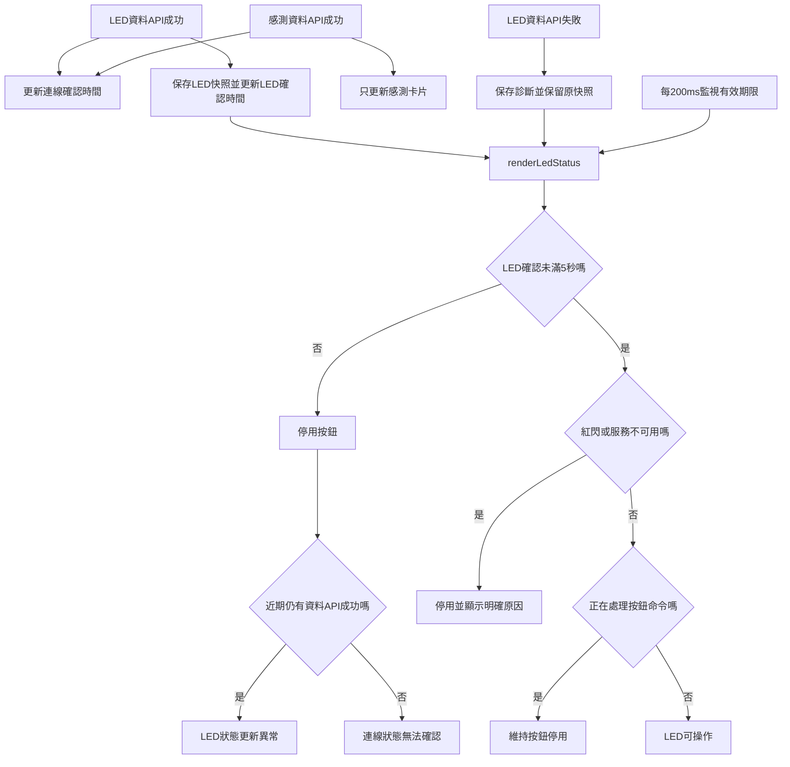

#### 案例：光照正常，但LED查詢偶爾逾時

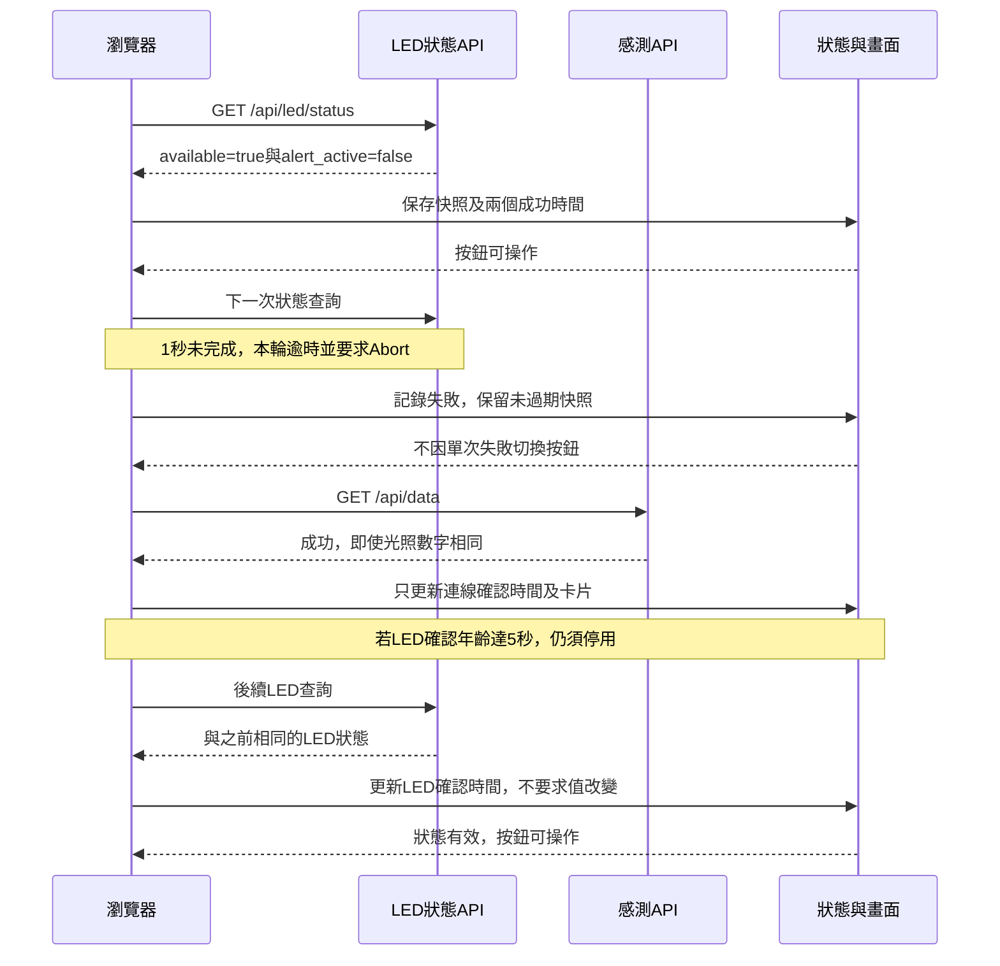

用假設時間走一次：t=0收到可操作快照，t=1.2秒某次查詢逾時，LED年齡還不到5秒，畫面不跳動。t=3秒光照成功，連線確認時間更新，但LED確認仍是t=0。若一直沒有LED成功，t=5秒起監視器停用並顯示「LED狀態更新異常」；若後來兩條通道都超過5秒未成功，則顯示「連線狀態無法確認」。收到相同的可操作LED快照就重新確認有效並恢復，完全不需要顏色或光照值改變。這是示例時間，不是實機量測。

#### 安全性、限制與診斷

保留5秒內快照可能暫時顯示過去的可操作狀態；若紅閃剛開始而前端尚未得知，使用者仍可能送出改色要求。後端submit檢查busy並回409，前端據此顯示紅閃，因此控制權沒有交給這個有效期限。若已知紅閃中，查詢失敗也不會自行推算閃完而開放按鈕；必須取得新的成功狀態。

LED資料成功代表快照確認，POST回409則是後端明确拒絕的控制證據；showLedStatus同樣呈現busy。感測通道中的led副本仍不使用，避免重回舊回應覆蓋風險。逾時Abort與Promise.race仍保留，晚到回應不渲染。

瀏覽器開發者工具Console可執行getLedDiagnostics()，查看failureCount、lastFailure、ledAgeMs與connectionAgeMs。這是RAM診斷，不是永久事件日誌；重載頁面就清除。連線健康只表示近期能成功通訊，不承諾此刻每一個端點都能回應。

**適用前提：**能容忍短時間使用最近狀態，且後端每次操作都驗證權限／busy。對不可容忍舊狀態的操作，應縮短期限或採更嚴格失敗政策，不能直接套用5秒。200ms監視與HTTP逾時也受瀏覽器排程影響，背景頁面可能延後。

#### 部署與實測記錄

該次舊版伺服器會在啟動時把HTML讀入RAM，因此部署後需重啟；目前版本已改成逐請求以1024-byte chunk串流`index.html`，不再保留`HTML_PAGE`。瀏覽器仍需重新整理，才會執行新頁面程式。

比較基線f6b8e53保存「單次失敗立即停用」，5f3807c實作有效期限；ab5465f另調整PIR輸出，與這項判斷無關。使用者最初只上傳HTML仍見舊現象，後於瀏覽器重新整理後回報不再發生瞬間失能；不能因此推定最初所有失敗都由網路造成。先前20個Python與2組JavaScript桌面測試通過，新狀態測試包含短暫失敗、LED過期但感測成功、整體連線過期與相同快照恢復。

給學生的檢查題：光照一直成功且LED超過5秒未更新，按鈕該不該可操作？答案是不該，因為「能連上ESP32」與「能確認LED可操作」是兩件不同的事。

## 9. 閃完之後再遮光：還有一個獨立的開關

> **busy=false表示LED可操作；armed=true才表示光照任務允許再發警示。兩者不是同一件事。**

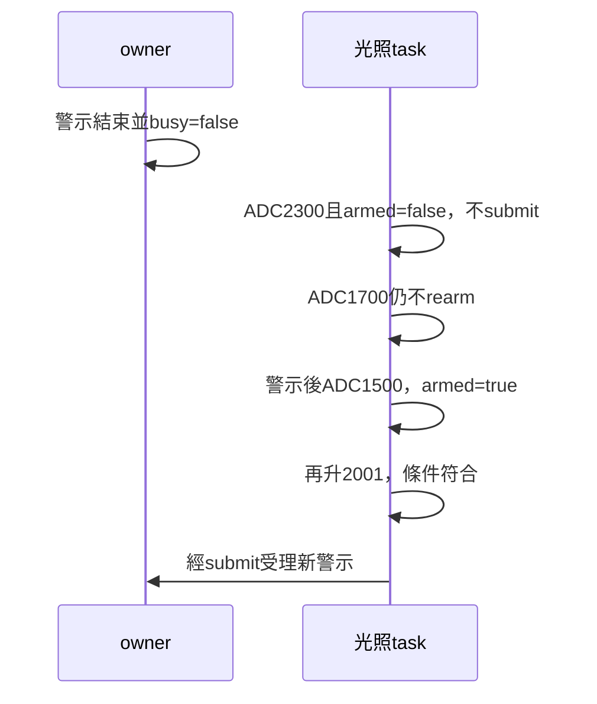

圖中最後一箭頭代表要求送到owner的命令入口，不是直接呼叫GPIO。busy由`LedController`管理，armed是`light_sensor_task`局部變數；解除警示不會替光照任務重設armed。警示期間短暫變亮也不算rearm，必須完成後再取樣到1500或以下。

## 10. 課堂演練與自我檢查

先不看程式，讓學生用紙卡代表cycle10、alert11和queue，按案例順序移動卡片。把「藍1」「busy」「armed」「receipt狀態」分開記錄，避免把不同資料混成一个LED變數。再依第4～9節圖逐一指向實際函式。

| 問題 | 核對答案 |
|---|---|
| submit accepted會立即換色嗎？ | 不會，只有owner執行才寫GPIO |
| 警示已受理但effect=None，可以切色嗎？ | 不可以，reserved已封鎖 |
| 藍1正在紅閃，正常色碼要改4嗎？ | 不改，4只作暫時輸出 |
| 按鈕accepted又變rejected，是錯誤嗎？ | 警示在執行前到達可依政策拒絕，是可解釋結果 |
| 按住到警示結束會換色嗎？ | 不會，必須放開重按 |
| 閃完又遮光為何沒再閃？ | armed還未由警示後ADC<=1500重新允許 |
| 哪裡能看到最終命令結果？ | result(ID)或GET命令結果API，而非舊receipt副本 |

實機操作先觀察普通切色、按鈕3綠閃與低光警示，再做效果中按住及ADC降至1500解除。案例6的精細交錯需要序列埠命令ID／結果配合，不能僅用肉眼宣稱已觀察到某個排程順序。後續如需課堂可控注入，可另設測試模式。

## 附錄：程式規格、仲裁理論與部署參考

下面保留較完整的架構與欄位規格。先完成案例，再用它作查表資料，不必在第一輪一次講完。

### A1. 問題分成四層

| 層次 | 問題 | 本版解法 |
|---|---|---|
| 一致性 | 讀、計算、寫入交錯會否遺失更新？ | 正常色碼只由 owner 推進；同步階段沒有 await |
| 所有權 | 誰能操作 GPIO？ | 初始化安全熄燈後，只有 LedController.run 的控制流程與 finally |
| 仲裁 | 多個要求要聽誰的？ | 一般命令 FIFO；警示立即預約、拒絕未執行及新改色；關機優先 |
| 效果執行 | 紅閃五次如何按時間推進？ | frame 狀態機，不阻塞其他 task |

critical section 描述一致性保障，單一 owner 是責任分配，仲裁政策回答誰先／拒絕誰；三者不是互相排斥的理論。將方法放在同一類別並不保證只由一個 task 執行。此版把硬體所有權集中在唯一 task，來源不計算或寫入色碼。

非同步 for + await 本身不阻塞整個事件迴圈，也可取消；選 frame 狀態機是為了把受理、仲裁、時間推進與狀態查詢放在一起，不是修正其「不能中斷」。本實驗不以解決先前尚待觀測的卡鈍為目的，也不宣稱已改善效能。

### A2. 要素與互動

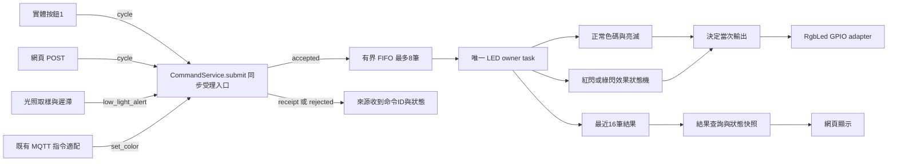

核心來源是按鈕1、按鈕3、Web與光照；MQTT callback bridge也將既有`led:4`／`led=4`格式交給同一個CommandService，避免留下直接寫入入口。桌面fake MQTT／fake GPIO已驗證adapter路徑，但按鈕3與真Broker尚未進行ESP32實機端到端測試。

#### 對照實作檔案

| 檔案／函式 | 工作 |
|---|---|
| main.main | 建立LedController、CommandService、create_task(run)，注入Web並傳給生產者 |
| tasks.button1_task | 讀按鈕、去彈跳、提交cycle，等待放開；忙碌時由共同命令入口回覆拒絕 |
| tasks.button3_task | 讀按鈕3、去彈跳、忙碌按壓消耗、空閒時提交green_flash_alert並等待放開 |
| tasks.light_sensor_task | 50 ms取樣，管理armed與裝置設定的遲滯，提交警示 |
| services.command_service.CommandService.submit | 產生request ID並轉交LedController，不碰GPIO |
| services.led_controller.LedController.run / _step / _apply | 唯一owner，每輪最多4筆命令，推進效果並渲染 |
| hardware.led.RgbLed.write | 色碼位元轉三個GPIO，只在輸出改變時寫入 |
| web_server.api_led_toggle | 受理後回202，不等待整段效果或假稱已執行 |
| web_server.api_led_command_result | 依ID查目前命令結果 |

生產者可以讀 busy 或唯讀 snapshot 以提示使用者，但不能讀改寫 desired color。同步 submit 會管理 queue、receipt 與預約旗標，這是受理控制面的操作；GPIO、正常狀態與效果執行仍只由 owner 更新。所有呼叫前提為同一個 uasyncio 事件迴圈，不可從 IRQ／執行緒直接操作這個清單佇列。

### A3. 命令種類與仲裁表

| 命令 | 參數 | 語義 |
|---|---|---|
| cycle | source=button1/web | 相對變更，不冪等；兩次必須推進兩色，不能合併 |
| set_color | value=0～7、source=mqtt | 絕對設定；目前也以FIFO處理，不另合併 |
| low_light_alert | source=light | 有時長警示；次數／亮滅時間從config取得 |

| 目前狀態／情況 | 新要求 | 結果 |
|---|---|---|
| 正常、有容量 | cycle或set_color | accepted，FIFO等owner執行 |
| 正常、普通佇列滿 | 改色 | rejected / queue_full；不靜默丟失 |
| 正常、有未執行改色 | 光照警示 | 預約警示，舊改色receipt改為rejected / alert_started，清除舊佇列 |
| 警示已受理或執行中 | 改色或警示 | rejected / busy，不排隊、不改正常狀態 |
| 已停止 | 任意命令 | rejected / stopped |
| 任意狀態 | request_stop | 停止受理，拒絕待處理，owner清理熄燈 |

警示優先於尚未執行的一般命令，不能撤銷先前已執行的改色。這是一條明确政策，不是通用數字優先權框架。只預約一個警示，所以普通佇列滿也能受理警示，先拒絕普通待處理，沒有額外成長的警示佇列。

### A4. 受理到完成：不能把202當成功執行

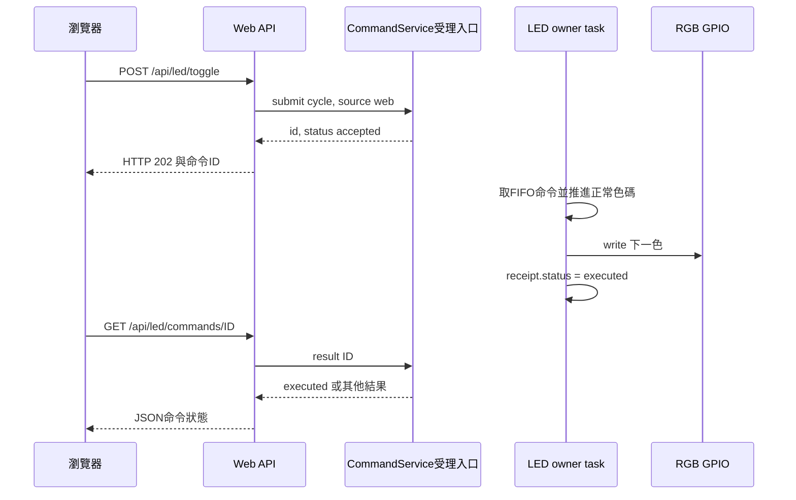

receipt 為字典：id、kind、source、status、reason。id在此次RAM服務內遞增，重啟重置；POST立即回的字典是副本，不會自動變成完成結果。owner更新內部receipt，客戶端再查詢。網頁最多輪詢15次、每次等待50 ms，逾時顯示尚未取得結果，不稱執行失敗；斷線亦顯示結果未知。

| HTTP／狀態 | 意義 |
|---|---|
| POST 202 accepted | 已受理，尚未執行；可能後續因警示被拒絕 |
| POST 409 rejected/busy | 警示期間立即拒絕 |
| POST 429 rejected/queue_full | 佇列已滿，來源可明確提示 |
| POST 503 | 服務未建立或停止 |
| 結果 accepted / executing | 等候或執行中 |
| 結果 executed | 軟體輸出已完成，不保證硬體實際亮燈 |
| 結果 rejected / failed / cancelled | 分別為政策拒絕、執行錯誤、停止中止 |
| 查詢404 | 最近16筆紀錄之外或未知ID，不代表從未執行 |

快取與佇列都有界，不寫Flash、不提供完整歷史。反覆拒絕的請求也可能把旧結果移出最近16筆；正在執行的命令仍保有內部receipt，但查詢可能已過期。這是小型教學系統的記憶體取捨，需長期歷史應另設儲存。

### A5. 警示競爭時機與狀態機

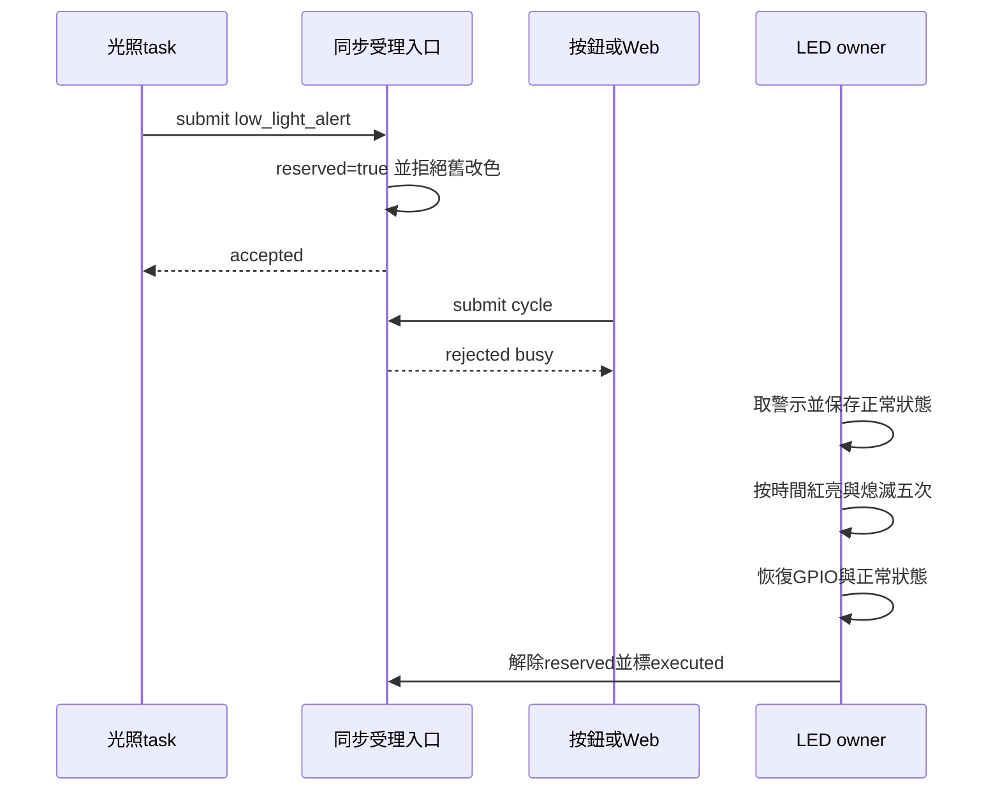

reserved在submit受理警示時就設true，沒有await，所以owner尚未取得排程也已拒絕新改色。只靠owner執行時才設busy會留下這個競爭窗口。警示开始會清除仍未執行的普通命令，且receipt留下拒絕原因，不會警示後補執行。

```mermaid
stateDiagram-v2
    [*] --> Normal
    Normal --> Reserved: 警示受理及封鎖改色
    Reserved --> RedOn: owner取命令並保存狀態
    RedOn --> DarkOff: 亮階段時間已到
    DarkOff --> RedOn: 滅階段已到且未滿五次
    DarkOff --> Normal: 第五次滅階段结束並恢復
    Normal --> Stopped: 關機或取消
    Reserved --> Stopped: 關機或取消
    RedOn --> Stopped: 關機或取消
    DarkOff --> Stopped: 關機或取消
    Stopped --> [*]
```

效果儲存color、phase_on、completed、started、count、on_ms、off_ms、records_alert、saved與receipt。正常色碼／亮滅不被紅亮、綠亮與全滅改寫，結束才恢復保存值；只有低光紅閃寫入既有警示歷史。相對時間以time.ticks_ms/ticks_diff計算，支援tick回繞。

owner每20 ms讓出排程；每輪最多4筆命令，避免一直drain而餓死效果。每輪最多推進一個亮滅階段，發生延遲時延長該階段，不快速補跳多個階段造成肉眼看不到指定次數。設定300 ms不代表硬體精準時間，仍受整個迴圈其他工作影響。

停止由request_stop在控制面設定停止、拒絕待處理；owner在下一次排程進入finally、標記未完成效果cancelled、寫0並發出stopped Event。main等待stopped後再結束喇叭清理。GPIO寫入錯誤會標failed並讓owner退出；若硬體連熄燈都失敗，軟體不能保證安全輸出。

### A6. 重新允許觸發：仍須先回到1500

> **警示完成不等於armed=true。警示結束後先取樣到ADC ≤ 1500，再升至ADC > 2000，才再次受理警示。**

armed仍在光照生產者內管理，50 ms取樣；警示busy期間不rearm。2300→1700→2300不重播；2300→1500→2001才重播。開機已暗仍觸發一次。兩個閾值形成遲滯，沒有新增冷卻時間或連續三次確認。

### A7. 與上一版比較：是否更容易理解？

| 面向 | 重構前 | 此分支 |
|---|---|---|
| 操作來源 | 呼叫具有忙碌檢查的RgbLed方法 | 只提交cycle／警示／set_color |
| 硬體層 | 包含正常狀態、token、快照、關機與GPIO | 只把索引轉為GPIO，重複輸出不寫 |
| 效果 | tasks警示協程＋token控制 | owner狀態機＋reserved受理旗標 |
| Web回應 | 同步改色後回200 | 回202，依ID取得實際結果 |
| 拒絕政策 | 分散在控制器與各入口 | submit／owner集中，來源處理receipt |
| 額外複雜度 | 少量狀態，適合效果單純 | 佇列容量、結果保存、frame推進、HTTP查詢 |

可讀性初步評估：來源與硬體層更簡單，責任較集中；整體程式不一定更短，尤其加入受理結果與查詢是新增複雜度。先讀submit→_apply→_step→run較容易理解；狀態機對初學者需要講解時間與階段。需實際教學及實機使用後再決定是否保留此架構，不能僅依測試宣稱更穩定。

不採用普通await Lock，因效果期間需拒絕而非等待；不接受背景改色，因完成後要恢復原狀；不加入通用優先權／搶占框架，因目前規則是先接受的紅閃或綠閃完成，後來效果以busy拒絕。Event本版只用於owner停止通知。

### A8. 部署與驗收

上傳`main.py`、`tasks.py`、`web_server.py`、`index.html`、`hardware/led.py`、`hardware/button.py`、`hardware/sensors.py`、`communication/mqtt_client.py`、`services/command_service.py`、`services/led_controller.py`、`services/sensor_snapshot.py`、`config.py`。ESP32的`config.py`須保留WiFi／密碼並加入`BUTTON3_PIN = 16`；不要部署任何`mdy_N/`備份目錄。

有意的差異：安全初始化先熄燈，白色7由owner在系統初始化完成後首次渲染，所以WiFi／NTP／MQTT初始化等待期間不再顯示白色。效果約20 ms frame延遲；Web既有URL維持，但成功受理從200改202。這些不是硬體故障。

驗收項目：

1. 正常時按鈕1與Web各按一次，色碼前進兩次，循環0～7。
2. 按鈕3綠閃三次後恢復原色或原先熄滅；期間按鈕1、按鈕3與低光效果不插入，按住直到結束不補執行。
3. 暗觸發完整五次紅閃，原色或原先熄滅恢復；期間一般命令與綠閃不插入。
4. 已受理但尚未執行的改色遇到任一效果，結果顯示`rejected / alert_started`。
5. 持續暗不重播，ADC降至1500或以下再升至2000以上才重播；閾值附近波動不排隊。
6. 刷RFID、PIR音樂、Web刷新正常；中斷後熄燈；重啟結果紀錄與ID重置。

桌面測試涵蓋綠閃三次、不同原狀恢復、紅綠效果互斥、待執行命令清除、忙碌按壓消耗、GPIO失敗，以及既有LED／Web／MQTT／PIR／RFID回歸。未進行按鈕3 ESP32實機接線、真Broker、真實瀏覽器布局或實機壓力驗證。

本講義全部21張Mermaid圖已使用11.13.0實際解析，21/21通過；未做Typora／VS Code視覺布局驗證，解析不等於所有編輯器的視覺布局一致。

### A9. 比較與回復

```powershell
git diff HEAD~1 HEAD -- hardware/led.py tasks.py services/led_controller.py services/command_service.py
git switch main
```
本講義以目前`refactor/architecture-foundation`的P1實作為基準；回復時依`ChangeLog.md`的`mdy_02/`快照還原既有檔案，移除P1新增服務／測試，並保留私人`config.py`中的WiFi設定。`LED_SINGLE_OWNER_GUIDE.md`不再把舊`LedService`介面或未接通MQTT callback描述成目前狀態。
目前 P1 已提交於 `defafb6`；若回復，依 `ChangeLog.md` 的 `mdy_02/` 快照還原既有檔案，移除 P1 新增服務／測試，並保留私人 `config.py` 的 WiFi／密碼。切換 Git 不會自動更新 ESP32 Flash，部署時必須使用同一版本的程式、服務與非機密配置。
