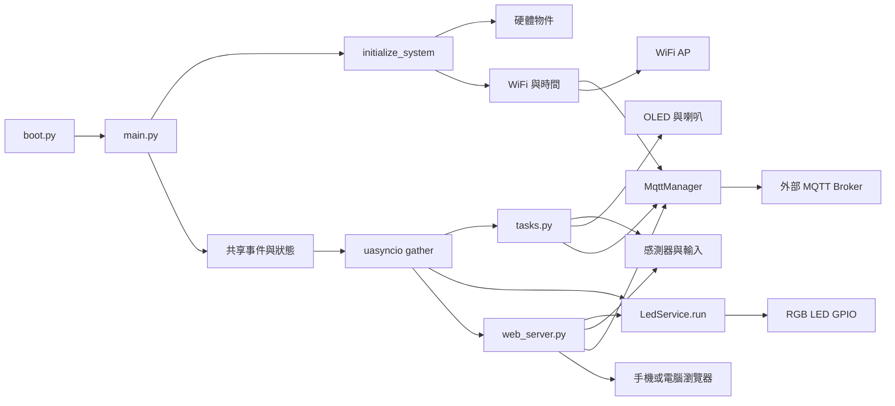

# IoT 教學專案系統架構

> 本文件於 2026-10-11 14:32:36 +08:00 依目前原始碼重新整理。程式註解、舊版文件與實作不同時，以目前 `main.py`、`tasks.py`、`services/`、`hardware/`、`communication/` 與 `web_server.py` 的實作為準。
>
> 本文件描述的是 ESP32／MicroPython 裝置端架構。桌面 fake GPIO 測試不能取代實際開發板、接線、韌體、WiFi、MQTT 或周邊驗證。

## 1. 系統定位

這是一套 ESP32 系列裝置上的 MicroPython 多感測器教學系統，使用單一 `uasyncio` 協同執行感測、控制、顯示與網路任務。確切開發板型號未在專案中指定，必須另外確認目前 GPIO 編號、ADC 通道及周邊介面是否被該 ESP32 變體支援。

目前主流程功能：

- DHT11 量測溫度與濕度。
- TEMT 光感測器透過 ADC 讀取原始亮度值，低光時觸發 RGB LED 警示。
- 兩個實體按鈕分別控制 LED 換色與觸發 MQTT 溫濕度發佈。
- `LedService` 作為 RGB LED 的唯一硬體 owner，仲裁按鈕、光感、Web 與預留 MQTT 指令來源。
- PIR 偵測移動，透過事件觸發無源喇叭旋律。
- MFRC522 RFID 讀卡，將最後成功讀取結果保存在 RAM 快照。
- SSD1306 OLED 顯示日期、星期、時間、溫度與濕度。
- 裝置上的 Microdot HTTP Server 提供儀表板與 REST API。
- MQTT 連接外部 Broker，發佈溫濕度；遠端 LED 指令目前有解析任務，但 callback 尚未真正接通。

目前沒有資料庫、歷史資料儲存、獨立雲端應用伺服器、帳號系統或 OTA 更新流程。感測、RFID、PIR、LED 與音樂狀態主要保存在裝置 RAM，重啟後不保留。

## 2. 從 `main.py` 開始的整體架構



`main.py` 是組裝與生命週期入口，不是所有控制規則的集中位置：

1. 匯入組態、硬體抽象、通訊轉接器、任務與 Web 模組。
2. 建立硬體與通訊物件。
3. 將同一批物件傳給任務，並注入 `web_server.py` 的模組全域變數。
4. 建立 LED owner、事件與 RAM 狀態快照。
5. 以 `uasyncio.gather()` 同時執行 13 個應用協程。

這是單一事件迴圈的協同多工系統，不是多執行緒或多程序架構。MQTT 函式庫可能另有自身的背景任務。

## 3. 分層與模組責任

| 層級 | 檔案／符號 | 責任與介面 |
|---|---|---|
| 開機路徑 | `boot.py` | 調整 `sys.path`；沒有啟用 WebREPL。 |
| 組裝／生命週期 | `main.py` | 建立硬體、WiFi、時間、MQTT、LED owner 與共享狀態；啟動 13 個協程；處理停止與例外清理。 |
| 組態 | `config.py` | GPIO、輪詢週期、光照門檻、WiFi profiles、MQTT topics、裝置名稱與色碼。公開基線為 `config.example.py`。 |
| 應用協調 | `tasks.py` | 按鈕、DHT、光感、PIR、RFID、OLED、喇叭、MQTT 發佈與訂閱任務。 |
| 控制服務 | `services/led_service.py` | LED 命令受理、busy 仲裁、有限佇列、警示效果、結果快照與唯一 GPIO owner。 |
| HTTP 介面 | `web_server.py` | Microdot 路由、HTML 載入、感測資料查詢、LED 命令、MQTT 發佈事件與狀態快照。 |
| 使用者介面 | `index.html` | 原生 HTML／CSS／JavaScript 儀表板，以 `fetch` 呼叫 REST API。 |
| WiFi／時間 | `communication/wifi.py` | 包裝已知 WiFi 連線、NTP 校時與目前時間字串。 |
| MQTT 轉接器 | `communication/mqtt_client.py` | 包裝 `mqtt_as.MQTTClient`，提供連線、等待、發佈、訂閱與回呼入口。 |
| 硬體抽象 | `hardware/led.py` | 三個 GPIO 的 3-bit RGB 輸出；只有 `LedService.run()` 應在初始化後寫入。 |
| 硬體抽象 | `hardware/button.py` | 上拉輸入、低電位按下、非同步輪詢、去彈跳與等待釋放。 |
| 硬體抽象 | `hardware/sensors.py` | DHT11 量測／快取、PIR 輸入與 ADC 光感讀取。 |
| 硬體抽象 | `hardware/display.py` | I2C／SSD1306 初始化、兩行文字與可選點陣字型。 |
| 硬體抽象 | `hardware/rfid.py` | MFRC522 非同步讀 UID 與格式化；讀取狀態由 `tasks.py` 保存。 |
| 硬體抽象 | `hardware/speaker.py` | PWM 音符播放、靜音與資源釋放。 |
| 狀態資料 | `hardware/motion.py` | 建立 PIR／音樂 RAM 快照，不直接操作 GPIO。 |
| 支援函式庫 | `lib/` | WiFi／時間工具、MQTT、Microdot、OLED、字型、RFID 與其他未整合函式庫。 |

`main.py` 將共享物件傳給任務，並注入 Web 模組，因此按鈕任務、背景任務與 HTTP 路由讀取同一份狀態。這種設計適合小型教學專案，但也讓 Web 層依賴模組全域變數，替換與離線測試較不容易。

## 4. 目錄結構與函式庫角色

```text
專案根目錄/
├── boot.py
├── main.py
├── config.py                  # 本機設定，含私人 WiFi profiles，不公開
├── config.example.py          # 公開設定範本
├── tasks.py
├── web_server.py
├── index.html
├── services/
│   └── led_service.py
├── communication/
│   ├── wifi.py
│   └── mqtt_client.py
├── hardware/
│   ├── button.py
│   ├── display.py
│   ├── led.py
│   ├── motion.py
│   ├── rfid.py
│   ├── sensors.py
│   └── speaker.py
├── tests/
└── lib/
    ├── microdot/
    ├── ns_tools.py
    ├── aiot_tools.py
    ├── mqtt_as.py
    ├── mqtt_async.py
    ├── ssd1306.py
    ├── bitmap_font_tool.py
    ├── mfrc522_async.py
    ├── mfrc522_async_sync.py
    ├── mfrc522.py
    ├── fonts/fusion_bdf.12
    └── 其他未整合函式庫
```

目前主流程：

- 使用 `mqtt_as`，不是 `mqtt_async`。
- 使用 `microdot`，不是 `ESPWebServer.py`。
- 實際使用 `mfrc522_async.py`、`aiot_tools.to_hex_string()`、`ssd1306.py` 與可選 `bitmap_font_tool.py`。
- `aiot_tools.py` 的 LLM、新聞、音效等其他功能不是本專案已啟用的功能；目前只依賴其時間工具與 RFID 格式化工具。
- `sounds.py`、`queue_ns_async.py`、`mfrc522_async_sync.py` 等檔案不在 `main.py` 的現行主流程中。

原始碼目錄與 ESP32 實際部署的 import 路徑仍須另行驗證。尤其 `boot.py` 只反轉 `sys.path`，不會自動把缺少的套件路徑加入搜尋路徑。

## 5. 硬體與組態

以下腳位以公開範本 `config.example.py` 為基準；實際 `config.py` 或開發板接線可能不同。

| 元件 | GPIO／介面 | 目前用途 |
|---|---|---|
| RGB LED | R=37、G=35、B=33 | 3-bit 顏色輸出；由 `LedService` 唯一寫入。 |
| 按鈕 1 | GPIO 17 | `Pin.IN`、`PULL_UP`；按下提交 LED `cycle` 命令。 |
| 按鈕 2 | GPIO 21 | `Pin.IN`、`PULL_UP`；按下設定 MQTT 發佈事件。 |
| DHT11 | GPIO 18 | 溫度／濕度量測與 RAM 快取。 |
| TEMT 光感測器 | ADC GPIO 8 | ADC 原始值 0～4095；低光時提交 LED 警示。 |
| PIR | GPIO 4 | 高電位表示移動；低到高時觸發音樂事件。 |
| 無源喇叭 | GPIO 6 | PWM 播放 `MOTION_MELODY`。 |
| OLED | I2C 0；SCL=7、SDA=5 | SSD1306，128×64；顯示時間與 DHT 資料。 |
| RFID | SPI SCK=12、MOSI=11、MISO=10、RST=9、CS=13 | MFRC522 非同步輪詢與 UID 快照。 |

RGB 色碼：

| 索引 | 顏色 |
|---:|---|
| 0 | 黑／全滅 |
| 1 | 藍 |
| 2 | 綠 |
| 3 | 青 |
| 4 | 紅 |
| 5 | 紫 |
| 6 | 黃 |
| 7 | 白 |

### LED 低光控制

公開設定：

```text
LIGHT_ALERT_ENABLED = True
LIGHT_ALERT_TRIGGER_ADC = 1000
LIGHT_ALERT_RESET_ADC = 1100
LIGHT_ALERT_BLINK_COUNT = 5
LIGHT_ALERT_ON_MS = 300
LIGHT_ALERT_OFF_MS = 300
LIGHT_POLL_INTERVAL_MS = 50
```

目前 `light_sensor_task()` 的控制規則：

1. 只有 `LIGHT_ALERT_ENABLED` 且 LED 不 busy 時才產生低光命令。
2. ADC `< 1000` 且已 armed 時，提交 `low_light_alert`。
3. ADC `>= 1100` 時重新 armed。
4. 1000～1099 之間維持既有 armed 狀態。
5. 警示期間由 `LedService` 保存原本的顏色／開關狀態，完成後還原。
6. 警示完成前不接受一般 LED 命令。

OLED 腳位、尺寸與字型路徑目前直接寫在 `hardware/display.py`；雖然設定範本也有對應欄位，顯示模組沒有完整使用那些欄位。

## 6. 開機與執行生命週期

目前 `main.py` 的實際順序如下：

1. 載入 `config`、硬體、通訊、任務與 Web 模組。必要函式庫缺失時，可能在 `initialize_system()` 前就失敗。
2. `uasyncio.run(main())` 建立主事件迴圈。
3. `initialize_system()` 建立 RGB LED、兩個按鈕、DHT11 與 ADC 光感測器。
4. DHT11 先做一次量測。
5. 嘗試建立 RFID；失敗時留下 `init_error` 並繼續。
6. 透過 `connect_wifi()` 連線到已知 WiFi；失敗包裝層可能仍回傳第一組設定，這不代表實際已連線。
7. 透過 `sync_time()` 優先使用 `ns_tools`，再嘗試 `aiot_tools`。
8. 以 `broker='broker.emqx.io'` 建立 MQTT client，最多嘗試三次，每次間隔 2 秒；失敗仍繼續主流程。
9. 嘗試建立 PIR 與喇叭；失敗時設定為 `None`，對應任務會跳過。
10. 建立 `publish_event`、`motion_event`、`LedService`、LED owner 與 `motion_state`。
11. 將共享物件注入 `web_server.py` 的模組全域變數。
12. 以 `uasyncio.gather()` 啟動 13 個應用協程。
13. 正常流程持續運行；Web Server、背景任務或 MQTT 函式庫維持事件迴圈。
14. 例外時要求 LED owner 停止、等待 LED 安全關閉，並嘗試斷開 MQTT；喇叭在 `finally` 釋放 PWM。

WiFi、NTP 與 DHT11 的底層操作可能是同步呼叫，會短暫占用協同式事件迴圈。`KeyboardInterrupt` 與一般例外的資源清理路徑也不完全一致。

## 7. `uasyncio` 應用任務

`main.py` 目前實際交給 `uasyncio.gather()` 的項目如下：

| 任務 | 觸發／頻率 | 讀取 | 輸出／副作用 |
|---|---|---|---|
| `button1_task` | 按下；輪詢 30 ms、去彈跳約 20 ms | 按鈕 1 | 提交 LED `cycle` 命令；LED busy 時消耗本次按下。 |
| `button2_task` | 按下；輪詢 30 ms、去彈跳約 20 ms | 按鈕 2 | `publish_event.set()`。 |
| `dht11_read_task` | 每 2 秒 | DHT11 | 更新溫度／濕度欄位。 |
| `light_sensor_task` | 每 50 ms | ADC | 依雙門檻提交 `low_light_alert`。 |
| `led_service.run()` | 每 20 ms frame | LED 命令佇列 | 唯一寫入 RGB LED；執行換色與閃爍效果。 |
| `rfid_read_task` | 每 500 ms | MFRC522 SPI | 更新最後成功 UID 與時間。 |
| `pir_monitor_task` | 每 500 ms | PIR GPIO | 偵測首次高電位／低到高，更新狀態並設定 `motion_event`。 |
| `music_on_motion_task` | 等待 `motion_event` | 事件與喇叭 | 播放旋律；播放期間事件可能合併。 |
| `oled_display_task` | 每 1 秒 | 時間、DHT RAM 快取 | 更新 OLED 兩行文字。 |
| `mqtt_publish_task` | 等待 `publish_event` | DHT RAM 快取 | 發佈溫濕度文字 payload；完成後清除 Event。 |
| `mqtt_subscribe_task` | 啟動時訂閱；之後每 10 秒休眠 | MQTT 指令 | 建立 LED 指令解析器，但 callback 目前未接通。 |
| `web_server_task` | 持續接收 HTTP | HTML 與共享物件 | 監聽 `0.0.0.0:80`。 |
| `sensor_monitor_task` | 每 10 秒 | 無 | 目前只有休眠，是監控功能預留位置。 |

MQTT 函式庫內部可能另有連線維持、重連與收訊工作，不列入上述應用任務數量。

## 8. 控制與資料流

### DHT11、OLED、Web 與 MQTT

```text
DHT11
  → dht11_read_task()
  → Dht11Sensor.temperature / humidity
  ├→ oled_display_task()
  ├→ GET /api/data
  └→ mqtt_publish_task()
```

DHT 讀取失敗時，`Dht11Sensor.measure()` 目前把欄位設為 `-1`。因此任務註解所說的「使用上次資料」與實際行為不一致；沒有獨立的 `valid`、`age`、`last_error` 快照。

### 光感與 LED

```text
TEMT ADC
  → light_sensor_task() 每 50 ms
  → LedService.submit('low_light_alert', 'light')
  → LedService.run() 每 20 ms
  → RgbLed.write()
```

`GET /api/data` 會額外直接呼叫 `light_sensor.read()`，不是只讀取背景任務快取。亮度是原始 ADC 值，不是經校正的 lux。

### LED 命令來源

```text
按鈕 1 ─┐
Web API ─┼→ LedService.submit() → 有界命令佇列 → LedService.run() → RGB GPIO
光感 ───┤
MQTT ───┘       （目前 MQTT callback 尚未接通）
```

`LedService` 的重要不變條件：初始化完成後，只有 `run()` 可以寫入 RGB LED；生產者只能同步提交命令與取得 receipt。

### 按鈕 2、Web 與 MQTT 發佈

```text
按鈕 2 或 POST /api/publish
  → publish_event.set()
  → mqtt_publish_task()
  → 讀取最近 DHT 快取
  → broker.emqx.io
```

`Event` 是旗標，不是每次觸發一筆的佇列。多次觸發可能合併；發佈完成後的 `clear()` 也可能消除發佈期間新來的觸發。此流程使用最近一次 DHT 快取，不會因按鈕按下立即重新量測。

### PIR、喇叭與 Web 狀態

```text
PIR 低→高
  → pir_monitor_task()
  ├→ motion_state
  └→ motion_event.set()
       → music_on_motion_task()
       → Speaker.play_song()
```

PIR 與音樂狀態會以 `motion_state` 提供給 `/api/data`。PIR 每次低到高只觸發一次；持續高電位不重播。

### RFID 與 Web

```text
MFRC522 SPI
  → rfid_read_task()
  → rfid_state
  → GET /api/data
```

沒有卡片時保留最後成功 UID；這是最後讀取紀錄，不表示卡片目前仍在感應區。

### 遠端 MQTT LED 控制

設計目標是：

```text
外部 MQTT client
  → nuu/csie/iot1133/cmd01
  → handle_cmd()
  → LedService.submit('set_color', 'mqtt', value)
```

但目前 `MqttManager.subscribe()` 沒有保存或呼叫傳入的 `callback`，MQTT client 使用的是 `MqttManager.on_message()`，而該方法只列印訊息。因此這條路徑目前不能宣稱可用。

## 9. HTTP 與 MQTT 介面

### HTTP API

| 方法 | 路徑 | 目前行為 |
|---|---|---|
| GET | `/` | 傳回 `index.html`。 |
| GET | `/index.html` | 傳回 `index.html`。 |
| GET | `/api/data` | 回傳 `temp`、`humidity`、`light`、`status`、RFID、PIR／音樂狀態與 LED snapshot。 |
| POST | `/api/led/toggle` | 提交 LED `cycle` 命令；接受時回 HTTP 202，busy／queue full／stopped 依原因回 409／429／503。 |
| GET | `/api/led/status` | 只回傳 LED RAM snapshot；不操作 ADC、DHT、SPI 或 GPIO；設定 `Cache-Control: no-store`。 |
| GET | `/api/led/commands/<id>` | 查詢有限結果歷史；過期或不存在時回 404。 |
| POST | `/api/publish` | 設定 MQTT 發佈事件，立即回應，不等待 MQTT 發佈完成。 |
| GET | `/api/status` | 目前固定回傳 `status: ok` 與 `System running`，不代表所有服務健康。 |

目前沒有認證、HTTPS、WebSocket 或 SSE。前端主要輪詢 `/api/data`，LED 狀態另有快速 `/api/led/status` 路徑。HTTP API 在同網段內可直接被呼叫，後端仍是控制權威，前端提示不能取代後端 busy／輸入檢查。

### MQTT

| 項目 | 目前實作 |
|---|---|
| Broker | `broker.emqx.io`，由 `main.py` 直接傳入 `MqttManager`。 |
| 傳輸 | 目前使用 TCP 1883；TLS、帳號與密碼未設定。 |
| 發佈主題 | `nuu/csie/iot1133/TempHumi`。 |
| 訂閱主題 | `nuu/csie/iot1133/cmd01`。 |
| QoS | 應用呼叫均為 0。 |
| Payload | 裝置名稱加溫度／濕度的 UTF-8 人類可讀文字，不是 JSON schema。 |
| 發佈觸發 | 實體按鈕 2 或 Web `/api/publish`。 |
| 入站 LED | 設計上支援 `led:4`／`led=4`，但目前 callback 未接通。 |

`config.py` 的萬用訂閱 `nuu/csie/iot1133/#` 目前沒有被使用；`DEVICE_ID` 沒有傳給 MQTT client 作為 client ID；`MQTT_PORT` 與重連退避欄位也未由 `MqttManager` 明確套用，實際重連依 `mqtt_as` 行為。

## 10. 現況限制與待完善項目

| 項目 | 程式證據與影響 |
|---|---|
| MQTT callback 未接通 | `MqttManager.subscribe(..., callback=handle_cmd)` 的 callback 參數被忽略；`on_message()` 只列印訊息，因此遠端 LED 指令目前不會進入 `LedService`。 |
| MQTT callback 契約需確認 | `mqtt_as` 的收訊 callback 呼叫型態與目前 async 定義仍需依實際函式庫版本確認；同步／非同步不一致可能使回呼不執行。 |
| 重連後未重新訂閱 | `on_connected()` 只設定旗標與 Event，沒有明確重新訂閱命令 topic 的應用邏輯。 |
| 連線狀態可能過期 | `_connected` 與 connected Event 沒有完整涵蓋非預期斷線；發佈／訂閱任務也沒有把 `wait_connected()` 的 False 狀態轉成 Web 健康狀態。 |
| DHT 失敗值混入資料 | `measure()` 失敗時以 `(-1, -1)` 覆寫欄位，沒有保留最後成功資料與資料品質／新鮮度。 |
| HTTP 成功語意過度 | `/api/publish` 設定 Event 後即回成功，不等於 MQTT 已送出；LED 202 也只表示命令 accepted，不表示 GPIO 已 executed。 |
| Web 健康檢查為占位 | `/api/status` 固定回 `ok`；`sensor_monitor_task()` 只有 sleep，不能代表 WiFi、MQTT、DHT、RFID 或 LED owner 健康。 |
| LED 命令 Event 可能合併 | `publish_event` 是單一旗標，不保存觸發次數；發佈期間的新事件可能被後續 `clear()` 合併或消除。 |
| Web 感測查詢會直讀 ADC | `/api/data` 直接呼叫 `light_sensor.read()`，與每 50 ms 的光感任務分開取樣；亮度沒有時間戳與品質資訊。 |
| 任務沒有統一 supervisor | 個別任務多半捕捉例外後繼續，但必要任務若退出，主系統仍可能繼續運作而沒有明確告警。 |
| 設定未完全集中 | OLED 腳位／尺寸／字型路徑寫在 `hardware/display.py`；Broker 由 `main.py` 直接指定；MQTT port 與退避設定未完整套用。 |
| 部署相依仍需驗證 | Microdot、`mqtt_as`、`ssd1306`、RFID 驅動、字型與 import path 必須依實際 MicroPython 檔案系統確認。 |
| GPIO 與板型限制 | 公開設定的 GPIO 37、35、33、8 等腳位不一定適用所有 ESP32 變體；必須依實際板型與電氣條件驗證。 |
| 機密與存取控制不足 | WiFi profiles 為本機設定；HTTP 無驗證；MQTT 使用公開 TCP 1883、共用 topic，沒有帳密與 TLS。 |
| 關閉流程不完全一致 | 一般例外會嘗試斷開 MQTT；`KeyboardInterrupt` 路徑主要停止 LED，所有網路／Web 資源沒有一致的 shutdown protocol。 |

以上限制是依目前程式碼的靜態分析；除下方桌面測試外，未宣稱已在 ESP32 實機重現。若要修正，建議順序為：先固定部署與 import 路徑，再完成 MQTT callback／重連契約，接著明確化感測快照與 API 完成語意，最後補齊健康監控、安全邊界與任務 supervisor。

## 11. 部署架構與實機檢核

目前原始目錄包含根目錄 `boot.py`，`lib/` 內同時放置 `microdot/`、`mqtt_as.py`、`ssd1306.py`、工具模組與字型。這是版本庫的來源結構，不等於所有檔案直接上傳後就能被 MicroPython 找到。特別要確認：

- `from microdot import Microdot, Response` 的套件搜尋路徑。
- `from mqtt_as import MQTTClient` 的檔案位置。
- `from ssd1306 import SSD1306_I2C` 的檔案位置。
- `from mfrc522_async import MFRC522Async` 的檔案位置。
- `./lib/fonts/fusion_bdf.12` 與 `hardware/display.py` 的相對路徑。
- `index.html` 是否位於 Web Server 的目前工作目錄。
- MicroPython 韌體是否提供 `machine`、`network`、`dht`、`uasyncio`、`ntptime` 及函式庫所需的其他模組。

建議的裝置端最小部署結構：

```text
裝置檔案系統 /
├── boot.py
├── main.py / config.py / tasks.py / web_server.py / index.html
├── hardware/
├── communication/
├── services/
└── lib/
    ├── microdot/ 或相容的 microdot.py
    ├── ns_tools.py / aiot_tools.py
    ├── mqtt_as.py / ssd1306.py / bitmap_font_tool.py
    ├── mfrc522_async.py
    └── fonts/fusion_bdf.12
```

實機檢核順序：

1. 確認開發板型號、GPIO、ADC、電源、共地與周邊接線。
2. 上傳後逐一確認必要模組、`index.html`、字型與驅動可以 import／讀取。
3. 單獨確認 RGB LED、兩個按鈕、DHT11、ADC、PIR、喇叭、OLED 與 RFID。
4. 確認 WiFi IP、NTP 校時與同網段瀏覽器可連接 HTTP 80。
5. 確認 `/api/data`、`/api/led/status`、LED 命令與命令結果查詢。
6. 以外部 MQTT client 驗證溫濕度 payload；入站 LED 指令必須先完成 callback 修正再驗證。
7. 驗證斷網／重連、感測失敗、按鈕連按、低光遲滯、LED 警示期間命令競爭與 Web／MQTT 完成語意。

## 12. 教學主題對應

| 教學主題 | 對應程式與可討論重點 |
|---|---|
| 開機組裝與生命週期 | `boot.py`、`main.py`、`initialize_system()`、`uasyncio.run()`、例外清理。 |
| 模組化與責任分離 | `main` 組裝、`hardware` 封裝、`communication` 通訊、`services` 控制、`tasks` 協調。 |
| GPIO 與位元運算 | RGB 3-bit 色碼、上拉輸入、低電位按鈕與安全輸出。 |
| 感測與資料品質 | DHT 快取、ADC 原始值、PIR 邊緣、RFID 最後成功快照與錯誤狀態。 |
| 去彈跳與遲滯 | 按鈕穩定檢查、ADC 1000／1100 雙門檻、避免低光重複觸發。 |
| 控制權與仲裁 | `LedService` 單一 owner、命令 receipt、busy、有限佇列與警示優先權。 |
| 非同步與事件 | `gather`、`sleep`、`Event`、協同多工、事件合併與同步阻塞操作。 |
| 顯示與字型 | I2C、SSD1306、點陣中文字型與簡化字型降級。 |
| 網路與時間 | WiFi profile、NTP、UTC+8、牆上時間與裝置運行時間的差異。 |
| MQTT 發佈訂閱 | topic、QoS、callback 契約、重連、重新訂閱與 accepted／sent／applied 語意。 |
| Web 與 REST | HTTP method、JSON、前端輪詢、快速 LED snapshot、命令結果與狀態期限。 |
| 系統整合與安全 | 共用 RAM 狀態、信任邊界、公開 Broker、HTTP 無認證、部署可重現性。 |

本專案的現況主軸是：**裝置端分層模組 + 單一非同步事件迴圈 + 共用感測狀態 + LED 單一 owner + 事件驅動 MQTT 發佈 + HTTP／MQTT 雙介面**。未接通的 MQTT 入站控制、未完成的健康監控、資料品質與安全邊界，都是適合後續課程與實作的延伸題目。

## 13. 分析與驗證界線

- 已完成的桌面測試：`python -B -m unittest discover -s tests -v`，目前 20 個測試通過。
- 測試涵蓋 LED owner／遲滯／按鈕、PIR／音樂、RFID 與設定相容性，使用 fake hardware 或測試替身。
- 尚未由本文件宣稱的驗證：實際 ESP32 開機、GPIO 電氣行為、WiFi、NTP、MQTT Broker、Microdot HTTP、OLED、PIR、喇叭與 RFID 實機運作。
- 文件中的「目前可用」表示程式路徑在靜態分析或桌面測試中存在；不表示未完成的網路／硬體整合已通過實機驗收。
