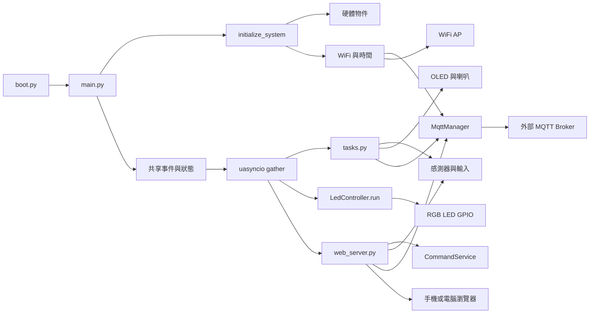

# IoT 教學專案系統架構

> 本文件於 2026-10-12 14:49:29 +08:00 依目前原始碼與本次函式庫整理更新。程式註解、舊版文件與實作不同時，以目前 `main.py`、`tasks.py`、`services/`、`hardware/`、`communication/` 與 `web_server.py` 的實作為準。
>
> 本文件描述的是 ESP32／MicroPython 裝置端架構。桌面 fake GPIO 測試不能取代實際開發板、接線、韌體、WiFi、MQTT 或周邊驗證。

## 1. 系統定位

這是一套 ESP32 系列裝置上的 MicroPython 多感測器教學系統，使用單一 `uasyncio` 協同執行感測、控制、顯示與網路任務。確切開發板型號未在專案中指定，必須另外確認目前 GPIO 編號、ADC 通道及周邊介面是否被該 ESP32 變體支援。

目前主流程功能：

- DHT11 量測溫度與濕度。
- TEMT 光感測器透過 ADC 讀取原始亮度值，低光時觸發 RGB LED 警示。
- 兩個實體按鈕分別控制 LED 換色與觸發 MQTT 溫濕度發佈。
- `CommandService` 作為按鈕、光感、Web 與 MQTT 的唯一 LED 命令入口；`LedController` 是 RGB LED 的唯一硬體 owner。
- PIR 偵測移動，透過事件觸發無源喇叭旋律。
- MFRC522 RFID 讀卡，將最後成功結果與最近 5 次讀卡紀錄保存在 RAM 快照。
- SSD1306 OLED 顯示日期、星期、時間、溫度與濕度。
- 裝置上的 Microdot HTTP Server 提供儀表板與 REST API。
- MQTT 連接外部 Broker，發佈溫濕度；遠端 LED 指令已由同步 callback 解析後交給 `CommandService`，但重連後重新訂閱仍待補強。

目前沒有資料庫、歷史資料儲存、獨立雲端應用伺服器、帳號系統或 OTA 更新流程。感測、RFID、PIR、LED 與音樂狀態主要保存在裝置 RAM，重啟後不保留。

## 2. 從 `main.py` 開始的整體架構



`main.py` 是組裝與生命週期入口，不是所有控制規則的集中位置：

1. 匯入組態、硬體抽象、通訊轉接器、任務與 Web 模組。
2. 建立硬體與通訊物件。
3. 將同一批物件傳給任務，並注入 `web_server.py` 的模組全域變數。
4. 建立 LED owner、事件與 RAM 狀態快照。
5. 以 `uasyncio.gather()` 同時執行 13 個應用協程。

這是單一事件迴圈的協同多工系統，不是多執行緒或多程序架構。MQTT 函式庫可能另有自身的背景任務。

## 3. 分層與模組責任

| 層級 | 檔案／符號 | 責任與介面 |
|---|---|---|
| 開機路徑 | `boot.py` | 調整 `sys.path`；沒有啟用 WebREPL。 |
| 組裝／生命週期 | `main.py` | 建立硬體、WiFi、時間、MQTT、LED owner 與共享狀態；啟動 13 個協程；處理停止與例外清理。 |
| 組態 | `config.py` | GPIO、輪詢週期、光照門檻、WiFi profiles、MQTT topics、裝置名稱與色碼。公開基線為 `config.example.py`。 |
| 應用協調 | `tasks.py` | 按鈕、DHT、光感、PIR、RFID、OLED、喇叭、MQTT 發佈與訂閱任務。 |
| 控制服務 | `services/command_service.py`、`services/led_controller.py` | 統一命令入口、request ID、驗證、有限佇列、AUTO／MANUAL 仲裁、結果快照與唯一 GPIO owner。 |
| HTTP 介面 | `web_server.py` | Microdot 路由、HTML 載入、感測資料查詢、LED 命令、MQTT 發佈事件與狀態快照。 |
| 使用者介面 | `index.html`、`assets/uplot/1.6.32/` | HTML／CSS／JavaScript 儀表板；uPlot 本機資產由 Web 路由提供。 |
| WiFi／時間 | `communication/wifi.py` | 包裝已知 WiFi 連線、NTP 校時與目前時間字串。 |
| MQTT 轉接器 | `communication/mqtt_client.py` | 包裝 `mqtt_as.MQTTClient`，提供連線、等待、發佈、訂閱與回呼入口。 |
| 硬體抽象 | `hardware/led.py` | 三個 GPIO 的 3-bit RGB 輸出；只有 `LedController.run()` 應在初始化後寫入。 |
| 硬體抽象 | `hardware/button.py` | 上拉輸入、低電位按下、非同步輪詢、去彈跳與等待釋放。 |
| 硬體抽象 | `hardware/sensors.py` | DHT11 與 ADC 驅動；失敗不覆寫 last-good 值。 |
| 共享快照 | `services/sensor_snapshot.py` | 感測值、valid、quality、age、error 與 sample sequence。 |
| 硬體抽象 | `hardware/display.py` | I2C／SSD1306 初始化、兩行文字與可選點陣字型。 |
| 硬體抽象 | `hardware/rfid.py` | MFRC522 非同步讀 UID 與格式化；讀取狀態由 `tasks.py` 保存。 |
| 硬體抽象 | `hardware/speaker.py` | PWM 音符播放、靜音與資源釋放。 |
| 狀態資料 | `hardware/motion.py` | 建立 PIR／音樂 RAM 快照，不直接操作 GPIO。 |
| 支援函式庫 | `lib/` | WiFi／時間工具、MQTT、Microdot、OLED、字型、RFID 與其他未整合函式庫。 |

`main.py` 將共享物件傳給任務，並注入 Web 模組，因此按鈕任務、背景任務與 HTTP 路由讀取同一份狀態。這種設計適合小型教學專案，但也讓 Web 層依賴模組全域變數，替換與離線測試較不容易。

## 4. 目錄結構與函式庫角色

```text
專案根目錄/
├── boot.py
├── main.py
├── config.py                  # 本機設定，含私人 WiFi profiles，不公開
├── config.example.py          # 公開設定範本
├── tasks.py
├── web_server.py
├── index.html
├── services/
│   ├── command_service.py
│   ├── led_controller.py
│   └── sensor_snapshot.py
├── communication/
│   ├── wifi.py
│   └── mqtt_client.py
├── hardware/
│   ├── button.py
│   ├── display.py
│   ├── led.py
│   ├── motion.py
│   ├── rfid.py
│   ├── sensors.py
│   └── speaker.py
├── tests/
├── lib/
│   ├── microdot/
│   ├── ns_tools.py
│   ├── aiot_tools.py
│   ├── mqtt_as.py                 # 主流程使用
│   ├── ssd1306.py
│   ├── bitmap_font_tool.py
│   ├── mfrc522_async.py           # 主流程使用
│   ├── async_queue.py             # 保留的唯一 Queue 實作；目前主流程未引用
│   ├── fonts/fusion_bdf.12
│   └── 其他未整合函式庫
└── lib_backup/                    # 來源封存，不納入裝置部署
    ├── mfrc522.py
    ├── mfrc522_async_sync.py
    ├── queue_ns_async.py
    └── mqtt_async.py
```

### 重複模組整理決策

| 類別 | `lib/` 保留 | 移入 `lib_backup/` | 保留理由 |
|---|---|---|---|
| MFRC522 | `mfrc522_async.py` | `mfrc522.py`、`mfrc522_async_sync.py` | `hardware/rfid.py` 明確延後匯入 `MFRC522Async`，並以 `await request()`、`await anticoll()` 讀卡；此檔案符合目前 `uasyncio` 主流程與 RFID 測試替身契約。同步版及同步／非同步混合版沒有目前呼叫者。 |
| Queue | `async_queue.py` | `queue_ns_async.py` | 兩檔都提供相同的自動擴充 `AsyncQueue`；目前沒有主流程 import。保留較小且單一責任的 `async_queue.py`；`queue_ns_async.py`額外提供未被使用的 `SimpleQueue`，且 `task_done()` 是空實作。 |
| MQTT | `mqtt_as.py` | `mqtt_async.py` | `communication/mqtt_client.py` 明確匯入 `mqtt_as.MQTTClient` 與 `mqtt_as.config`，目前主流程及文件均以此實作為準。`mqtt_async.py`沒有目前呼叫者，不能與現行 adapter 互換而不重新驗證 API 契約。 |

整理原則是「保留目前實際 import 且有測試／文件契約的實作；沒有呼叫者的替代版本只封存，不讓它繼續進入裝置部署清單」。`lib_backup/` 只保存來源檔案，不應加入 ESP32 的最小部署內容。


目前主流程：

- 使用 `mqtt_as`，不是 `mqtt_async`。
- 使用 `microdot`，不是 `ESPWebServer.py`。
- 實際使用 `mfrc522_async.py`、`aiot_tools.to_hex_string()`、`ssd1306.py` 與可選 `bitmap_font_tool.py`。
- `aiot_tools.py` 的 LLM、新聞、音效等其他功能不是本專案已啟用的功能；目前只依賴其時間工具與 RFID 格式化工具。
- `lib_backup/` 內的 `queue_ns_async.py`、`mfrc522.py`、`mfrc522_async_sync.py` 與 `mqtt_async.py` 只是封存版本，不在 `main.py` 的現行主流程中，也不應上傳到裝置。

原始碼目錄與 ESP32 實際部署的 import 路徑仍須另行驗證。尤其 `boot.py` 只反轉 `sys.path`，不會自動把缺少的套件路徑加入搜尋路徑。

## 5. 硬體與組態

以下腳位以公開範本 `config.example.py` 為基準；實際 `config.py` 或開發板接線可能不同。

| 元件 | GPIO／介面 | 目前用途 |
|---|---|---|
| RGB LED | R=37、G=35、B=33 | 3-bit 顏色輸出；由 `LedController` 唯一寫入。 |
| 按鈕 1 | GPIO 17 | `Pin.IN`、`PULL_UP`；按下提交 LED `cycle` 命令。 |
| 按鈕 2 | GPIO 21 | `Pin.IN`、`PULL_UP`；按下設定 MQTT 發佈事件。 |
| DHT11 | GPIO 18 | 溫度／濕度量測與 RAM 快取。 |
| TEMT 光感測器 | ADC GPIO 8 | ADC 原始值 0～4095；更新 `SensorSnapshot` 並提交低光命令。 |
| PIR | GPIO 4 | 高電位表示移動；低到高時觸發音樂事件。 |
| 無源喇叭 | GPIO 6 | PWM 播放 `MOTION_MELODY`。 |
| OLED | I2C 0；SCL=7、SDA=5 | SSD1306，128×64；顯示時間與 DHT 資料。 |
| RFID | SPI SCK=12、MOSI=11、MISO=10、RST=9、CS=13 | MFRC522 非同步輪詢與 UID 快照。 |

RGB 色碼：

| 索引 | 顏色 |
|---:|---|
| 0 | 黑／全滅 |
| 1 | 藍 |
| 2 | 綠 |
| 3 | 青 |
| 4 | 紅 |
| 5 | 紫 |
| 6 | 黃 |
| 7 | 白 |

### LED 低光控制

公開設定：

```text
LIGHT_ALERT_ENABLED = True
LIGHT_ALERT_TRIGGER_ADC = 1000
LIGHT_ALERT_RESET_ADC = 1100
LIGHT_ALERT_BLINK_COUNT = 5
LIGHT_ALERT_ON_MS = 300
LIGHT_ALERT_OFF_MS = 300
LIGHT_POLL_INTERVAL_MS = 50
```

目前 `light_sensor_task()` 的控制規則：

1. 只有 `LIGHT_ALERT_ENABLED` 且 LED 不 busy 時才產生低光命令。
2. ADC `< 1000` 且已 armed 時，提交 `low_light_alert`。
3. ADC `>= 1100` 時重新 armed。
4. 1000～1099 之間維持既有 armed 狀態。
5. 警示期間由 `LedController` 保存原本的 desired／enabled 狀態，完成後還原。
6. 警示完成前不接受一般 LED 命令。

OLED 腳位、尺寸與字型路徑目前直接寫在 `hardware/display.py`；雖然設定範本也有對應欄位，顯示模組沒有完整使用那些欄位。

## 6. 開機與執行生命週期

目前 `main.py` 的實際順序如下：

1. 載入 `config`、硬體、通訊、任務與 Web 模組。必要函式庫缺失時，可能在 `initialize_system()` 前就失敗。
2. `uasyncio.run(main())` 建立主事件迴圈。
3. `initialize_system()` 建立 RGB LED、兩個按鈕、DHT11 與 ADC 光感測器。
4. DHT11 先做一次量測。
5. 嘗試建立 RFID；失敗時留下 `init_error` 並繼續。
6. 透過 `connect_wifi()` 連線到已知 WiFi；失敗包裝層可能仍回傳第一組設定，這不代表實際已連線。
7. 透過 `sync_time()` 優先使用 `ns_tools`，再嘗試 `aiot_tools`。
8. 以 `broker='broker.emqx.io'` 建立 MQTT client，最多嘗試三次，每次間隔 2 秒；失敗仍繼續主流程。
9. 嘗試建立 PIR 與喇叭；失敗時設定為 `None`，對應任務會跳過。
10. 建立 `publish_event`、`motion_event`、`SensorSnapshot`、`LedController`、`CommandService` 與 `motion_state`。
11. 將共享物件注入 `web_server.py` 的模組全域變數。
12. 以 `uasyncio.gather()` 啟動 13 個應用協程。
13. 正常流程持續運行；Web Server、背景任務或 MQTT 函式庫維持事件迴圈。
14. 例外時要求 LED owner 停止、等待 LED 安全關閉，並嘗試斷開 MQTT；喇叭在 `finally` 釋放 PWM。

WiFi、NTP 與 DHT11 的底層操作可能是同步呼叫，會短暫占用協同式事件迴圈。`KeyboardInterrupt` 與一般例外的資源清理路徑也不完全一致。

## 7. `uasyncio` 應用任務

`main.py` 目前實際交給 `uasyncio.gather()` 的項目如下：

| 任務 | 觸發／頻率 | 讀取 | 輸出／副作用 |
|---|---|---|---|
| `button1_task` | 按下；輪詢 30 ms、去彈跳約 20 ms | 按鈕 1 | 透過 `CommandService` 提交 LED `cycle` 命令。 |
| `button2_task` | 按下；輪詢 30 ms、去彈跳約 20 ms | 按鈕 2 | `publish_event.set()`。 |
| `dht11_read_task` | 每 2 秒 | DHT11 | 更新 `SensorSnapshot`；失敗保留 last-good 並標示 quality／error。 |
| `light_sensor_task` | 每 50 ms | ADC | 更新 `SensorSnapshot`，依雙門檻提交 `low_light_alert`。 |
| `led_controller.run()` | 每 20 ms frame | 有界 LED 命令佇列 | 唯一寫入 RGB LED；執行 AUTO／MANUAL 仲裁與閃爍效果。 |
| `rfid_read_task` | 每 500 ms | MFRC522 SPI | 更新最後成功 UID／時間，並保留最近5次成功讀卡。 |
| `pir_monitor_task` | 每 100 ms | PIR GPIO | 非同步防抖：高電位穩定`PIR_HIGH_DEBOUNCE_MS`後觸發一次，低電位穩定`PIR_LOW_REARM_MS`後重新武裝。 |
| `music_on_motion_task` | 等待 `motion_event` | 事件與喇叭 | 播放旋律；播放期間事件可能合併。 |
| `oled_display_task` | 每 1 秒 | `SensorSnapshot` | 更新 OLED 兩行文字，不直接量測 DHT。 |
| `mqtt_publish_task` | 等待 `publish_event` | `SensorSnapshot` | 發佈溫濕度文字 payload；完成後清除 Event。 |
| `mqtt_subscribe_task` | 啟動時確認連線並訂閱；之後每 10 秒休眠 | MQTT 指令 | 解析 `led:4`／`led=4`，交給 `CommandService`。 |
| `web_server_task` | 持續接收 HTTP | HTML 與共享物件 | 監聽 `0.0.0.0:80`。 |
| `sensor_monitor_task` | 每 10 秒 | 無 | 目前只有休眠，是監控功能預留位置。 |

MQTT 函式庫內部可能另有連線維持、重連與收訊工作，不列入上述應用任務數量。

## 8. 控制與資料流

### DHT11、OLED、Web 與 MQTT

```text
DHT11
  → dht11_read_task()
  → Dht11Sensor.temperature / humidity
  ├→ oled_display_task()
  ├→ GET /api/data
  └→ mqtt_publish_task()
```

`Dht11Sensor.measure()` 失敗時保留最後有效值，並由 `SensorSnapshot` 記錄 `valid=False`、`quality=error`、`age_ms` 與 `error`；不再用 `-1` 作為通用故障值。

### 光感與 LED

```text
TEMT ADC
  → light_sensor_task() 每 50 ms
  → CommandService.submit('low_light_alert', 'light')
  → LedController.run() 每 20 ms
  → RgbLed.write()
```

`GET /api/data` 只讀取 `SensorSnapshot`；不再由 HTTP handler 直接觸發 ADC 或 DHT。

### LED 命令來源

```text
按鈕 1 ─┐
Web API ─┼→ CommandService → LedController → 有界命令佇列 → RGB GPIO
光感 ───┤
MQTT ───┘
```

`LedController` 的重要不變條件：初始化完成後，只有 `run()` 可以寫入 RGB LED；所有 producer 只能透過 `CommandService` 提交命令與取得 receipt。

### 按鈕 2、Web 與 MQTT 發佈

```text
按鈕 2 或 POST /api/publish
  → publish_event.set()
  → mqtt_publish_task()
  → 讀取最近 DHT 快取
  → broker.emqx.io
```

`Event` 是旗標，不是每次觸發一筆的佇列。多次觸發可能合併；發佈完成後的 `clear()` 也可能消除發佈期間新來的觸發。此流程使用最近一次 DHT 快取，不會因按鈕按下立即重新量測。

### PIR、喇叭與 Web 狀態

```text
PIR 低→高
  → pir_monitor_task()
  ├→ motion_state
  └→ motion_event.set()
       → music_on_motion_task()
       → Speaker.play_song()
```

PIR與音樂狀態會以`motion_state`提供給`/api/data`及快速的`/api/motion/status`。`pir_monitor_task()`以100 ms輪詢；高電位連續穩定200 ms才觸發，觸發後持續高電位或短暫低／高抖動不會重複計數，低電位連續穩定1500 ms後才重新武裝。通過重新武裝後的下一次穩定高電位才會加入`recent_detections`，最多保留5筆，供網頁移動偵測卡顯示。

`MOTION_DETECTED_HOLD_MS = 5000`只控制網頁`motion_state.detected`的顯示保持時間；防抖與重新武裝由`PIR_HIGH_DEBOUNCE_MS`及`PIR_LOW_REARM_MS`控制。這些參數都在`config.py`／`config.example.py`提供。

### RFID 與 Web

```text
MFRC522 SPI
  → rfid_read_task()
  → rfid_state.last_uid／last_read_at
  → rfid_state.recent_reads（最多5筆）
  → GET /api/data
```

成功讀卡會同時更新最後一筆`last_uid`、`last_read_at`與`recent_reads`；`recent_reads`每筆包含`uid`與`read_at`，超過5筆時移除最舊資料。沒有卡片時保留既有快照，不表示卡片目前仍在感應區。

### LED、RFID、移動偵測的 Web 顯示

`LedController.snapshot()` 提供 `mode`、`desired_color`、`enabled`、`applied_output`、queue 狀態與警示紀錄。低光警示完成後恢復 desired state；前端透過 `/api/led/status` 讀取快速 RAM snapshot。

`rfid_state.recent_reads`與`motion_state.recent_detections`都是裝置RAM的最近5筆快照。前端每次成功輪詢直接重繪三個區塊，不在瀏覽器另行累積；所以重新整理頁面不會恢復舊事件，裝置重啟也會清空這些紀錄。

### 遠端 MQTT LED 控制

設計目標是：

```text
外部 MQTT client
  → nuu/csie/iot1133/cmd01
  → handle_cmd()
  → CommandService.submit('set_color', 'mqtt', value)
```

`MqttManager.subscribe()` 保存並派送 callback；`handle_cmd()` 維持既有 wire format，解析後只呼叫 `CommandService.submit()`，不直接操作 LED。這完成 P1 的共同入口，但尚未包含重連後重新訂閱政策。

### 8.1 MQTT 同步 callback 的契約與責任邊界

目前使用的 `lib/mqtt_as.py` 以 `subs_cb(topic, msg, retained)` 的**同步呼叫契約**交付入站訊息。它不會等待應用層的 `async def` callback；若直接把非同步函式交給它，呼叫結果只是尚未執行的 coroutine。`MqttManager.on_message()` 因此必須保持普通 `def`，先取得已保存的應用 handler，再依 handler 的結果決定直接完成或以 `uasyncio.create_task()` 排程。

本專案的同步 callback 只負責快速邊界工作：

1. 接收並記錄 `topic`、`msg`、`retained`。
2. 將 bytes 解碼、解析既有 `led:4`／`led=4` 格式。
3. 呼叫 `CommandService.submit('set_color', 'mqtt', value)`。

它不等待 Broker、不讀 DHT、不執行 LED 閃爍，也不直接寫 GPIO。`subscribe()` 另須保存傳入的應用 callback，因為底層 client 實際註冊的是 `MqttManager.on_message`；只完成 topic 訂閱而忘記保存 handler，訊息仍會在函式庫內被收到，但不會進入應用命令路徑。

| 階段 | 負責者 | 可宣稱的結果 |
|---|---|---|
| 底層同步 callback 被呼叫 | `mqtt_as` → `MqttManager.on_message` | 裝置收到一筆入站訊息 |
| payload 解析並提交 | `tasks.handle_cmd` → `CommandService` | 命令已受理或已拒絕 |
| LED 執行 | `LedController.run()` | 命令已套用／失敗 |

`wait_connected()` 只確認連線條件，不代表重連後訂閱已恢復；目前重新訂閱政策仍是待補強項目。這個界線適合作為測試題：fake MQTT 必須同步呼叫保存的 `subs_cb`，再驗證 `led:4` 確實抵達 `CommandService`，而不是只檢查 `subscribe()` 回傳成功。

### 8.2 從 MQTT 封包到 LED 的實際時序

以下用外部 client 發送 `led:4` 說明目前程式的責任分界。這不是一次同步函式呼叫就完成的動作，而是跨越函式庫、adapter、應用任務與 LED owner 的多階段流程：

1. **Broker／網路交付：**外部 client 將 payload 發到命令 topic；`mqtt_as` 收到封包後準備呼叫設定中的 `subs_cb`。此時只能知道裝置函式庫收到資料，不能知道 LED 會不會變紅。
2. **底層 callback：**`mqtt_as` 以同步方式呼叫 `MqttManager.on_message(topic, msg, retained)`。這個入口是普通 `def`，因為底層不會 `await` 應用 callback。
3. **adapter 派送：**`MqttManager.on_message()` 查找 `subscribe()` 時保存的 `_message_callback`，再把三個原始參數交給它。若保存動作遺漏，封包會停在 adapter，不會進入 `tasks.py`。
4. **wire format 解析：**`tasks.mqtt_subscribe_task()` 註冊的 `handle_cmd()` 將 bytes 解碼，接受既有的 `led:4`／`led=4` 格式，並轉成內部 `set_color` 命令。
5. **命令受理：**`CommandService.submit()` 檢查色碼、來源、模式、busy、停止狀態與 queue 容量，回傳 receipt。這個 receipt 表示命令已受理或被拒絕，不表示 GPIO 已經寫入。
6. **owner 執行：**`LedController.run()` 在自己的 task 中取出命令，依目前模式與效果狀態更新 LED；只有這一層在初始化後寫 RGB GPIO。

因此，觀察到以下各種訊息時，診斷結論不同：

| 觀察結果 | 可以推論 | 仍不能推論 |
|---|---|---|
| MQTT log 顯示收到 `led:4` | 函式庫或 adapter 看到了 payload | handler 已執行、命令合法、LED 已變色 |
| `handle_cmd()` 顯示命令 receipt | payload 已解析，命令已受理或拒絕 | owner 已套用、LED 物理亮度正確 |
| `LedController` 記錄 applied | 軟體 owner 已執行 GPIO 寫入 | 外部觀察者一定看到正確光學結果 |
| `wait_connected()` 回傳 True | 當次等待取得連線確認 | 重連後訂閱已恢復、任何命令已完成 |

這個時序也是為什麼 `MqttManager.on_message()` 不應直接呼叫 `RgbLed.write()`：那會跳過共同命令入口、繞過 queue／busy／AUTO／MANUAL 政策，並讓 MQTT 變成另一個偷偷擁有 LED 的來源。

### 8.3 兩個容易混淆的失敗版本

#### 失敗版本 A：把同步函式庫當成會等待的非同步函式庫

```python
# 看起來合理，但 mqtt_as 不會 await 它
async def handle_cmd(topic, msg, retained):
    command = parse(msg)
    await something()
    command_service.submit('set_color', 'mqtt', command)
```

底層執行 `handle_cmd(...)` 時只取得 coroutine。若沒有 adapter bridge，`parse()` 與 `submit()` 都不會發生。修正不是盲目刪除所有 `async`，而是讓 `MqttManager.on_message()` 成為符合底層契約的普通入口；本專案的短處理 handler 保持同步，真正需要等待的工作才排入事件迴圈。

#### 失敗版本 B：訂閱成功，但 callback 被丟掉

```text
client 設定 subs_cb = MqttManager.on_message
  → subscribe(topic, callback=handle_cmd)
  → 只呼叫 client.subscribe(topic)
  → 沒有保存 handle_cmd
  → on_message 找不到應用 handler
  → MQTT 有資料，但 CommandService 沒有命令
```

因此 `subscribe()` 回傳 `True` 只表示 topic 訂閱呼叫成功；還要用 fake client 同步觸發底層 callback，確認保存的 handler 收到 `(topic, msg, retained)`，再確認命令抵達 `CommandService`。

### 8.4 目前實作與尚未完成的邊界

目前已完成的是 callback bridge、handler 派送、`wait_connected()` 結果檢查、既有 payload 解析與共用 `CommandService` 入口。這些由桌面 fake MQTT／fake GPIO 測試覆蓋。

目前尚未完成的是重連後重新訂閱、命令跨重連的去重／過期政策、Broker ACK 與真實硬體端到端確認。不能因為同步 callback 測試通過，就宣稱 MQTT 長時間運作或 LED 實機控制已完整驗收。

## 9. HTTP 與 MQTT 介面

### HTTP API

| 方法 | 路徑 | 目前行為 |
|---|---|---|
| GET | `/` | 傳回 `index.html`。 |
| GET | `/index.html` | 傳回 `index.html`。 |
| GET | `/assets/uplot/1.6.32/uPlot.iife.min.js` | 以 `Response.send_file()` 串流固定版本的 uPlot JavaScript；長效快取。 |
| GET | `/assets/uplot/1.6.32/uPlot.min.css` | 以 `Response.send_file()` 回傳固定版本的 uPlot CSS；長效快取。 |
| GET | `/api/data` | 回傳 `temp`、`humidity`、`light`、`light_thresholds`、`status`、RFID、PIR／音樂狀態與 LED snapshot；`light_thresholds`來自`config.py`。 |
| GET | `/api/motion/status` | 只回傳PIR／喇叭RAM snapshot；不讀取DHT、ADC、SPI或GPIO；設定`Cache-Control: no-store`，供網頁獨立輪詢移動狀態。 |
| POST | `/api/led/toggle` | 提交 LED `cycle` 命令；接受時回 HTTP 202，busy／queue full／stopped 依原因回 409／429／503。 |
| GET | `/api/led/status` | 只回傳 LED RAM snapshot；不操作 ADC、DHT、SPI 或 GPIO；設定 `Cache-Control: no-store`。 |
| GET | `/api/led/commands/<id>` | 查詢有限結果歷史；過期或不存在時回 404。 |
| POST | `/api/publish` | 設定 MQTT 發佈事件；連線可用時回 `202` 與 `status: accepted`，不等待 MQTT 發佈完成。 |
| GET | `/api/publish/status` | 回傳最近一次發佈的 `idle`、`accepted`、`publishing`、`published`、`failed` 或 `unavailable` 狀態；設定 `Cache-Control: no-store`。 |
| GET | `/api/status` | 目前固定回傳 `status: ok` 與 `System running`，不代表所有服務健康。 |

目前沒有認證、HTTPS、WebSocket或SSE。前端以`/api/data`取得溫濕度、光照與RFID，另以`/api/motion/status`每1000 ms取得PIR／喇叭RAM快照，LED則使用快速`/api/led/status`路徑。HTTP API在同網段內可直接被呼叫，後端仍是控制權威，前端提示不能取代後端busy／輸入檢查。

### uPlot 靜態資產與前端圖表整合

光照圖表的整合不是把圖表畫在 ESP32，也不是讓 MicroPython 直接產生 Canvas。系統把責任拆成三層：

| 層 | 檔案／路徑 | 責任 |
|---|---|---|
| 裝置資料 | `web_server.py` 的 `/api/data` | 讀取目前 ADC 光照值與`config.py`的光照遲滯門檻，序列化為 JSON 的 `light`、`light_thresholds` 欄位；不保存圖表歷史。 |
| 頁面應用 | `index.html` | 載入 uPlot、輪詢 JSON、在瀏覽器 RAM 保存最近80筆、決定 X／Y 軸範圍與更新圖表。 |
| 繪圖函式庫 | `/assets/uplot/1.6.32/uPlot.iife.min.js`、`uPlot.min.css` | 提供 uPlot 建構函式、Canvas 折線繪製與圖表 CSS；不接觸 GPIO、ADC 或 MicroPython。 |

#### 1. `index.html` 的兩個資產引用

HTML head 先引用 CSS：

```html
<link rel="stylesheet" href="/assets/uplot/1.6.32/uPlot.min.css">
```

body 底部先載入 uPlot JavaScript，再執行本頁 inline JavaScript：

```html
<script src="/assets/uplot/1.6.32/uPlot.iife.min.js"></script>
<script>
    // createLightChart(), updateLightChart() ...
</script>
```

這個順序確保 inline script 執行時，全域 `uPlot` 已存在。CSS 與 JavaScript 都使用裝置同源的絕對根路徑，不依賴 CDN、DNS 或外部網路；版本號放進 URL，讓升級資產時可避開長效快取的舊內容。

#### 2. 頁面端資料與圖表生命週期

```text
瀏覽器 updateData()
  └─ GET /api/data
       └─ data.light
            └─ updateLightChart()
                 ├─ Number()、限制到 0～4095
                 ├─ push；超過80筆 shift
                 ├─ 第一次：new uPlot(options, data, #lightChart)
                 └─ 後續：setData() + setScale('x') + setScale('y')
```

`lightHistory` 是頁面分頁自己的 JavaScript 陣列，不是 `web_server.py` 的 Python 全域，也不是 ESP32 Flash 資料庫。重新整理會清空它；`/api/data` 每次只提供目前光照讀值。`createLightChart()` 只建立一個 uPlot instance，後續輪詢更新既有 Canvas，視窗尺寸變更則由 `resizeLightChart()` 呼叫 `setSize()`。

#### 3. 軸範圍與「只顯示兩點」的避免方式

Y 軸在 `index.html` 明確設為 `auto: false`：

- 歷史值全部在 2048 以下：`0～2048`，刻度 `0、512、1024、1536、2048`。
- 歷史值曾超過 2048：`0～4095`，刻度 `0、1024、2048、3072、4095`。

X 軸也設為 `auto: false`，並提供 identity `range` 函式；每次 `renderLightChart()` 在 `setData(chartData, false)` 後明確設定 `0～max(1, n-1)`。這是必要的更新契約：若只更新資料而保留初始 `0～1`，後續樣本會超出可視範圍，使用者會誤以為折線停止在兩個點。資料超過80筆時，最舊資料被移除，X 軸回到 `0～79`，形成固定寬度的最近資料滑動視窗。

同一個 Canvas draw hook 會畫兩條紅色實線並標示 API 實際數字，例如目前裝置的`暗 500`與`亮 1100`。它們對應`data.light_thresholds.trigger`／`reset`；目前裝置的500～1099是LED低光控制遲滯緩衝區，公開範例設定則是1000～1099。前端只負責把門檻映射成視覺線，真正的低光判斷仍由裝置端 `tasks.light_sensor_task()` 與 LED owner 執行，圖線不會改變 GPIO 或命令仲裁。

`web_server.py` 的 `api_data()` 讀取 `config.LIGHT_ALERT_TRIGGER_ADC` 與 `config.LIGHT_ALERT_RESET_ADC`，放入同一個 JSON 的`light_thresholds`物件；`index.html`在`updateData()`中先呼叫`updateLightThresholds(data.light_thresholds)`，再更新圖表。若只修改裝置端`config.py`，不需要修改HTML，下一次API成功回應會更新紅線位置；若回應暫時缺少欄位，前端保留最後一次有效門檻。

#### 4. `web_server.py` 的靜態資產路由

`web_server_task()` 啟動時呼叫 `load_html()`，只將 `index.html` 讀入 `HTML_PAGE`。uPlot 檔案不併入這個 HTML 字串，而由兩個獨立路由使用 `Response.send_file()` 回應：

```python
@app.route('/assets/uplot/1.6.32/uPlot.iife.min.js')
async def uplot_javascript(request):
    return Response.send_file(
        'assets/uplot/1.6.32/uPlot.iife.min.js',
        content_type='application/javascript; charset=utf-8',
        max_age=31536000)

@app.route('/assets/uplot/1.6.32/uPlot.min.css')
async def uplot_stylesheet(request):
    return Response.send_file(
        'assets/uplot/1.6.32/uPlot.min.css',
        content_type='text/css; charset=utf-8',
        max_age=31536000)
```

`send_file()` 的路徑是 ESP32 檔案系統上的相對路徑；因此 `assets/uplot/1.6.32/` 必須與 `web_server.py` 的執行工作目錄及部署結構相符。JavaScript／CSS 使用各自的 MIME type，`max_age=31536000` 表示瀏覽器可以長期快取。版本升級時必須同時修改 HTML 引用、Python 路由與裝置檔案目錄；只替換同一路徑的檔案，可能因快取讓部分瀏覽器仍使用舊版本。

#### 5. 部署與錯誤邊界

uPlot 整合至少需要下列檔案：

```text
index.html
web_server.py
assets/uplot/1.6.32/uPlot.iife.min.js
assets/uplot/1.6.32/uPlot.min.css
assets/uplot/1.6.32/LICENSE
```

部署後應從瀏覽器 Network 確認：

1. `GET /index.html` 或 `/` 回應新 HTML。
2. `GET /assets/uplot/1.6.32/uPlot.iife.min.js` 為 HTTP 200，且 MIME type 為 JavaScript。
3. `GET /assets/uplot/1.6.32/uPlot.min.css` 為 HTTP 200，且 MIME type 為 CSS。
4. `GET /api/data` 持續回傳含 `light` 的 JSON。
5. `#lightChart` 產生 uPlot Canvas，光照樣本超過兩筆後 X 軸仍持續延伸。

若只缺 uPlot JavaScript，文字感測卡仍可能更新，但 `createLightChart()` 會顯示圖表元件載入失敗；若只缺 CSS，Canvas 可能存在但尺寸／外觀不完整。這些靜態資產錯誤與 `/api/data` 感測錯誤是不同故障類型，不能以「API 有回應」推論圖表資產已部署成功。

### MQTT

| 項目 | 目前實作 |
|---|---|
| Broker | `broker.emqx.io`，由 `main.py` 直接傳入 `MqttManager`。 |
| 傳輸 | 目前使用 TCP 1883；TLS、帳號與密碼未設定。 |
| 發佈主題 | `nuu/csie/iot1133/TempHumi`。 |
| 訂閱主題 | `nuu/csie/iot1133/cmd01`。 |
| QoS | 應用呼叫均為 0。 |
| Payload | 裝置名稱加溫度／濕度的 UTF-8 人類可讀文字，不是 JSON schema。 |
| 發佈觸發 | 實體按鈕 2 或 Web `/api/publish`。 |
| 入站 LED | 支援 `led:4`／`led=4`；同步 callback 解析後交給 `CommandService`，不直接操作 GPIO。 |

`config.py` 的萬用訂閱 `nuu/csie/iot1133/#` 目前沒有被使用；`DEVICE_ID` 沒有傳給 MQTT client 作為 client ID；`MQTT_PORT` 與重連退避欄位也未由 `MqttManager` 明確套用，實際重連依 `mqtt_as` 行為。

`MqttManager.connect()`在連線失敗時保留原始例外類型與訊息（例如`OSError: [Errno 104] ECONNRESET`），以MicroPython可用的字串輸出記錄並回傳`False`；不依賴桌面Python的`traceback`模組。`main.py`的最外層例外路徑也只輸出例外類型／訊息，避免診斷程式再次遮蔽原始網路錯誤。

## 10. 現況限制與待完善項目

| 項目 | 程式證據與影響 |
|---|---|
| MQTT callback 已接通 | `MqttManager.on_message()` 符合 `mqtt_as` 的同步三參數契約，派送至 handler；handler 再呼叫 `CommandService.submit()`。 |
| MQTT callback 契約已以本地函式庫確認 | `lib/mqtt_as.py` 的收訊路徑直接呼叫 `subs_cb(topic, msg, retained)`；桌面 fake client 測試覆蓋同步派送。 |
| 重連後未重新訂閱 | `on_connected()` 目前設定旗標與 Event，但沒有明確重新訂閱命令 topic 的應用邏輯。 |
| 連線狀態可能過期 | `_connected` 與 connected Event 已在 adapter 連線／失聯檢查中互相更新；仍未形成完整的 Web 健康狀態或 supervisor。 |
| DHT 失敗值與品質已分離 | `Dht11Sensor` 保留 last-good；`SensorSnapshot` 另外記錄 valid／quality／age／error。 |
| HTTP 發佈語意已分層 | `/api/publish` 只回 `accepted`／`unavailable`；`/api/publish/status` 另回背景任務的 `publishing`／`published`／`failed`，但 QoS0 不保證 Broker ACK，且 Event 仍可能合併。 |
| Web 健康檢查為占位 | `/api/status` 固定回 `ok`；`sensor_monitor_task()` 只有 sleep，不能代表 WiFi、MQTT、DHT、RFID 或 LED owner 健康。 |
| LED 命令 Event 可能合併 | `publish_event` 是單一旗標，不保存觸發次數；發佈期間的新事件可能被後續 `clear()` 合併或消除。 |
| Web 感測查詢只讀快照 | `/api/data` 讀 `SensorSnapshot`，不直接呼叫 ADC 或 DHT；感測任務負責更新資料。 |
| 任務沒有統一 supervisor | 個別任務多半捕捉例外後繼續，但必要任務若退出，主系統仍可能繼續運作而沒有明確告警。 |
| 設定未完全集中 | OLED 腳位／尺寸／字型路徑寫在 `hardware/display.py`；Broker 由 `main.py` 直接指定；MQTT port 與退避設定未完整套用。 |
| 部署相依仍需驗證 | Microdot、`mqtt_as`、`ssd1306`、RFID 驅動、字型與 import path 必須依實際 MicroPython 檔案系統確認。 |
| GPIO 與板型限制 | 公開設定的 GPIO 37、35、33、8 等腳位不一定適用所有 ESP32 變體；必須依實際板型與電氣條件驗證。 |
| 機密與存取控制不足 | WiFi profiles 為本機設定；HTTP 無驗證；MQTT 使用公開 TCP 1883、共用 topic，沒有帳密與 TLS。 |
| 關閉流程不完全一致 | 一般例外會嘗試斷開 MQTT；`KeyboardInterrupt` 路徑主要停止 LED，所有網路／Web 資源沒有一致的 shutdown protocol。 |

以上限制是依目前程式碼的靜態分析；除下方桌面測試外，未宣稱已在 ESP32 實機重現。P1 已完成 SensorSnapshot、CommandService、LedController 與三個命令來源遷移；下一步優先完成重連後重新訂閱，再補齊健康監控、安全邊界與任務 supervisor。

## 11. 部署架構與實機檢核

目前原始目錄包含根目錄 `boot.py`，`lib/` 內同時放置 `microdot/`、`mqtt_as.py`、`ssd1306.py`、工具模組與字型。這是版本庫的來源結構，不等於所有檔案直接上傳後就能被 MicroPython 找到。特別要確認：

- `from microdot import Microdot, Response` 的套件搜尋路徑。
- `from mqtt_as import MQTTClient` 的檔案位置。
- `from ssd1306 import SSD1306_I2C` 的檔案位置。
- `from mfrc522_async import MFRC522Async` 的檔案位置。
- `./lib/fonts/fusion_bdf.12` 與 `hardware/display.py` 的相對路徑。
- `index.html` 是否位於 Web Server 的目前工作目錄。
- MicroPython 韌體是否提供 `machine`、`network`、`dht`、`uasyncio`、`ntptime` 及函式庫所需的其他模組。

建議的裝置端最小部署結構：

```text
裝置檔案系統 /
├── boot.py
├── main.py / config.py / tasks.py / web_server.py / index.html
├── assets/
│   └── uplot/1.6.32/
│       ├── uPlot.iife.min.js
│       ├── uPlot.min.css
│       └── LICENSE
├── hardware/
├── communication/
├── services/
└── lib/
    ├── microdot/ 或相容的 microdot.py
    ├── ns_tools.py / aiot_tools.py
    ├── mqtt_as.py / ssd1306.py / bitmap_font_tool.py
    ├── mfrc522_async.py
    └── fonts/fusion_bdf.12
```

實機檢核順序：

1. 確認開發板型號、GPIO、ADC、電源、共地與周邊接線。
2. 上傳後逐一確認必要模組、`index.html`、`assets/uplot/1.6.32/uPlot.iife.min.js`、`assets/uplot/1.6.32/uPlot.min.css`、字型與驅動可以讀取／import。
3. 單獨確認 RGB LED、兩個按鈕、DHT11、ADC、PIR、喇叭、OLED 與 RFID。
4. 確認 WiFi IP、NTP 校時與同網段瀏覽器可連接 HTTP 80。
5. 確認 `/api/data`、`/api/led/status`、LED 命令與命令結果查詢。
6. 以外部 MQTT client 驗證溫濕度 payload 與 `led:4`／`led=4` 入站指令；目前桌面測試已確認 adapter 派送，但尚未宣稱真 Broker／ESP32 實機通過。
7. 驗證斷網／重連、感測失敗、按鈕連按、低光遲滯、LED 警示期間命令競爭與 Web／MQTT 完成語意。

## 12. 教學主題對應

| 教學主題 | 對應程式與可討論重點 |
|---|---|
| 開機組裝與生命週期 | `boot.py`、`main.py`、`initialize_system()`、`uasyncio.run()`、例外清理。 |
| 模組化與責任分離 | `main` 組裝、`hardware` 封裝、`communication` 通訊、`services` 控制、`tasks` 協調。 |
| GPIO 與位元運算 | RGB 3-bit 色碼、上拉輸入、低電位按鈕與安全輸出。 |
| 感測與資料品質 | DHT 快取、ADC 原始值、PIR 邊緣與最近5次時間、RFID 最後成功快照與最近5次讀卡狀態。 |
| 去彈跳與遲滯 | 按鈕穩定檢查、ADC 1000／1100 雙門檻、避免低光重複觸發。 |
| 控制權與仲裁 | `LedController` 單一 owner、命令 receipt、busy、有限佇列與警示優先權。 |
| 非同步與事件 | `gather`、`sleep`、`Event`、協同多工、事件合併與同步阻塞操作。 |
| 顯示與字型 | I2C、SSD1306、點陣中文字型與簡化字型降級。 |
| 網路與時間 | WiFi profile、NTP、UTC+8、牆上時間與裝置運行時間的差異。 |
| MQTT 發佈訂閱 | topic、QoS、callback 契約、重連、重新訂閱與 accepted／sent／applied 語意。 |
| Web 與 REST | HTTP method、JSON、前端輪詢、快速 LED snapshot、命令結果與狀態期限。 |
| 系統整合與安全 | 共用 RAM 狀態、信任邊界、公開 Broker、HTTP 無認證、部署可重現性。 |

本專案的現況主軸是：**裝置端分層模組 + 單一非同步事件迴圈 + 共用感測狀態 + LED 單一 owner + 事件驅動 MQTT 發佈 + HTTP／MQTT 雙介面**。未接通的 MQTT 入站控制、未完成的健康監控、資料品質與安全邊界，都是適合後續課程與實作的延伸題目。

## 13. 分析與驗證界線

- 已完成的桌面測試：`python -B -m unittest discover -s tests -v`，目前 23 個測試通過。
- 測試涵蓋 LED owner／遲滯／按鈕、PIR／音樂、RFID 與設定相容性，使用 fake hardware 或測試替身。
- 尚未由本文件宣稱的驗證：實際 ESP32 開機、GPIO 電氣行為、WiFi、NTP、MQTT Broker、Microdot HTTP、OLED、PIR、喇叭與 RFID 實機運作。
- 文件中的「目前可用」表示程式路徑在靜態分析或桌面測試中存在；不表示未完成的網路／硬體整合已通過實機驗收。
