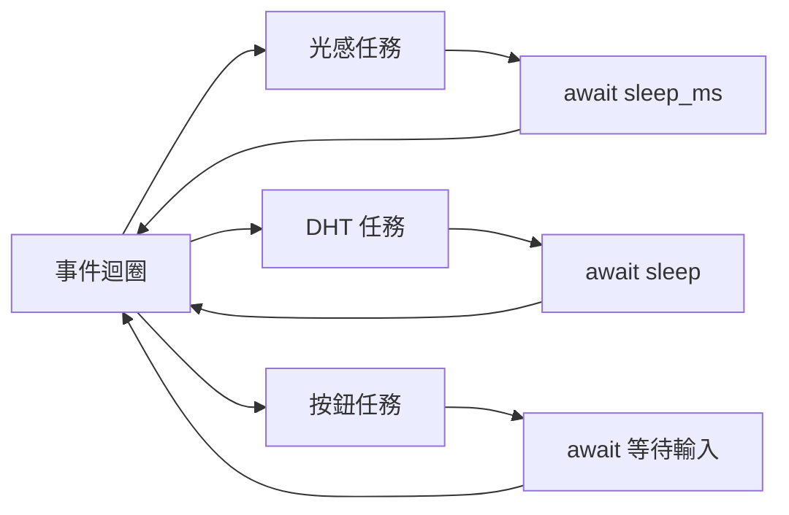
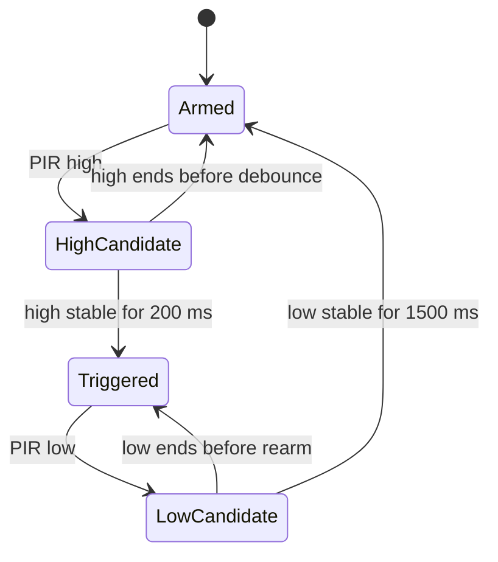
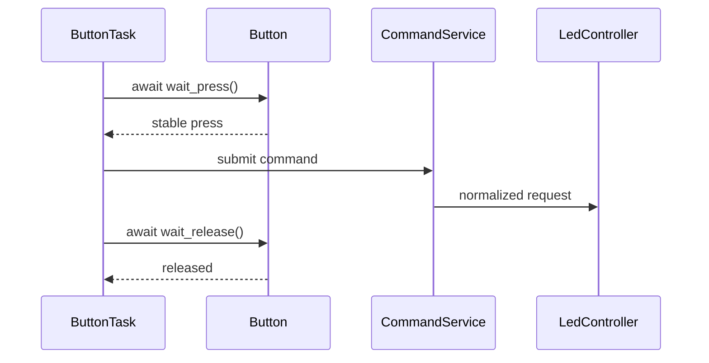
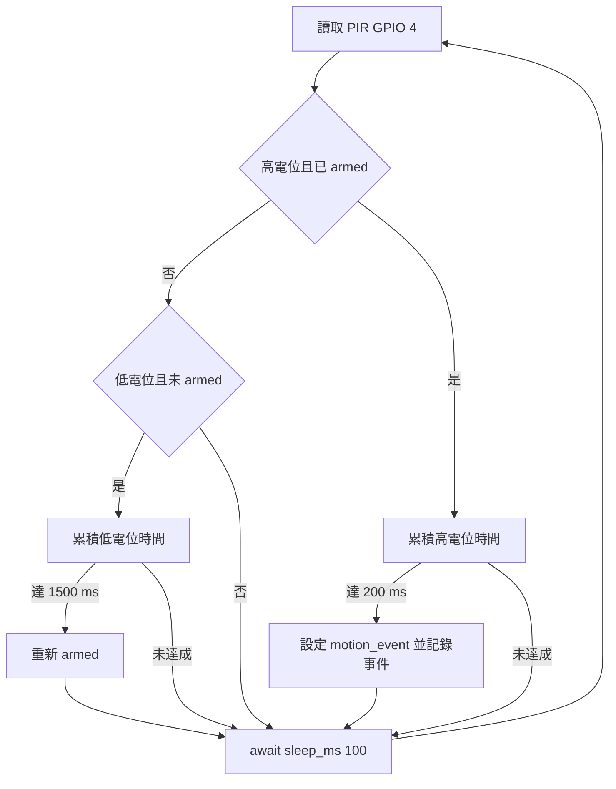
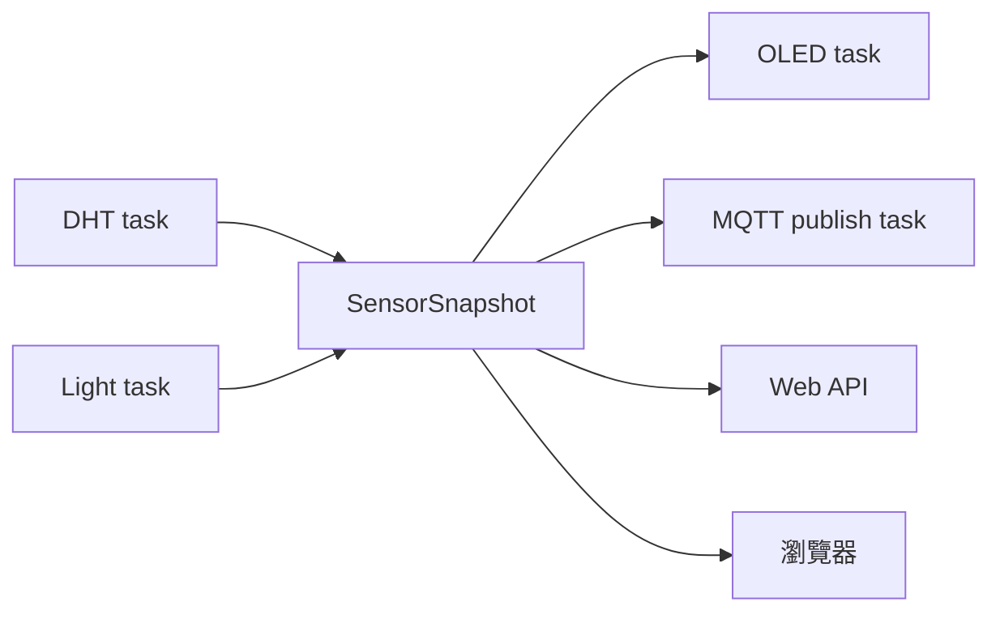
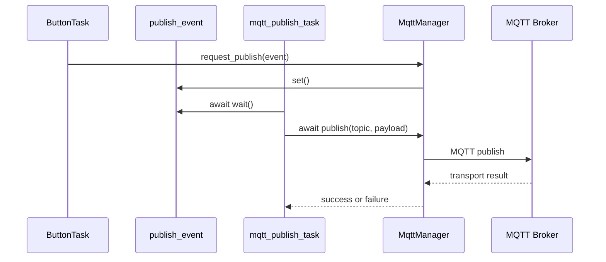
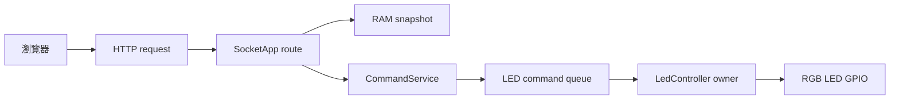

# MicroPython `uasyncio` 教學講義：從事件迴圈到 ESP32 多感測器系統

**適用專案：**本專案目前的 ESP32／MicroPython 多感測器系統。<br>
**文件狀態：**依目前 `config.py`、`main.py`、`tasks.py`、`hardware/`、`services/`、`communication/` 與 `web_server.py` 整理；「目前行為」不等於已完成 ESP32 實機端到端驗收。<br>
**整理時間：**2026-10-27 01:15:22 +08:00。<br>
**閱讀對象：**已具備 Python 基礎、準備在 ESP32 上撰寫 MicroPython 非同步程式的學生。

> 本講義使用 `uasyncio` 這個 MicroPython 模組名稱。部分概念與 CPython `asyncio` 相同，但 API、記憶體限制、可用模組與硬體阻塞行為可能不同；實際開發板的 MicroPython 韌體版本是最後判定依據。

---

## 1. 學習目標

完成本講義後，學生應能：

1. 解釋 coroutine、task、event loop 與 cooperative scheduling 的關係。
2. 使用 `async def`、`await`、`uasyncio.run()`、`create_task()`、`gather()`。
3. 正確選用 `sleep()`、`sleep_ms()`、`Event`、`Lock`、timeout 與 cancellation。
4. 分辨「直接 `await`」、「建立背景 task」與「等待多個 coroutine」的差異。
5. 將按鈕、感測器、顯示器、喇叭、RFID、MQTT 與 Web Server 拆成可協同執行的任務。
6. 說明為什麼 `time.sleep()`、同步 I/O 或過長的無 `await` 迴圈會阻塞整個 ESP32。
7. 使用 `Event` 表達通知，使用 snapshot 表達資料，使用 bounded queue 表達有順序的命令。
8. 讀懂本專案的 LED 單一 owner、PIR 狀態機、MQTT callback bridge 與安全清理設計。
9. 在桌面 fake GPIO／fake MQTT 測試與 ESP32 實機驗證之間建立正確界線。

---

## 2. 先看本專案的硬體與時間尺度

### 2.1 硬體配置

以下硬體表以公開 `config.example.py` 為可追蹤基線；實機私人 `config.py` 可能依開發板與接線使用不同腳位，WiFi profiles 不在教材中重製。

| 元件 | 腳位／介面 | 在非同步系統中的角色 |
|---|---|---|
| RGB LED | R=`GPIO 37`、G=`GPIO 35`、B=`GPIO 33` | `LedController.run()` 唯一寫入者 |
| 按鈕 1 | `GPIO 17` | 等待穩定按下，提交 LED `cycle` 命令 |
| 按鈕 2 | `GPIO 21` | 等待穩定按下，設定 MQTT 發佈事件 |
| 按鈕 3 | `GPIO 16` | 等待穩定按下，提交 LED 綠閃命令 |
| DHT11 | `GPIO 18` | 每 2 秒讀取溫度與濕度 |
| TEMT 光感測器 | ADC `GPIO 8` | 每 50 ms 取樣，更新 snapshot 並判斷低光 |
| PIR | `GPIO 4` | 每 100 ms 取樣，穩定高電位後觸發一次 |
| 無源喇叭 | PWM `GPIO 6` | 等待 PIR event，非同步播放旋律 |
| OLED | I2C 0；SCL=`GPIO 7`、SDA=`GPIO 5`；128×64 | 每 1 秒讀 snapshot 後更新畫面 |
| RFID MFRC522 | SPI：SCK=`12`、MOSI=`11`、MISO=`10`、RST=`9`、CS=`13` | 每 500 ms 輪詢，非同步等待卡片回應 |

目前專案沒有在程式與設定中明確指定 ESP32 開發板變體。公開基線的 GPIO 37、35、33、8 等腳位是否可用，必須依實際開發板、封裝與接線確認；教材不把靜態設定表當成電氣驗證證據。

### 2.2 時間參數

| 功能 | 設定值 | 教學問題 |
|---|---:|---|
| 光感輪詢 | 50 ms | 高頻取樣是否值得增加 CPU 負載？ |
| DHT11 量測 | 2 s | 慢速感測不應拖住其他任務 |
| OLED 更新 | 1 s | 顯示資料來自 snapshot，不重新量測 DHT |
| RFID 輪詢 | 500 ms | 無卡時仍要讓出事件迴圈 |
| PIR 輪詢 | 100 ms | 取樣間隔影響邊緣判斷 |
| PIR 高電位確認 | 200 ms | 把短暫雜訊排除 |
| PIR 低電位重新武裝 | 1500 ms | 一次移動事件結束後才允許下一次 |
| 按鈕去彈跳 | 20 ms | 穩定讀值而非一次讀值 |
| 按鈕輪詢 | 30 ms | 按下與釋放都要交還控制權 |
| LED owner frame | 20 ms | 控制命令與閃爍效果的更新頻率 |
| 低光警示 | 5 次，每次亮／滅 300 ms | 持續效果必須由狀態機逐步完成 |

公開基線與目前裝置都採 ADC 越高越暗：嚴格高於 `2000` 觸發低光警示，降至 `1500`（含）以下才重新 armed。教材討論時仍應以正在操作的裝置 `config.py` 為準，不要把範例值當作其他光感模組的校正結果。

---

## 3. 從阻塞程式開始理解問題

### 3.1 連續阻塞的寫法

```python
import time

while True:
    read_button()
    time.sleep(0.03)
    read_light()
    time.sleep(0.05)
    read_dht()
    time.sleep(2)
    update_oled()
```

這段程式只有一條控制流程。`time.sleep(2)` 期間，按鈕、PIR、Web Server、MQTT 收訊與 LED 更新都沒有機會執行。

### 3.2 協同式分工

```python
import uasyncio

async def read_light_task():
    while True:
        read_light()
        await uasyncio.sleep_ms(50)

async def read_dht_task():
    while True:
        read_dht()
        await uasyncio.sleep(2)

async def main():
    await uasyncio.gather(
        read_light_task(),
        read_dht_task(),
    )

uasyncio.run(main())
```

這不是兩條 CPU 執行緒。它是單一事件迴圈在協程的 `await` 位置切換：



**核心規則：**協程只有在執行到可等待的 `await`，或呼叫會讓出控制權的非同步 API 時，其他 task 才有機會執行。

---

## 4. Coroutine、`async def` 與 `await`

### 4.1 `async def` 只定義非同步函式

```python
async def blink_once():
    led_on()
    await uasyncio.sleep_ms(300)
    led_off()
```

呼叫：

```python
operation = blink_once()
```

此時 `operation` 是 coroutine object，不代表函式已完成。必須由另一個 async context 執行：

```python
await blink_once()
```

或：

```python
task = uasyncio.create_task(blink_once())
```

### 4.2 `await` 的意義

`await` 同時表達兩件事：

1. 等待某個非同步操作的結果。
2. 在等待期間把事件迴圈控制權交給其他可執行工作。

以下程式會等待每個音符，但不會在每個音符期間鎖死整個系統：

```python
async def play_song(notes):
    for note, duration in notes:
        set_note(note)
        await uasyncio.sleep(duration)
    silence()
```

本專案的 `hardware/speaker.py` 使用相同原則：音符之間以 `await uasyncio.sleep(duration)` 等待，並在 `finally` 中靜音。

### 4.3 常見錯誤：把 coroutine 當結果

錯誤概念：

```python
result = mqtt_manager.publish(topic, message)
print(result)  # 這裡可能只是 coroutine object
```

正確概念：

```python
result = await mqtt_manager.publish(topic, message)
```

若底層 callback 是同步契約，不能直接假設 callback 可以被 `await`；必須在邊界確認回傳值是否為 awaitable，再由 `uasyncio.create_task()` 派送。這正是 `communication/mqtt_client.py` 的 callback bridge 責任。

---

## 5. 事件迴圈生命週期

### 5.1 `uasyncio.run()`

目前程式入口：

```python
if __name__ == '__main__':
    uasyncio.run(main())
```

`uasyncio.run(main())` 會：

1. 建立或啟用事件迴圈。
2. 執行 `main()` coroutine。
3. 讓 `main()` 建立硬體、連線、建立 task 並等待主流程。
4. 當主 coroutine 結束或拋出未處理例外時離開執行環境。

目前 `main()` 本身通常不會正常返回，因為它等待包含 Web Server 與永久輪詢迴圈的 `gather()`。

### 5.2 `uasyncio.gather()`

目前 `main.py` 使用 `gather()` 同時維持 14 個應用協程：

- `button1_task`
- `button2_task`
- `button3_task`
- `dht11_read_task`
- `light_sensor_task`
- `led_controller.run()`
- `rfid_read_task`
- `pir_monitor_task`
- `music_on_motion_task`
- `oled_display_task`
- `mqtt_publish_task`
- `mqtt_subscribe_task`
- `web_server_task`
- `sensor_monitor_task`

概念寫法：

```python
await uasyncio.gather(
    button_task(),
    sensor_task(),
    web_task(),
)
```

`gather()` 適合描述「這些工作共同構成服務生命週期」。如果其中一個 task 拋出未處理例外，整體錯誤策略必須明確設計；不能只把所有 coroutine 丟進 `gather()` 就假設系統會自動復原。

### 5.3 直接 `await` 與 `create_task()`

| 寫法 | 語意 | 適用情境 |
|---|---|---|
| `await work()` | 目前流程等待 work 完成 | 初始化、必須取得結果的操作 |
| `create_task(work())` | 建立背景 task，當前流程繼續 | LED owner、獨立監控、背景消費者 |
| `await gather(a(), b())` | 同時等待多項工作 | 主服務生命週期、並行初始化後的長駐任務 |

目前 LED controller 先建立 task，再把它放入 `gather()`；這表示 owner task 已經被建立，但仍由主流程共同等待其結束。

---

## 6. `sleep()` 與 `sleep_ms()`

### 6.1 使用方式

```python
await uasyncio.sleep(1)
await uasyncio.sleep_ms(100)
```

兩者都是非同步等待。選擇原則：

- 秒級週期使用 `sleep()`。
- 硬體輪詢、去彈跳與短暫閃爍使用 `sleep_ms()`。
- 不要用 `time.sleep()` 取代它們。

### 6.2 永久迴圈必須讓出控制權

正確：

```python
async def monitor():
    while True:
        sample()
        await uasyncio.sleep_ms(100)
```

危險：

```python
async def monitor():
    while True:
        sample()
```

第二段沒有 `await`，會長時間霸佔事件迴圈；其他 task 可能完全無法執行。

### 6.3 週期與工作時間

若任務本身耗時，單純在工作後 sleep：

```python
while True:
    sample()
    await uasyncio.sleep_ms(100)
```

實際週期約為「sample 時間 + 100 ms」。如果需要固定節拍，必須另外使用 `ticks_ms()` 計算下一次目標時間；但在小型教學裝置中，先保證不阻塞與錯誤可觀察，通常比過早追求精密節拍更重要。

---

## 7. `time.ticks_ms()` 與狀態機計時

`uasyncio.sleep_ms()` 負責「等待多久」，`time.ticks_ms()` 負責「判斷某個狀態持續多久」。兩者責任不同。

```python
started = time.ticks_ms()

while True:
    now = time.ticks_ms()
    if time.ticks_diff(now, started) >= 200:
        break
    await uasyncio.sleep_ms(20)
```

不要直接使用：

```python
if now - started >= 200:
    ...
```

MicroPython 的 tick 計數會回繞，應使用 `time.ticks_diff()`。

### 7.1 PIR 狀態機

目前 `pir_monitor_task()` 的主要狀態：

- `armed=True`：可以接受下一次移動。
- 看到高電位後記錄 `high_since`。
- 高電位持續至少 200 ms：觸發一次 `motion_event`，設定 `armed=False`。
- 低電位持續至少 1500 ms：重新 `armed=True`。
- `detected_hold_ms=5000` 只影響狀態顯示保持，不是重新計數條件。



這種設計比固定冷卻時間更能表達「一次事件何時結束」，但門檻仍須依實際 PIR 模組調整。

---

## 8. `Event`：通知，不是資料佇列

### 8.1 基本 API

```python
ready = uasyncio.Event()

ready.set()       # 發出通知
await ready.wait()  # 等待通知
ready.clear()     # 清除旗標
```

`Event` 可以想成一盞「有人按過」的燈。它不保存每一次通知的數量，也不保存通知內容。

### 8.2 本專案的兩個 Event

```python
publish_event = uasyncio.Event()
motion_event = uasyncio.Event()
```

| Event | 設定者 | 等待者 | 附帶資料 |
|---|---|---|---|
| `publish_event` | 按鈕 2、Web 發佈路徑 | `mqtt_publish_task()` | `SensorSnapshot` 與 MQTT manager 狀態 |
| `motion_event` | `pir_monitor_task()` | `music_on_motion_task()` | `motion_state` 與目前旋律 |

`publish_event` 的目前語意是「至少有一個發佈要求待處理」。多次 `set()` 不會形成多筆訊息；因此它不是可靠的發佈工作佇列。

### 8.3 Event 與資料分離

建議：

```python
state = {'value': None}
event = uasyncio.Event()

async def producer():
    state['value'] = read_value()
    event.set()

async def consumer():
    await event.wait()
    event.clear()
    use(state['value'])
```

本專案感測值則更進一步集中在 `SensorSnapshot`，讓 OLED、Web 與 MQTT 讀相同的 last-good 資料，而不是各自觸發硬體讀取。

---

## 9. `Lock` 與共享資源

### 9.1 基本用法

```python
lock = uasyncio.Lock()

async def update_shared_state(value):
    async with lock:
        shared_state['value'] = value
        await slow_operation()
```

鎖的目的，是讓多個 task 在需要一致性的區段中排隊。鎖不是讓程式自動變快，也不是所有共享變數都必須加鎖。

### 9.2 本專案的 MQTT lock

`lib/mqtt_as.py` 內部使用 `asyncio.Lock()` 保護部分網路寫入流程。這是函式庫內部的傳輸資源協調，不代表應用層可以在任何地方同時操作 MQTT socket。

### 9.3 LED 為什麼不用「大家共用一把鎖」

LED 採用較明確的 single-owner 模型：

1. 按鈕、Web、MQTT、光感只提交命令。
2. `CommandService` 統一產生 request ID 與命令邊界。
3. `LedController.run()` 是唯一實際寫 GPIO 的 task。
4. LED 的 busy、佇列、警示效果與恢復狀態都在 owner 內處理。

這比讓多個 task 自己取得鎖、自己寫 GPIO 更容易檢查「誰擁有狀態」。

---

## 10. Timeout、連線等待與錯誤分類

### 10.1 `wait_for()`

目前 MQTT manager 使用：

```python
await uasyncio.wait_for(
    self._connected_event.wait(), timeout_sec)
```

逾時時捕捉：

```python
try:
    await uasyncio.wait_for(operation(), 5)
except uasyncio.TimeoutError:
    print('操作逾時')
```

逾時代表「在指定時間內沒有得到結果」，不代表操作成功，也不一定代表硬體永遠故障。

### 10.2 連線狀態的兩層判斷

MQTT 目前分開處理：

- `_connected_event`：通知曾經取得連線確認。
- `is_connected()`：必要時再查底層 client 的實際連線狀態。

這避免只依賴過期的 Python 布林旗標。

### 10.3 例外隔離

每一個長駐硬體 task 通常具有自己的 `try / except`：

```python
while True:
    try:
        read_sensor()
    except Exception as exc:
        record_error(exc)
    await uasyncio.sleep_ms(100)
```

這種寫法適合可暫時失敗的感測器，但不能把所有例外都吞掉。必須：

- 記錄錯誤。
- 更新可觀察狀態。
- 決定是否保留 last-good value。
- 判斷是否要停止該 task。
- 不把未知狀態假裝成正常值。

### 10.4 `finally` 與安全狀態

`hardware/speaker.py`：

```python
async def play_song(self, notes):
    try:
        ...
        await uasyncio.sleep(duration)
    finally:
        self.silence()
```

即使播放正常結束、音符錯誤或 task 被取消，都會關閉 PWM 輸出。

`services/led_controller.py` 也在 `run()` 的 `finally` 中將 LED 寫成 0，並設定 stopped event。硬體資源的安全收尾不能依靠「正常路徑一定會走到最後一行」。

---

## 11. Task cancellation 與資源生命週期

### 11.1 取消不是例外的替代品

task 可能因為：

- 系統停止。
- 上層工作失敗。
- 硬體需要重新初始化。
- 教學實驗要求停止。

而被取消。被取消的 task 仍要執行必要的 cleanup。

### 11.2 建立可停止的 task

```python
async def worker(stop_event):
    try:
        while not stop_event.is_set():
            await do_one_step()
            await uasyncio.sleep_ms(100)
    finally:
        release_hardware()
```

本專案的 LED controller 使用 `request_stop()`、`wait_stopped()` 與 `finally`，讓主程式能要求停止後等待 owner 完成安全關閉。

### 11.3 不要遺失 task 的責任

```python
uasyncio.create_task(background_work())
```

這種寫法可能讓建立者忘記 task 的生命週期與例外。若 task 是核心服務，應保存 reference、加入主生命週期管理，或提供明確的停止／等待介面。

---

## 12. Queue、生產者與消費者

### 12.1 Event 與 Queue 的選擇

| 問題 | 適合工具 |
|---|---|
| 「有事情發生，至少通知一次」 | `Event` |
| 「每一筆資料都要保留順序」 | Queue |
| 「只需要最新值」 | Snapshot |
| 「命令不可無限堆積」 | Bounded queue |
| 「控制權只能由一個 task 掌握」 | Single owner + queue |

MicroPython 不同韌體版本的 Queue API 可能不同；本主流程不把標準 Queue 當成必要依賴。專案另有 `lib/async_queue.py`，但目前主流程的 LED 命令由 `LedController` 內部 bounded list 管理。

### 12.2 LED bounded queue

`LedController` 目前的規則：

- 一般命令容量為 8。
- 每個 frame 最多處理 4 筆。
- 結果歷史最多保存 16 筆。
- 佇列滿時回傳 `queue_full`。
- 低光警示接受後立即保留 LED，清除尚未執行的一般命令。
- 警示完成後恢復原本的 desired color 與 enabled 狀態。

這讓「命令已受理」與「硬體已完成」保持可觀察的差異。

### 12.3 受理與執行的狀態

```text
accepted → executing → executed
     └──────────────→ rejected
     └──────────────→ failed
     └──────────────→ cancelled
```

HTTP `202` 或 receipt 的 `accepted` 只表示命令進入受理邊界，不表示 LED 已經完成輸出。

---

## 13. 按鈕：非同步輪詢與去彈跳

`hardware/button.py` 的 `Button` 提供：

- `wait_press()`：等待低電位並進行非同步去彈跳。
- `wait_release()`：等待回到釋放狀態。
- `debounce_read()`：以 1 ms 取樣，要求穩定狀態持續設定時間。

目前 `tasks.py` 的按鈕任務結構：



按鈕 task 不直接寫 LED，也不在硬體 adapter 中決定 Web 或 MQTT 政策。

### 13.1 不能只讀一次 GPIO

機械按鈕可能在穩定前產生快速高低變化。一次讀到低電位不等於使用者完成有效按下；去彈跳必須與取樣週期及實機開關特性一起調整。

### 13.2 單擊、雙擊、長按的延伸

既有 `ESP32上無源按鈕的asyncio版本.md` 展示了以 task 延後判斷單擊、並區分雙擊與長按的概念。該範例適合作為延伸教材，但不能直接當成目前主流程已部署的完整手勢 dispatcher；目前主流程仍是 `wait_press()`、執行一次動作、`wait_release()`。

---

## 14. PIR：穩定邊緣而非固定冷卻

PIR task 的資料流程：



學生需要分開觀察：

- `pir_high`：目前輸入電位。
- `detected`：最近事件的顯示保持狀態。
- `count`：已確認事件次數。
- `armed`：是否允許下一次事件。
- `motion_event`：通知播放任務。

`MOTION_DETECTED_HOLD_MS=5000` 是網頁狀態顯示保持時間，不是 PIR 去重或重新武裝時間。

---

## 15. 感測器、Snapshot 與展示任務

### 15.1 Producer 與 Consumer 分離

目前架構：



Web API、OLED 與 MQTT 不直接重新讀取 DHT 或 ADC，而是讀取 RAM snapshot。這樣可以避免慢速感測阻塞控制提示，也讓感測品質可以和數值一起傳遞。

### 15.2 Last-good 與品質

`SensorSnapshot` 每個欄位包含：

- `value`
- `valid`
- `quality`
- `age_ms`
- `error`
- `updated_at_ms`

感測失敗時不把 last-good value 偷換成任意錯誤數字；系統應同時保存可用值與「目前資料不新鮮／不可靠」的資訊。

### 15.3 重要邊界

- 感測成功只更新該感測器 snapshot。
- 感測失敗不應觸發未知的 LED 警示命令。
- Web 展示不代表後端控制權限。
- Snapshot 是 RAM 資料，重啟後清空。

---

## 16. RFID：非同步 SPI 等待

`hardware/rfid.py` 封裝 `lib/mfrc522_async.py`，以：

```python
stat, _ = await self.reader.request(self.reader.REQIDL)
stat, raw_uid = await self.reader.anticoll()
```

驅動在等待 MFRC522 狀態暫存器時使用 `await asyncio.sleep_ms(1)`，因此輪詢期間能讓出事件迴圈。

目前 `rfid_read_task()`：

- 每 500 ms 呼叫一次 `read_uid()`。
- 無卡時保留最後成功紀錄。
- 成功時更新 UID、時間與最近 5 筆資料。
- 讀取例外時標示 `read_error`。

這個案例說明：即使底層是 SPI，也不能假設整個操作必然瞬間完成；需要把可等待的硬體等待放在非同步邊界內。

---

## 17. 喇叭：`await` 與 `finally` 的完整案例

目前 `hardware/speaker.py` 的核心約束：

1. PWM 由 `Speaker` 管理。
2. 每個音符設定頻率與 duty。
3. 以 `await uasyncio.sleep(duration)` 等待音符時間。
4. `finally` 一律 `silence()`。
5. `deinit()` 在系統結束時釋放 PWM。

播放任務等待 PIR event：

```python
while True:
    await motion_event.wait()
    motion_event.clear()
    await speaker.play_song(melody)
```

如果事件在播放期間再次被設定，Event 可能只保留「有事件待處理」的旗標；目前設計允許播放中的事件合併，不承諾每一次 PIR 脈衝都各播放一首歌。

---

## 18. MQTT：非同步網路與 callback bridge

### 18.1 應用流程



按鈕 2 的 `request_publish()` 只代表請求被登記；真正的網路發佈由 `mqtt_publish_task()` 等到 Event 後執行。

### 18.2 同步 callback 與非同步 handler

`mqtt_as` 的收訊 callback 契約是同步三參數：

```python
callback(topic, msg, retained)
```

目前 `MqttManager.on_message()`：

1. 將同步 callback 交給已保存的應用 callback。
2. 呼叫 callback。
3. 若 callback 回傳 awaitable，才建立 task 派送。
4. 不在 callback 內直接寫 LED GPIO。

這避免把 `async def` 函式當成普通同步函式呼叫後，卻忘記 coroutine 尚未執行。

### 18.3 目前 MQTT 指令邊界

目前 `tasks.py` 仍接受：

- `led:4`
- `led=4`

解析後交給：

```text
MqttManager callback
    → mqtt_subscribe_task 的 handle_cmd
    → CommandService.submit('set_color', 'mqtt', led_value)
    → LedController
```

Broker ACK、完整重連後重新訂閱與外部端到端驗證不應從目前文件推論為已完成。

---

## 19. Web Server：任務與共享快照

`web_server_task()` 會：

1. 取得並顯示 WiFi IP。
2. 呼叫 `await app.start_server(host='0.0.0.0', port=80, debug=False)` 啟動原生 Socket 伺服器。
3. 在收到首頁請求時，以 `Response.send_file()` 分塊串流 `index.html`，不在啟動時整檔載入 RAM。

Web API 路由本身是 async handler。重要原則：

- `/api/data` 讀 `SensorSnapshot`、RFID、PIR、LED RAM 狀態。
- `/api/motion/status` 只讀 PIR／喇叭快照，不等待 DHT、ADC 或 SPI。
- LED POST 路由只提交 `CommandService` 命令。
- `/api/publish/status` 回傳 MQTT 最近一次狀態，使用 `Cache-Control: no-store`。
- HTTP `202` 只代表命令已受理。



瀏覽器、HTTP JSON、ESP32 Python 物件是三個不同執行世界，不是共享同一份記憶體。

---

## 20. LED 單一 owner：非同步控制的完整案例

### 20.1 命令來源

目前可能提出 LED 命令的來源：

- 按鈕 1。
- Web 路由。
- MQTT 收訊 callback。
- 光感低光控制。

所有來源都必須經由 `CommandService`，不能直接寫 `RgbLed`。

### 20.2 Owner 生命週期

```text
CommandService.submit()
    → LedController.submit_command()
    → accepted / rejected receipt
    → LedController.run()
    → _step() 每 20 ms
    → RgbLed.write()
    → executed / failed / cancelled
```

`LedController.run()` 每輪：

1. 讀取目前時間。
2. 最多處理 4 個一般命令。
3. 更新閃爍效果狀態機。
4. 寫入目前應套用的 RGB 輸出。
5. `await uasyncio.sleep_ms(20)`。

### 20.3 為什麼不能讓光感 task 直接閃燈

光感 task 只負責：

- 讀 ADC。
- 更新 snapshot。
- 在門檻條件成立時提交 `low_light_alert`。

它不負責：

- 直接寫 RGB GPIO。
- 保存一般 LED desired state。
- 決定 Web 或按鈕命令是否可插入。
- 管理警示完成後的復原。

這些責任集中在 owner，才能避免多個 task 互相覆蓋輸出。

---

## 21. 非同步設計的常見錯誤

### 錯誤 1：在 async task 中使用 `time.sleep()`

症狀：Web、按鈕與其他感測器突然延遲。<br>
修正：改成 `await uasyncio.sleep()` 或拆出可等待的非同步 driver。

### 錯誤 2：永久迴圈沒有 `await`

症狀：其他 task 看似沒有啟動。<br>
修正：每次輪詢後加入合理的非同步等待，並檢查同步硬體 API 是否本身過慢。

### 錯誤 3：把 `Event` 當 Queue

症狀：快速連續事件被合併，學生誤以為每個事件都會執行一次。<br>
修正：若每筆都重要，使用有界 Queue 或明確的計數／序號。

### 錯誤 4：在 callback 內直接操作硬體

症狀：MQTT 收訊延遲、控制權責任混亂。<br>
修正：callback 做最小解析，交給 task、service 或 owner。

### 錯誤 5：只以旗標判斷連線

症狀：看似 connected，但 publish 仍失敗。<br>
修正：以事件通知搭配底層連線檢查與 timeout。

### 錯誤 6：把 accepted 當成 executed

症狀：Web 顯示已完成，但 LED 尚未套用或已被拒絕。<br>
修正：保留 request ID，分開記錄 accepted、executing、executed、failed。

### 錯誤 7：取消 task 後沒有安全收尾

症狀：PWM 持續發聲、LED 保持亮起、socket 未釋放。<br>
修正：在 `finally` 中清理，並提供 `wait_stopped()`。

### 錯誤 8：把桌面 asyncio API 直接搬到 MicroPython

症狀：韌體缺少模組、API 參數不相容或產生額外記憶體負擔。<br>
修正：先查目標韌體的 `uasyncio` API，優先使用本專案已驗證的模式。

---

## 22. API 速查表

| API／概念 | 目前專案用途 | 注意事項 |
|---|---|---|
| `async def` | 定義 task、初始化、硬體等待 | 呼叫後先得到 coroutine |
| `await` | 等待非同步操作並讓出控制權 | 不可在普通 `def` 中使用 |
| `uasyncio.run()` | 啟動 `main()` | 應由程式入口管理 |
| `uasyncio.create_task()` | 啟動 LED owner、callback coroutine | 保存核心 task 的生命週期 |
| `uasyncio.gather()` | 同時維持 14 個應用協程 | 例外策略要明確 |
| `uasyncio.sleep()` | 秒級週期與音符時間 | 必須 `await` |
| `uasyncio.sleep_ms()` | ms 級輪詢、去彈跳、frame | 不要用 `time.sleep_ms()` 取代非同步等待 |
| `uasyncio.Event` | PIR、MQTT 發佈通知 | 不保存每次通知與資料 |
| `uasyncio.Lock` | MQTT 傳輸資源協調 | 鎖定範圍要小，避免等待期間阻塞他人 |
| `uasyncio.wait_for()` | MQTT 連線確認 timeout | timeout 不是成功 |
| `uasyncio.TimeoutError` | 捕捉等待逾時 | 回報 unavailable 或 retry policy |
| `CancelledError` | task 被取消時的清理邊界 | 仍須執行硬體 cleanup |
| Queue 概念 | LED bounded command queue | 先確認目標韌體 API；本流程使用 owner 內部佇列 |
| `time.ticks_ms()` | PIR、LED 效果計時 | 搭配 `ticks_diff()` |
| `time.ticks_diff()` | 處理 tick 回繞 | 不要直接減法 |

### 網路 API 的範圍

`open_connection()`、`start_server()` 等 stream／server API 是否可用，取決於目標 MicroPython 版本。這個專案以 `SocketApp` 封裝 `uasyncio.start_server()`，不再載入 Microdot；學生不應在未查證韌體的情況下，把 CPython `asyncio` 網路範例直接當成 ESP32 可執行程式。

---

## 23. 目前實作與尚未完成項目

### 目前程式路徑已存在

- `uasyncio.run(main())`
- `uasyncio.gather()`
- `uasyncio.create_task()`
- `sleep()`、`sleep_ms()`
- `Event`
- `Lock`（函式庫內部）
- `wait_for()` 與 `TimeoutError`
- 非同步按鈕去彈跳
- PIR 非同步狀態機
- RFID 非同步讀取
- 喇叭播放的 cancellation-safe cleanup
- MQTT callback bridge
- LED owner 與 bounded command admission
- 原生 Socket／`uasyncio.start_server()` 非同步 Web Server

### 不應誤稱為目前已完成

- 完整按鈕單擊／雙擊／長按 dispatcher。
- MQTT 重連後完整重新訂閱驗證。
- 真 Broker 與外部訂閱者端到端驗證。
- 所有 GPIO、ADC、SPI、I2C 電氣與時序的 ESP32 實機驗證。
- 永久化資料庫、OTA、帳號系統或雲端後端。

---

## 24. 教師講解順序建議

1. 先用 `time.sleep()` 示範整個事件迴圈被阻塞。
2. 改成兩個 `async def` task，觀察交錯輸出。
3. 加入按鈕與光感兩個不同時間尺度。
4. 用 `Event` 將 PIR 與喇叭分離。
5. 用 snapshot 將感測與展示分離。
6. 用 `Lock` 解釋共享資源，再比較 LED single owner。
7. 加入 timeout、錯誤與 cancellation。
8. 最後追蹤 MQTT callback 到 LED owner 的完整資料路徑。

每一段都要求學生回答：

- 哪個 task 正在執行？
- 下一個 `await` 在哪裡？
- 哪個物件保存資料？
- 哪個元件真正寫硬體？
- 如果此操作失敗，誰記錄錯誤？
- 如果 task 被取消，誰負責清理？

---

## 25. 驗證界線

桌面測試可以驗證：

- task 的邏輯順序。
- fake GPIO 的命令邊界。
- Event 的通知行為。
- timeout 與錯誤分支。
- MQTT adapter 的 callback 契約。
- LED owner 的命令、佇列與狀態。

桌面測試不能取代：

- 真實 GPIO 電位與按鈕去彈跳。
- DHT11、PIR、TEMT、RFID、OLED 與喇叭的電氣接線。
- ESP32 特定韌體的記憶體與排程負載。
- WiFi、真 Broker、瀏覽器與裝置的端到端延遲。
- 長時間運行與斷線重連。

實機報告必須寫明：開發板、韌體、接線、設定值、測試時間、觀察結果與未驗證項目。
