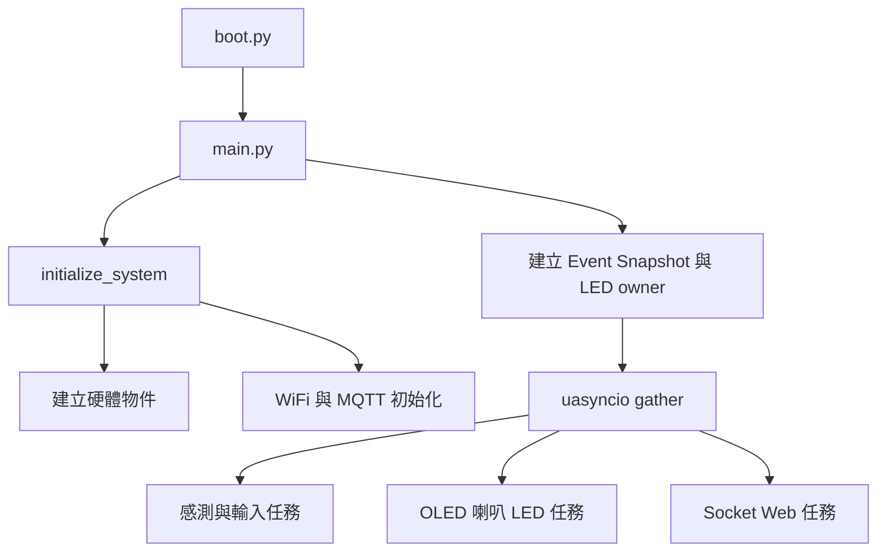
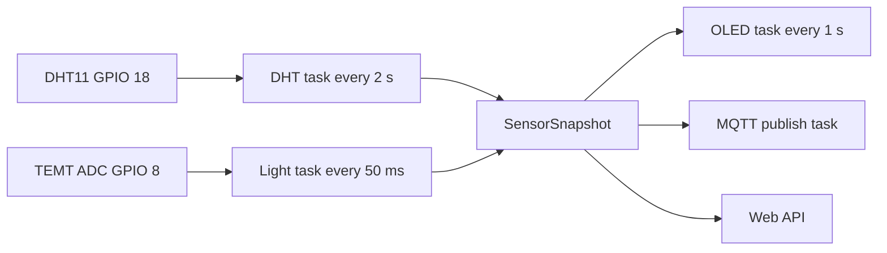
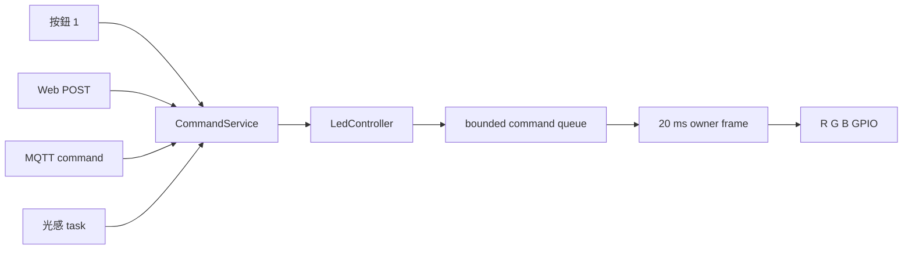
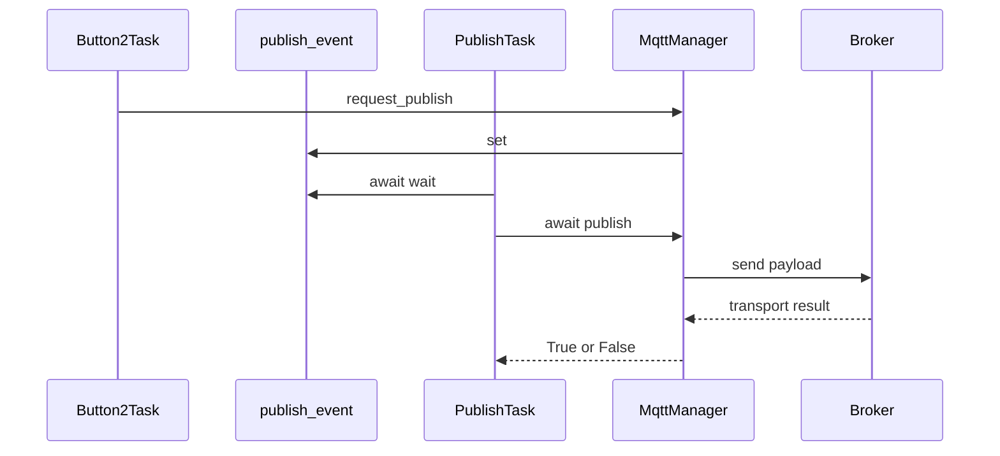
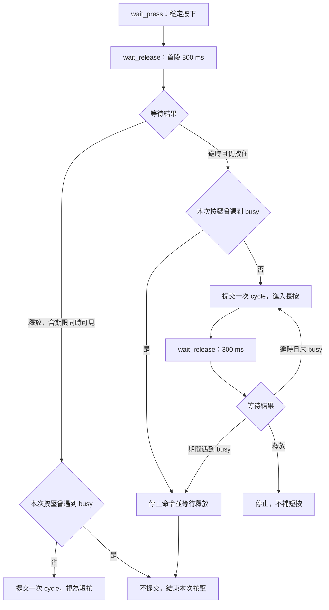

# `uasyncio` 學生操作手冊：ESP32 多感測器實作

**適用專案：**本專案目前的 ESP32／MicroPython 多感測器系統。<br>
**先修：**Python 基礎、GPIO 基礎、函式與類別、基本網路概念。<br>
**文件狀態：**操作步驟依目前專案程式與 `config.py` 整理；桌面測試不等於 ESP32 實機驗證。<br>
**整理時間：**2026-10-27 01:15:22 +08:00。

---

## 0. 使用規則

### 0.1 你要學會的不只是把程式跑起來

每一個實驗都要回答：

1. 這個 task 做什麼？
2. 它在哪裡 `await`？
3. 它與哪些 task 共用資料或硬體？
4. 它使用 Event、snapshot、queue 還是直接回傳值？
5. 如果硬體讀取失敗，狀態如何表示？
6. 如果 task 被取消，硬體如何回到安全狀態？

### 0.2 必須區分的三種結果

- **靜態檢查：**程式碼與文件內容符合預期。
- **桌面 fake 測試：**以替身驗證邏輯，不代表 GPIO 或網路實機。
- **ESP32 實機驗證：**實際開發板、接線、韌體、WiFi 與周邊共同運作。

報告不可把前兩者寫成第三者。

---

## 1. 課前安全與硬體檢查

### 1.1 先確認開發板

專案目前沒有在程式中指定完整 ESP32 開發板型號。開始前請記錄：

- 開發板製造商與型號。
- MicroPython 韌體版本。
- USB 序列埠名稱。
- 供電方式。
- GPIO 37、35、33、8 是否在該板可用。

如果開發板的 GPIO 編號、ADC 通道或周邊功能不同，先停止部署，更新接線或建立該板的公開設定，不要直接猜測。

### 1.2 接線表

| 元件 | 公開範例設定 | 操作前檢查 |
|---|---|---|
| RGB LED | R=37、G=35、B=33 | 確認 LED 電阻、共陽／共陰與輸出邏輯 |
| 按鈕 1 | GPIO 17 | 連接至輸入腳與 GND，使用內部上拉 |
| 按鈕 2 | GPIO 21 | 連接至輸入腳與 GND，使用內部上拉 |
| 按鈕 3 | GPIO 16 | 連接至輸入腳與 GND，使用內部上拉 |
| DHT11 | GPIO 18 | 確認供電、資料線與必要上拉 |
| TEMT 光感 | ADC GPIO 8 | 確認輸出電壓不超過 ADC 允許範圍 |
| PIR | GPIO 4 | 確認輸出高低電位與預熱狀態 |
| 無源喇叭 | PWM GPIO 6 | 確認不要直接超載 GPIO，依課堂電路接法使用 |
| OLED | I2C 0，SCL=39、SDA=40 | 確認電源電壓與共地 |
| RFID MFRC522 | SCK=12、MOSI=11、MISO=10、RST=9、CS=13 | 確認模組電壓與 SPI 接線 |

### 1.3 不要分享機密

- `config.py` 可能含私人 WiFi profiles。
- 不要把 `config.py` 上傳到公開 repository。
- 不要把 WiFi 密碼貼到課堂截圖、Issue、報告或聊天室。
- 公開範例使用 `config.example.py` 的 placeholder。
- 不要以公開範例覆蓋已有私人設定的 `config.py`。

---

## 2. 目前設定與觀察預期

### 2.1 輪詢與事件時間

| 功能 | 目前值 | 你要觀察的行為 |
|---|---:|---|
| 按鈕去彈跳 | 20 ms | 快速抖動不應形成多次有效按下 |
| 按鈕輪詢 | 30 ms | 等待按鈕時其他 task 仍可運作 |
| 光感輪詢 | 50 ms | ADC 快速更新，但不應直接寫 LED |
| DHT11 | 2 s | 慢速量測不應阻塞 OLED、PIR 或 Web |
| OLED | 1 s | 讀取 snapshot，不直接觸發 DHT |
| RFID | 500 ms | 無卡時持續輪詢，成功時保留最近資料 |
| PIR | 100 ms | 高電位穩定 200 ms 才觸發 |
| PIR 重新武裝 | 1500 ms 低電位 | 未完成低電位穩定前不接受下一次事件 |
| LED frame | 20 ms | owner 逐輪處理命令與閃爍狀態 |
| 低光警示 | 5 次，亮／滅各 300 ms | 完整警示後恢復原本狀態 |

### 2.2 光感門檻

公開基線與目前裝置的非機密控制設定：

```python
LIGHT_DARK_WHEN_HIGH = True
LIGHT_ALERT_TRIGGER_ADC = 2000
LIGHT_ALERT_RESET_ADC = 1500
```

控制語意：

- ADC 嚴格高於 2000，且已 armed：提交一次低光警示。
- ADC 在 1501～2000：維持目前 armed 狀態，不觸發新的警示。
- ADC 小於或等於 1500：重新 armed。
- 光感讀取失敗或值未知：不可提交低光控制命令。

不要把 2000／1500 當成所有光感模組的通用校正值；實際操作以裝置 `config.py`、模組方向與現場量測為準。

---

## 3. 檔案與部署邊界

### 3.1 主要執行檔

目前主流程的主要檔案包括：

```text
main.py
boot.py
tasks.py
web_server.py
config.py
hardware/
communication/
services/
lib/
index.html
assets/uplot/1.6.32/
```

`lib/` 內只部署目前主流程需要的實作，例如 `mqtt_as.py`、`mfrc522_async.py`、SSD1306 與字型等；Web Server 已由 `web_server.py` 的原生 Socket 實作提供，不需載入 Microdot。實際清單應依目前 import 與課堂部署版本確認。

### 3.2 不要部署的來源快照或封存檔

```text
mdy_01/
mdy_02/
lib_backup/
tests/
```

這些檔案可供比較、測試或回復，不是 ESP32 的最小部署內容。

### 3.3 啟動路徑



### 3.4 公開設定檢查

部署前檢查：

- 實機 `config.py` 是否存在。
- `config.py` 的 WiFi profiles 是否為自己的設定。
- 公開範例是否仍是 placeholder。
- 沒有把私人設定複製進教材或 Git。
- 開發板 GPIO 與設定表一致。

---

## 4. 實驗一：兩個協程交錯執行

### 4.1 目標

學會：

- `async def`
- `await`
- `uasyncio.sleep_ms()`
- `uasyncio.gather()`
- cooperative scheduling

### 4.2 操作程式

請先在暫存檔或 REPL 中執行，不要直接覆蓋主程式：

```python
import uasyncio

async def fast_task():
    for index in range(5):
        print('fast', index)
        await uasyncio.sleep_ms(200)

async def slow_task():
    for index in range(3):
        print('slow', index)
        await uasyncio.sleep_ms(500)

async def main():
    await uasyncio.gather(fast_task(), slow_task())
    print('all done')

uasyncio.run(main())
```

### 4.3 預期觀察

輸出不會是全部 `fast` 完成後才全部 `slow`；兩者會在等待期間交錯。

請記錄：

| 問題 | 你的觀察 |
|---|---|
| 哪一行讓 `fast_task()` 讓出控制權？ | |
| `slow_task()` 是否阻塞 200 ms 的任務？ | |
| `gather()` 何時返回？ | |

### 4.4 阻塞對照

將其中一個 `await uasyncio.sleep_ms(500)` 暫時改為：

```python
import time
time.sleep(0.5)
```

重新觀察輸出順序，說明另一個 task 為何停住。完成比較後還原為非同步等待。

### 4.5 驗收

- 能指出每一個 `await`。
- 能說明 `time.sleep()` 會阻塞整個事件迴圈。
- 能說明 `gather()` 是等待多個 coroutine 的組合，不是建立多個 CPU 執行緒。

---

## 5. 實驗二：三個按鈕與非同步去彈跳

### 5.1 目標

學會：

- `Pin.IN` 與 `Pin.PULL_UP`
- 低電位按下
- `wait_press()` 與 `wait_release()`
- `sleep_ms()`
- 去彈跳不應阻塞其他 task

### 5.2 目前程式路徑

```text
main.py
    → Button(config.BUTTON1_PIN)
    → tasks.button1_task()
    → await button1.wait_press()
    → await button1.wait_release(timeout_ms=800)
        ├─ 800 ms 內放開：CommandService.submit('cycle', 'button1') 一次
        └─ 仍按住：立即提交一次，之後每 300 ms 仍按住再提交
    → 放開或 task 取消：停止本次手勢，不補送命令
```

按鈕 2 的路徑是：

```text
main.py
    → Button(config.BUTTON2_PIN)
    → tasks.button2_task()
    → await button2.wait_press()
    → mqtt_manager.request_publish(publish_event)
    → await button2.wait_release()
```

按鈕 3 的路徑是：

```text
main.py
    → Button(config.BUTTON3_PIN)
    → tasks.button3_task()
    → await button3.wait_press()
    → CommandService.submit('green_flash_alert', 'button3')
    → await button3.wait_release()
```

### 5.3 操作步驟

1. 依實機 `config.py` 確認按鈕 1、2、3 的 GPIO；公開範例分別是 17、21、16。
2. 部署主流程與正確 `config.py`。
3. 開機後觀察序列埠。
4. 短按並放開按鈕 1，確認只產生一筆 LED `cycle` receipt。
5. 按住按鈕 1 超過800 ms，確認先換下一色，之後每300 ms持續依序換色，放開後不再新增命令。
6. 按一下按鈕 2，記錄 MQTT 發佈請求狀態。
7. 按一下按鈕 3，記錄綠閃命令 receipt；效果期間的新 LED 命令應依 busy 政策處理。
8. 同時觀察 PIR、OLED 或 Web 狀態是否仍更新。

### 5.4 觀察問題

- 按鈕按下時 GPIO 是高還是低？
- `debounce_read()` 為何要多次取樣？
- `wait_release()` 為何也是非同步函式？
- 按鈕 task 是否直接呼叫 `RgbLed.write()`？如果沒有，誰負責？
- 按住按鈕時，DHT、PIR 或 Web 是否仍有機會執行？

### 5.5 常見錯誤

| 現象 | 可能原因 |
|---|---|
| 一按就產生很多命令 | 沒有等待釋放、接線浮動或去彈跳太短 |
| 一直判定按下 | 上拉接線、按鈕方向或 GPIO 設定錯誤 |
| 其他功能停止 | 在按鈕迴圈使用同步長時間等待 |
| LED 命令被拒絕 | LED 正在低光警示、queue 滿或 controller stopped |

---

## 6. 實驗三：DHT11、光感與 OLED 的不同週期

### 6.1 目標

學會：

- 不同感測器使用不同輪詢週期。
- producer 更新 `SensorSnapshot`。
- OLED 與 Web 只讀 snapshot。
- 讀取失敗時保留 last-good value 並標記錯誤。

### 6.2 目前資料流



### 6.3 操作步驟

1. 啟動裝置並開啟 OLED。
2. 觀察 OLED 的溫度、濕度與時間。
3. 用手或光源改變光感輸入，觀察 ADC 值。
4. 開啟 Web `/api/data`，確認回應中有：
   - `temperature`
   - `humidity`
   - `light`
   - `sensor`
   - `light_thresholds`
5. 比較 OLED、Web 與序列埠的更新時間。
6. 暫時移除或干擾 DHT11 資料線，在安全條件下觀察 error 與 last-good value。

### 6.4 `SensorSnapshot` 欄位練習

請從 `/api/data` 或序列埠記錄一筆：

| 欄位 | 記錄值 |
|---|---|
| `value` | |
| `valid` | |
| `quality` | |
| `age_ms` | |
| `error` | |
| `updated_at_ms` | |

回答：

1. 為什麼讀取失敗時不能只把溫度改成 `-1`？
2. `age_ms` 對 Web 顯示有什麼用途？
3. OLED task 為什麼不應直接呼叫 `dht_sensor.measure()`？
4. 感測成功是否代表 LED 低光警示一定會觸發？還需要哪些條件？

### 6.5 驗收

- DHT 約每 2 秒更新，而不是每個 Web request 都重新讀取。
- 光感約每 50 ms 取樣。
- OLED 更新不會直接觸發新的 DHT 量測。
- 暫時失敗時可以看到錯誤狀態，不會把錯誤值冒充正常值。

---

## 7. 實驗四：PIR Event 與無源喇叭

### 7.1 目標

學會：

- `uasyncio.Event()`
- `set()`、`wait()`、`clear()`
- PIR 穩定高電位觸發
- 低電位重新武裝
- `finally` 確保喇叭靜音

### 7.2 目前流程

```text
PIR GPIO 4
    → pir_monitor_task()
    → high stable >= 200 ms
    → motion_event.set()
    → music_on_motion_task().wait()
    → Speaker.play_song()
    → await sleep(duration)
    → finally silence()
```

### 7.3 操作步驟

1. 確認 PIR 接到 GPIO 4。
2. 確認喇叭接到 GPIO 6，並使用課堂指定保護電路。
3. 啟動裝置後先等待 PIR 模組穩定。
4. 讓手在感測範圍內移動。
5. 觀察序列埠是否出現一次移動事件。
6. 觀察喇叭是否播放 `C4、E4、D4、G3、REST`。
7. 在播放期間再次移動，記錄事件是否合併。
8. 移動停止後保持低電位，等待至少 1500 ms，再測試下一次事件。

### 7.4 觀察表

| 測試 | 預期結果 | 實際結果 |
|---|---|---|
| 高電位短於 200 ms | 不應觸發完整事件 | |
| 高電位持續超過 200 ms | 觸發一次 | |
| 高電位維持不變 | 不應每 100 ms 重複計數 | |
| 低電位少於 1500 ms 後再次高 | 通常仍未重新武裝 | |
| 低電位至少 1500 ms 後再次高 | 可觸發下一次 | |
| 播放中取消 task | 喇叭應靜音 | |

### 7.5 重要區分

- `pir_high`：目前輸入高低。
- `detected`：網頁顯示保持狀態。
- `count`：已確認的事件數。
- `armed`：是否允許下一次事件。
- `motion_event`：task 間通知旗標。

`MOTION_DETECTED_HOLD_MS=5000` 不是 5 秒冷卻時間；它是狀態顯示保持時間。

---

## 8. 實驗五：RGB LED 單一 owner 與命令 receipt

### 8.1 目標

學會：

- 多個來源不直接寫同一個 GPIO。
- `CommandService` 是命令入口。
- `LedController.run()` 是唯一 LED owner。
- `accepted` 不等於 `executed`。
- bounded queue 與 busy 狀態。

### 8.2 LED 命令資料流



### 8.3 操作步驟

1. 啟動裝置。
2. 由按鈕 1 提交數次 `cycle`。
3. 由 Web POST `/api/led/toggle` 提交一次換色。
4. 在光線低於目前 trigger threshold 時觀察低光警示。
5. 警示期間嘗試按按鈕 1；這次按壓應只消耗到放開，不產生 receipt。
6. 警示結束後重新短按並放開，記錄新命令的 receipt：
   - `status`
   - `reason`
   - `request_id`
7. 警示完成後觀察 LED 是否恢復警示前的 desired color。
8. 觀察 `/api/data` 或 LED status 中的：
   - `alert_active`
   - `queue_depth`
   - `desired_color`
   - `applied_output`
   - `last_command`

### 8.4 目前命令政策

- 一般命令最多保留 8 筆。
- 每個 20 ms frame 最多處理 4 筆。
- 結果歷史最多保存 16 筆。
- 低光警示接受時立即保留 LED。
- 警示期間一般命令可能被拒絕為 `busy` 或 `alert_started`。
- `MANUAL` 模式下低光警示會被拒絕為 `manual_mode`。

### 8.5 禁止的修改

以下寫法違反目前 owner 設計：

```python
# 不要在按鈕 task 中直接做
rgb_led.write(4)

# 不要在光感 task 中直接做
rgb_led.write(4)
```

正確方向：

```python
receipt = command_service.submit('set_color', 'student', 4)
print(receipt)
```

### 8.6 驗收

- 按鈕、Web、MQTT、光感都經過共同命令入口。
- 實際 RGB GPIO 只有 owner 寫入。
- `accepted` 與 `executed` 可被區分。
- 警示完成後能恢復警示前狀態。
- busy 或 queue full 時有明確 reason，而不是靜默遺失。

---

## 9. 實驗六：MQTT 非同步發佈與訂閱

### 9.1 目標

學會：

- `await connect()`。
- `wait_connected()` 與 timeout。
- `await publish()`。
- `await subscribe()`。
- 同步 callback 與非同步 task 的橋接。
- accepted、publishing、published、failed 的差異。

### 9.2 公開 MQTT 設定

公開範例目前使用：

```text
Broker: broker.emqx.io
Port: 1883
Command topic: nuu/csie/iot1133/cmd01
Temperature topic: nuu/csie/iot1133/TempHumi
Subscribe topic: nuu/csie/iot1133/#
```

實際操作仍以正在部署的 `config.py` 與教師指定 Broker 為準。

### 9.3 按鈕 2 發佈流程



### 9.4 操作步驟

1. 確認 WiFi 設定為自己的網路，不要公開密碼。
2. 確認裝置可取得 IP。
3. 觀察 MQTT 初始化與連線訊息。
4. 按下按鈕 2。
5. 查詢 `/api/publish/status`。
6. 記錄狀態依序是否出現：
   - `accepted`
   - `publishing`
   - `published` 或 `failed`
7. 如果連線不存在，記錄是否為 `unavailable` 或 `failed`。

### 9.5 MQTT LED 指令

目前可測試的 payload 格式：

```text
led:4
```

或：

```text
led=4
```

裝置收到後會：

```text
同步 MQTT callback
    → handle_cmd()
    → 解析顏色索引
    → CommandService.submit('set_color', 'mqtt', value)
    → LedController
```

callback 不應直接寫 LED。

### 9.6 逾時實驗

在沒有可用 Broker 或暫時關閉網路的環境下測試：

- `wait_connected()` 是否在 timeout 後返回 False。
- 程式是否把逾時誤報成 published。
- 其他硬體任務是否仍能運作。
- Web 狀態是否顯示 unavailable 或 failed。

不要把公開 Broker 的瞬間成功或失敗當成永久網路特性；報告需記錄測試時間與網路條件。

---

## 10. 實驗七：RFID 非同步 SPI

### 10.1 目標

學會：

- SPI 周邊初始化。
- `await request()`。
- `await anticoll()`。
- 無卡、成功與例外的差異。
- 最近 5 筆 RAM 紀錄。

### 10.2 操作步驟

1. 確認 MFRC522 五條 SPI／控制線接線正確。
2. 開機觀察 RFID 初始化結果。
3. 不放卡，觀察讀卡 task 是否持續運行。
4. 放入一張卡，記錄 UID 與時間。
5. 連續讀取 6 次不同或相同卡片。
6. 查詢 Web `/api/data` 中的 `rfid.recent_reads`。
7. 確認最多只保留最近 5 筆。
8. 重新開機，確認 RAM 紀錄清空。

### 10.3 觀察問題

- 無卡是否被當成程式致命錯誤？
- `read_uid()` 為什麼是 `async def`？
- 驅動在哪裡使用 `await sleep_ms(1)`？
- 讀卡錯誤與「沒有卡」是否完全相同？目前程式有什麼限制？
- 紀錄重啟後為何消失？

---

## 11. 實驗八：Timeout、錯誤注入與安全清理

### 11.1 目標

學會：

- `uasyncio.wait_for()`。
- `TimeoutError`。
- task 例外隔離。
- `finally`。
- 硬體安全狀態。

### 11.2 測試案例

| 測試 | 操作 | 應觀察 |
|---|---|---|
| DHT 失敗 | 暫時中斷資料線 | last-good 與 error 狀態分開 |
| RFID 未接 | 不接或關閉模組 | 主流程依政策降級或標示錯誤 |
| OLED 失敗 | 暫時移除模組 | 其他任務仍可執行，畫面 task 記錄錯誤 |
| MQTT 斷線 | 關閉網路或指定不可用環境 | timeout／failed，不假裝 published |
| 喇叭取消 | 播放中停止 task | `finally` 後 PWM 靜音 |
| LED 停止 | 要求 controller stop | LED 寫成 0，`wait_stopped()` 返回 |

### 11.3 報告格式

對每個案例記錄：

```text
測試名稱：
硬體／網路條件：
觸發方式：
序列埠輸出：
Web 狀態：
其他任務是否繼續：
安全狀態：
是否需要重啟：
未驗證項目：
```

### 11.4 不可接受的結果

- 逾時被顯示為成功。
- 喇叭停止後仍持續發聲。
- LED 停止後仍保持不安全輸出。
- 一個感測器錯誤使所有非相關功能無限重啟。
- 錯誤被空白 catch 完全吞掉，沒有狀態或日誌。

---

## 12. 實驗九：任務取消與資源釋放

### 12.1 目標

學會：

- task 的停止條件。
- `finally` 的責任。
- stop request 與 stopped confirmation。
- 為什麼 cleanup 必須在例外與取消路徑都執行。

### 12.2 觀察目前設計

LED owner：

```text
request_stop()
    → _stopping = True
    → 清除待處理命令
    → run() 離開迴圈
    → finally 寫 LED 0
    → _stopped.set()
    → wait_stopped() 返回
```

Speaker：

```text
play_song()
    → await 音符時間
    → 正常結束或取消
    → finally silence()
```

### 12.3 學生練習

請新增一個簡單的可停止示範 task，不要先修改正式主流程：

```python
import uasyncio

async def worker(stop_event):
    try:
        while not stop_event.is_set():
            print('working')
            await uasyncio.sleep_ms(200)
    finally:
        print('cleanup')
```

回答：

1. 如果沒有 `finally`，硬體清理可能漏在哪些路徑？
2. `stop_event.set()` 後 task 是否一定立刻停止？
3. 為什麼需要等待 stopped confirmation？

---

## 13. 實驗十：Web 狀態與非同步控制

### 13.1 目標

學會：

- 原生 Socket async route。
- Web API 讀 snapshot。
- Web 命令提交與硬體完成分離。
- `no-store` 狀態查詢。
- 快速控制狀態與慢速感測展示分流。

### 13.2 重要路由

| 路由 | 用途 | 非同步／狀態重點 |
|---|---|---|
| `/api/data` | 感測、RFID、PIR、LED 綜合資料 | 讀 RAM snapshot，不重新量測硬體 |
| `/api/motion/status` | PIR／喇叭狀態 | 不等待 DHT、ADC、SPI；`no-store` |
| `/api/led/toggle` | 提交 cycle 命令 | 受理不等於完成 |
| `/api/led/commands` | 提交標準 LED 命令 | 後端檢查 busy、mode、queue |
| `/api/publish/status` | 查 MQTT 最近結果 | `accepted`／`published`／`failed` 分開 |
| `/api/status` | 基本服務狀態 | 不是完整硬體健康證明 |

### 13.3 操作步驟

1. 從序列埠取得 ESP32 IP。
2. 以瀏覽器開啟 `http://裝置IP/`。
3. 開啟瀏覽器開發者工具的 Network 面板。
4. 觀察 `/api/data` 與 `/api/motion/status` 的請求頻率。
5. 移動手臂，確認 motion 狀態不必等待完整感測 API。
6. 點擊 LED 按鈕，觀察 HTTP 狀態碼與 JSON receipt。
7. 對照 LED 實際輸出與 API 的 `accepted`／`executed`。

### 13.4 分析問題

- 如果 DHT 量測變慢，為什麼 `/api/motion/status` 仍應保持輕量？
- 為什麼前端顯示「已受理」不能寫成「LED 已完成」？
- `/api/data` 內的 `light_thresholds` 是從哪裡來？
- 重整瀏覽器後，最近 RFID 與 PIR 記錄是否仍存在？為什麼？

---

## 14. 桌面測試與實機報告

### 14.1 專案桌面測試

教師或助教可在桌面環境執行：

```powershell
python -B -m unittest discover -s tests -v
```

若系統沒有 `python`，使用課堂已確認可用的 Python 執行檔。這些測試可能使用 fake GPIO、fake MQTT 或 TestClient；測試通過只能證明替身路徑，不代表 ESP32 實機通過。

### 14.2 學生實機報告最少內容

```text
開發板型號：
MicroPython 韌體版本：
程式版本／Git commit：
config.py 非機密設定摘要：
接線照片或接線表：
執行時間：
測試項目：
觀察結果：
失敗與重現方式：
尚未驗證項目：
```

不要把 WiFi SSID／密碼、token 或私有裝置資訊放入報告。

---

## 15. 綜合實作題

選擇一題，先提交設計，再修改程式：

### 題目 A：長按按鈕

要求：

- 不破壞現有短按流程。
- 說明長按判定需要的狀態與時間。
- 不在硬體 driver 內寫 LED 業務政策。
- 由 `CommandService` 提交命令。
- 實作取消與按鈕釋放邊界。

目前專案的參考實作採用以下規則：

- 狀態為 `press_rejected`（本次按壓曾遇到 busy）與 `long_press_active`（是否已跨過長按門檻）。
- 從穩定按下後計時 800 ms；期限前放開只切換下一色一次。
- 達 800 ms 仍按住時切換下一色，之後每 300 ms 依 0→1→…→7→0 順序繼續切換，放開立即停止且不再執行短按。
- `hardware.button.Button` 只提供「釋放或逾時」輸入結果；`tasks.button1_task` 決定短按／長按政策，並一律呼叫 `CommandService.submit('cycle', 'button1')`。
- 沒有另外建立 timer task；取消 `button1_task` 時 `CancelledError` 向外傳播，因此不會留下延後命令。釋放與 800 ms 期限同時被觀察時，以釋放為準。取消或放開只停止後續提交，已由`CommandService`受理的命令不會被隱含撤回。

### 題目 B：OLED 狀態頁輪播

要求：

- 只讀 `SensorSnapshot` 與 RAM 狀態。
- 不直接觸發 DHT、ADC、RFID。
- 每一頁使用非同步等待。
- 顯示資料過期或錯誤時要明確表示。

### 題目 C：MQTT 週期發佈

要求：

- 使用獨立 task。
- 連線狀態未知時不可宣稱已發佈。
- 不能建立無限堆積的 task。
- 明確處理 timeout 與失敗。
- 說明與按鈕 2 的 Event 語意有何不同。

### 題目 D：PIR 事件 Queue

要求：

- 說明為什麼 Event 會合併事件。
- 設計有限容量與滿載策略。
- 說明每筆事件的 timestamp 與順序。
- 不能讓 queue 無限制增加。

### 題目 E：LED 命令結果查詢

要求：

- 使用 request ID。
- 分開 accepted、executing、executed、rejected、failed。
- 不讓前端快照取代後端 busy／mode 檢查。
- 提供可觀察的錯誤 reason。

---

## 16. 綜合題提交格式

```text
題目：
問題定義：
硬體與設定：
新增或修改的 task：
使用的 await 邊界：
Event／Snapshot／Queue 選擇理由：
共享資源與 owner：
錯誤與 timeout 政策：
取消與 cleanup 政策：
桌面測試結果：
ESP32 實機結果：
未驗證項目：
回復方式：
```

另附：

- 任務流程圖。
- 修改前後差異。
- 至少一個正常案例。
- 至少一個失敗案例。
- 至少一個邊界時間案例。

### 16.1 題目 A：長按按鈕提交

- **題目：**A，長按按鈕。
- **問題定義：**保留按鈕 1 的短按換下一色，並加入按住連續換色。穩定按下後，800 ms 內放開時只在放開後提交一次 `cycle`；持續按住達 800 ms 時立即提交第一次長按命令，之後每 300 ms 再提交一次，放開後停止且不補送短按命令。
- **硬體與設定：**公開範例的按鈕 1 是 GPIO 17、內部上拉、低電位按下；去彈跳 20 ms、輪詢 30 ms、長按門檻 800 ms、重複週期 300 ms。實際部署仍以未公開的 `config.py` 與實機接線為準。
- **新增或修改的 task：**修改既有 `tasks.button1_task()`，沒有新增常駐 task。`hardware.button.Button.wait_release()` 增加可選的 `timeout_ms` 與 `reject_if`，但只回報輸入端的釋放／逾時與 busy 拒絕狀態，不決定 LED 顏色或手勢政策。
- **使用的 await 邊界：**`wait_press()` 等待穩定按下；`wait_release(timeout_ms=800)` 區分短按與長按；進入長按後以 `wait_release(timeout_ms=300)` 等待釋放或下一個重複點；每輪手勢完成後 `sleep_ms(100)`；非取消例外後 `sleep(1)`，避免錯誤迴圈忙轉。driver 內的輪詢也使用 `sleep_ms()` 讓出事件迴圈。
- **Event／Snapshot／Queue 選擇理由：**手勢判定只需要目前按壓狀態與時間，不需要 Event 或 Snapshot。每一次換色都必須保留為獨立命令，因此經 `CommandService` 送入 `LedController` 的有限 Queue；若改用 Event，連續多次 `set()` 可能合併，無法代表每一次換色。
- **共享資源與 owner：**`button1_task()` 只是 producer，只能呼叫 `command_service.submit('cycle', 'button1')`。`LedController` 是 RGB LED 唯一 owner，負責命令驗證、排序、狀態轉換與 GPIO 寫入；按鈕 task 和 `Button` driver 都不直接寫 LED GPIO。
- **錯誤與 timeout 政策：**`wait_release()` 回傳 `True` 表示已釋放，回傳 `False` 表示期限到時仍按住；這個 timeout 是手勢結果，不是執行錯誤。只要同一次按壓期間曾觀察到 `command_service.busy`，`press_rejected` 就保持為真，停止長按重複並等到放開，不在 busy 結束後補送。`CommandService` 回傳的 `rejected` receipt 只記錄，不重試；其他例外會記錄後延遲一秒再進入下一輪。
- **取消與 cleanup 政策：**`button1_task()` 明確重新拋出 `CancelledError`，不把取消當成一般錯誤重啟。`wait_release()` 不建立背景 timer；取消後不會再產生延後命令。若取消時腳位已釋放，driver 的 `finally` 會清除 `is_pressed`。已被 `CommandService` 受理的命令不因按鈕放開或 task 取消而隱含撤回，仍由 owner 完成或依 owner 停止流程處理。
- **桌面測試結果：**Fake GPIO 邊界測試已驗證「第 800 ms 同時看到釋放時，釋放優先」、「持續按住 800 ms 回傳逾時且保留按下狀態」及「等待被取消且腳位已釋放時清除狀態」。task 測試已驗證短按只提交一次、長按依 800／300／300 ms 等待並在放開後不補短按、取消後停止未來重複，以及按住期間遇到 busy 後停止提交。桌面 smoke 另觀察到短按輸出 `[0]`、兩個長按節拍輸出 `[0, 1]`，在第一筆命令前取消時提交 0 筆。
- **ESP32 實機結果：**尚未在 ESP32 實體按鈕上驗證本題的 800／300 ms 手感、去彈跳與 RGB GPIO 輸出；不可把桌面 fake 測試寫成實機通過。
- **未驗證項目：**實際按鍵彈跳、長時間按住、在實機 busy 效果中途按住、取消時的真實腳位狀態，以及不同負載下重複週期的排程誤差。
- **回復方式：**以 `mdy_07/hardware/button.py`、`mdy_07/tasks.py`、`mdy_07/config.example.py` 與 `mdy_07/tests/test_led_owner.py` 還原修改前版本，移除新增的 `tests/test_button.py`；私人 `config.py` 只移除本題新增的兩個非機密時間欄位，不得用公開範例覆蓋 WiFi profiles。`mdy_07/` 是來源快照，不可部署到 ESP32。

#### 任務流程圖



任何等待點收到取消時，都直接離開本流程並重新拋出 `CancelledError`。

#### 修改前後差異

| 項目 | 修改前 | 修改後 |
|---|---|---|
| 短按命令時點 | 穩定按下後立即提交 | 800 ms 內放開後提交 |
| 每次按壓的命令數 | 固定一筆 | 短按一筆；長按從 800 ms 起每 300 ms 一筆 |
| 釋放等待 | 無期限，只等待釋放 | 可回報釋放或指定期限到達 |
| LED 業務政策 | `button1_task()` 提交一筆命令 | 仍由 `button1_task()` 判定手勢並提交，driver 不知道 LED 政策 |
| 取消 | 落入一般例外處理的風險不明確 | 明確重新拋出 `CancelledError`，沒有背景 timer |
| 設定 | 沒有長按時間設定 | 公開設定新增 800 ms 門檻與 300 ms 重複週期 |

#### 案例證據

| 類型 | 操作／條件 | 應有且已由桌面測試證明的結果 |
|---|---|---|
| 正常案例：短按 | 穩定按下後未滿 800 ms 即放開 | 放開後只提交一筆 `cycle` |
| 正常案例：長按 | 800 ms 與下一個 300 ms 期限皆仍按住，之後放開 | 依序提交兩筆 `cycle`，放開時不再補一筆短按 |
| 失敗案例：busy | 長按已提交一筆後，同一次按壓期間 owner 轉為 busy | 保留已受理命令，停止後續重複，等到放開才開始下一輪 |
| 邊界時間案例 | 第 800 ms 恰好可觀察到釋放 | 釋放優先，視為短按，只提交一筆 |
| 取消案例 | 已進入等待但 task 被取消 | `CancelledError` 向外傳播，不產生取消後的新命令 |


---

## 17. 故障排除索引

### `ImportError: no module named uasyncio`

- 確認程式是在 MicroPython 韌體上執行，不是普通桌面 Python。
- 確認韌體版本提供 `uasyncio`。
- 不要直接把桌面 `asyncio` 套件複製到 ESP32 取代韌體模組。

### `NameError` 或設定欄位不存在

- 確認使用的是正確 `config.py`。
- 不要用公開範例覆蓋私人設定。
- 檢查本次程式與設定是否來自同一版本。

### 按鈕沒有反應

- 依實機 `config.py` 確認三個按鈕 GPIO；公開範例為 17／21／16。
- 確認共地與內部上拉接線。
- 確認按下是低電位。
- 確認 task 已啟動。
- 確認是否仍在等待釋放或被去彈跳拒絕。

### LED 一直紅閃或無法換色

- 讀取 LED status 的 `alert_active`、`busy`、`queue_depth`。
- 確認光感方向設定；目前高值越暗模式要檢查 ADC 是否嚴格高於 2000。
- 確認 ADC 是否降至 1500（含）以下重新 armed。
- 確認目前是否為 AUTO 模式。
- 不要由其他 task 直接寫 GPIO。

### PIR 重複或不觸發

- 觀察高電位是否穩定 200 ms。
- 觀察低電位是否穩定 1500 ms。
- PIR 模組可能需要預熱。
- `detected` 顯示保持不等於已重新 armed。
- 記錄實機波形或輸出，不要只修改數字猜測。

### MQTT 顯示已受理但沒有訊息

- `accepted` 不等於 `published`。
- 查 `/api/publish/status`。
- 確認 `wait_connected()` 成功。
- 檢查 Broker、topic、WiFi 與 timeout。
- 不要把 callback 收到當成 Broker 已確認。

### OLED 顯示空白

- 確認 I2C 0、SCL 39、SDA 40。
- 確認供電與共地。
- 確認 `ssd1306.py` 在裝置上。
- 觀察初始化與更新錯誤。
- 其他 task 是否仍在運作。

### RFID 讀不到卡

- 確認 SPI 五條控制線。
- 確認模組電壓。
- 確認 `mfrc522_async.py` 在 `lib/` 且 import 路徑正確。
- 區分「無卡」與「初始化／通訊錯誤」。
- 記錄 `rfid_state.status` 與 `error`。

---

## 18. 最終驗收清單

### 非同步概念

- [ ] 能解釋 coroutine、task、event loop。
- [ ] 能指出所有永久迴圈的 `await`。
- [ ] 能說明 `time.sleep()` 為何會阻塞。
- [ ] 能區分 Event、Snapshot 與 Queue。
- [ ] 能說明 timeout、accepted 與 executed 的差異。

### 硬體功能

- [ ] 按鈕 1 可提交 LED 命令。
- [ ] 按鈕 2 可提交 MQTT 發佈請求。
- [ ] DHT11 可更新溫濕度 snapshot。
- [ ] 光感可更新 ADC snapshot。
- [ ] PIR 可在穩定高電位後觸發一次。
- [ ] 喇叭播放完成或取消後會靜音。
- [ ] OLED 可讀 snapshot 顯示。
- [ ] RFID 可讀取並保留最近 5 筆 RAM 紀錄。
- [ ] Web API 可查詢狀態。

### 架構與安全

- [ ] LED 只有單一 owner 寫 GPIO。
- [ ] 感測失敗不把錯誤值冒充正常值。
- [ ] MQTT 失敗不被宣稱為成功。
- [ ] task 停止時硬體進入安全狀態。
- [ ] 報告不包含私人 WiFi、token 或密碼。
- [ ] 報告明確區分桌面測試與 ESP32 實機結果。

---

## 19. 課後反思

請用自己的話回答：

1. 為什麼單一事件迴圈仍然可以同時處理按鈕、感測器與網路？
2. 為什麼非同步不等於平行執行？
3. 哪一種工作最不適合直接放在 callback 中？
4. 在這個專案中，為什麼 LED 使用 single owner 比所有 task 共用一把 Lock 更容易維護？
5. 什麼時候 Event 不夠用？
6. 為什麼 snapshot 要同時保存 value、valid、quality、age 與 error？
7. `MOTION_DETECTED_HOLD_MS` 與 `PIR_LOW_REARM_MS` 的責任有何不同？
8. 如果 Web 回傳 HTTP 202，哪些事情仍可能尚未發生？
9. 如何證明一個修改真的在 ESP32 上安全，而不是只在桌面測試通過？
10. 如果要把新功能加入本專案，哪一個 task 或 owner 應該負責它？為什麼？

### 19.1 反思回答

1. **為什麼單一事件迴圈仍可處理多種工作？**
   每個 coroutine 在等待 GPIO 輪詢間隔、感測週期、Socket 或 MQTT I/O 時都會執行 `await`，把控制權交回事件迴圈。事件迴圈因此可以在一個工作等待期間執行其他已就緒工作；前提是每個永久迴圈都有可到達的 `await`，而且兩個 `await` 之間不能長時間阻塞。

2. **為什麼非同步不等於平行執行？**
   目前 Python coroutine 是合作式交錯執行，同一時刻仍只有目前被事件迴圈選中的 Python 程式片段在執行。網路或硬體可能在背景等待資料，但這不代表兩段 Python 業務邏輯同時跑；若一段程式不讓出控制權，其他 coroutine 一樣會停住。

3. **哪一種工作最不適合直接放在 callback 中？**
   會長時間執行或需要等待的工作最不適合，例如阻塞式網路 I/O、感測器重試、播放整段旋律、大量計算或用 `time.sleep()` 延遲。callback 應只做必要的資料驗證、更新極小狀態，或通知專責 task；真正工作交給可 timeout、可取消的 coroutine。

4. **為什麼 LED single owner 比所有 task 共用一把 Lock 更容易維護？**
   Lock 只能避免同一瞬間同時寫 GPIO，不能統一命令順序、AUTO／MANUAL 政策、busy 拒絕、效果恢復、receipt 狀態與停止時熄燈。single owner 讓所有 producer 只提交命令，把上述規則集中在 `LedController`，因此新增來源時不必在每個 task 複製同一套 LED 狀態機。

5. **什麼時候 Event 不夠用？**
   當每一次事件都必須保留、需要 payload、順序、計數或背壓時，Event 不夠用。Event 只表示「目前已被設定」；在 consumer 清除前多次 `set()` 可能合併。這類需求應使用有限容量 Queue，並明確定義滿載時拒絕、丟棄或覆蓋哪一筆。

6. **為什麼 snapshot 要保存多個中繼欄位？**
   `value` 保存最後可用值；`valid` 表示目前樣本是否可信；`quality` 提供可直接顯示或判斷的品質狀態；`age_ms` 說明最後有效更新距今多久；`error` 保留本次失敗原因。只有數值時，consumer 無法分辨新資料、過期的 last-good 資料、從未取得資料與感測失敗，也可能把舊值誤報為即時正常值。

7. **`MOTION_DETECTED_HOLD_MS` 與 `PIR_LOW_REARM_MS` 有何不同？**
   `MOTION_DETECTED_HOLD_MS` 目前是 5000 ms，只控制 Web／RAM 的 `detected` 提示要在最近一次偵測後保留多久。`PIR_LOW_REARM_MS` 目前是 1500 ms，控制 PIR 必須維持低電位多久才重新 armed、允許下一次事件。前者是顯示時效，後者是事件去重與重新觸發政策，不能互相取代。

8. **HTTP 202 回傳後仍可能尚未發生什麼？**
   202 只證明命令通過同步受理，不證明 owner 已開始處理、GPIO 已改變、效果已完成或 MQTT 已發佈。命令可能仍在 Queue，之後也可能因停止或硬體錯誤成為 `cancelled`／`failed`；client 必須用 request ID 查結果，而不能把 `accepted` 顯示成 `executed`。

9. **如何證明修改在 ESP32 上安全？**
   先通過桌面邏輯測試，再把同版本程式與非機密設定部署到目標 ESP32，核對實際接線與啟動紀錄，操作正常、失敗、timeout、取消及邊界案例，並同時觀察序列輸出、API 狀態和真實 GPIO／周邊結果。停止與重啟後還要確認 task 能清理資源、輸出回到安全狀態，且其他按鈕、感測、Web、MQTT 工作仍可回應。沒有實機證據時，只能標示桌面通過。

10. **新功能應由哪一個 task 或 owner 負責？**
    先依資源與政策分工，而不是把邏輯放進最方便呼叫的 driver。以題目 A 為例，按壓時間與短按／長按政策屬於 `button1_task()`，`Button` 只提供輸入狀態，RGB GPIO 仍只由 `LedController` 寫入。其他功能也採同一原則：感測 task 更新 Snapshot、MQTT manager 管連線與發佈、喇叭 owner 管播放；跨資源需求用命令或事件交接，不讓 producer 直接控制別人的硬體。

---

## 附錄 A：實驗一至十參考回答與實測結果

本附錄依目前程式、`uasyncio_experiments/` 與 2026-11-05 的 ESP32-S3 執行紀錄作答。以下將「由程式可判定的設計答案」和「當次實機確實觀察到的結果」分開；沒有操作按鈕、PIR 或 RFID 卡的項目保留為未驗證，不以預期行為代替實測。

### A.1 實驗一：兩個協程交錯執行

**題目回答：**

| 問題 | 回答 |
|---|---|
| 哪一行讓 `fast_task()` 讓出控制權？ | `await sleep_ms(200)`；在手冊的簡化程式中是 `await uasyncio.sleep_ms(200)`。 |
| `slow_task()` 是否阻塞 200 ms 的任務？ | 不會。`slow_task()` 在 `await sleep_ms(500)` 期間把控制權交回事件迴圈，`fast_task()` 可以繼續執行。 |
| `gather()` 何時返回？ | `fast_task()` 與 `slow_task()` 都完成後才返回，接著輸出 `all done`。 |

若把非同步等待改成 `time.sleep(0.5)`，同一執行緒會在這 0.5 秒內停住，事件迴圈無法切換到 `fast_task()`；這是阻塞 API 與 cooperative scheduling 的差異。當次實機沒有另跑阻塞版本，因此這段是程式語意分析，不是實測結果。

**實測結果：**程式在 1.800 秒自然結束；`fast` 與 `slow` 在各自的 `await` 間交錯，最後輸出 `all done`。此項通過。

### A.2 實驗二：三個按鈕與非同步去彈跳

**題目回答：**

1. 按鈕使用 `Pin.PULL_UP`，未按下時為高電位，接到 GND 後按下為低電位。
2. `debounce_read()` 必須連續取樣，因為機械接點在按下或放開瞬間可能快速抖動；單次低電位不足以證明一次穩定按壓。
3. `wait_release()` 也必須使用非同步等待，否則使用者持續按住時會阻塞 DHT、PIR、Web 與其他 task。
4. 按鈕 task 不直接呼叫 `RgbLed.write()`。按鈕 1、3 將命令交給 `CommandService`，最後只有 `LedController.run()` 寫 RGB GPIO；按鈕 2 只向 MQTT 發佈流程提交請求。
5. 等待按下、去彈跳與等待放開都有 `await`，因此按住按鈕時其他 task 仍應取得執行機會。

**實測結果：**6.144 秒觀察期間 heartbeat 從 0 持續到 5，證明三個按鈕 task 在等待輸入時沒有阻塞事件迴圈。當次未人工按下或放開任何按鈕，所以穩定低電位、單次命令、去彈跳與釋放訊息仍未完成實機驗收；本項只能判定為部分驗證。

### A.3 實驗三：DHT11、光感與 OLED 的不同週期

**一筆可保存的觀察：**

| 欄位 | 回答 |
|---|---|
| `value` | 實驗三觀察到溫度 24～25°C、濕度 69%、光感 4095；實驗十的 `/api/data` 另記錄 25°C、69%、光感 3768。 |
| `valid` | 成功更新時為 `True`；讀取錯誤時改為 `False`，但 `value` 保留最後成功值。 |
| `quality` | 成功更新為 `good`；讀取錯誤為 `error`。 |
| `age_ms` | 每次 `snapshot()` 以目前 tick 減去 `updated_at_ms` 計算；當次報告未保存精確數值。 |
| `error` | 感測成功時為 `None`；失敗時保存錯誤文字。2026-11-05 的 OLED `ETIMEDOUT` 是顯示器錯誤，不是感測欄位值；2026-11-06 修正腳位後 OLED 初始化與寫入未再出現該錯誤。 |
| `updated_at_ms` | 保存最近一次成功更新的 tick；當次報告未保存精確數值。 |

**問題回答：**

1. 不能把失敗值改成 `-1`，因為 `-1` 可能被消費者誤當成真實量測。保留 last-good value，再以 `valid`、`quality`、`error` 和 `age_ms` 表達品質，才能區分「數值」與「目前是否可信」。
2. `age_ms` 讓 Web 判斷資料是否過期；數值相同不代表沒有收到新樣本，成功更新仍會刷新 `updated_at_ms`。
3. OLED 不應直接呼叫 `dht_sensor.measure()`，否則顯示更新會建立第二個硬體讀取者、改變 DHT 量測週期，並可能讓慢速量測拖住顯示流程。OLED 應只讀 `SensorSnapshot`。
4. 感測成功不等於一定觸發低光警示。還要確認 `LIGHT_ALERT_ENABLED`、AUTO 模式、`armed` 狀態、`LIGHT_DARK_WHEN_HIGH` 的方向及 trigger／reset 門檻；命令仍可能被 LED owner 的 busy 政策拒絕。

**實測結果：**2026-11-05 首次執行時，DHT 約每兩秒更新，光感與 snapshot sequence 持續增加，但 OLED 因驅動硬編碼 SCL 7／SDA 5 而初始化 `ETIMEDOUT`，程式降級到序列埠。2026-11-06 將 OLED 改為讀取 `config.py` 的 SCL 39／SDA 40 後重跑：I2C 掃描找到 `0x3C`，SSD1306 初始化與畫面寫入完成；6 秒觀察內 DHT 為 25°C、濕度 71% 降至 69%，光感為 846～871，consumer 每秒輸出且未出現 OLED 例外。已驗證 I2C 與顯示寫入路徑；本次沒有攝影畫面可供文件直接核對實體像素。

### A.4 實驗四：PIR Event 與無源喇叭

**設計答案：**

- PIR 必須穩定高電位至少 200 ms 才設定 `motion_event`，持續高電位不會每 100 ms 重複計數。
- 觸發後要穩定低電位至少 1500 ms 才重新 armed；不足 1500 ms 的短低電位不應允許下一次事件。
- `motion_event` 是通知旗標，不保存每次移動的數量；播放期間的多次 `set()` 可能合併為最多一筆待處理通知。
- `Speaker.play_song()` 與 `music_on_motion_task()` 的 `finally` 都負責靜音，取消或例外不能只依賴正常播放結束。
- `pir_high` 是目前 GPIO 值；`detected` 是顯示保持狀態；`count` 是已確認事件數；`armed` 決定能否接受下一次事件。

**實測結果：**實機私人設定使用 PIR GPIO 6、喇叭 PWM GPIO 21，兩者初始化成功。8.113 秒內 PIR 保持低電位，狀態持續為 `ready`／`idle`，事件迴圈仍有輸出。當次沒有製造移動，因此「短於 200 ms」、「高電位觸發」、「持續高不重複」、「低電位重新武裝」、「旋律播放」與「播放中取消」都未實測；本項為部分驗證。

### A.5 實驗五：RGB LED 單一 owner 與命令 receipt

**題目回答：**

1. Producer 只能呼叫 `CommandService.submit()`；命令先得到 request ID 與 `accepted`／`rejected` receipt，之後由 `LedController.run()` 執行。
2. `accepted` 只表示命令進入受理邊界，還可能變成 `executing`、`executed`、`failed` 或 `cancelled`；不能在收到 accepted 時宣稱 GPIO 已完成。
3. 效果執行期間 owner 保持 busy。新命令要得到明確的 `rejected`／`busy`，而不是靜默覆蓋效果。
4. owner 停止時先拒絕或取消未完成工作，最後將 LED 寫成 0，再設定 stopped confirmation。

**實測結果：**2.997 秒內，`cycle` 由 accepted 轉為 executed；綠閃受理後，效果期間再次提交 `cycle` 得到 rejected／busy；綠閃最後為 executed。停止時收到 owner 已停止訊息且輸出已關閉。這證明 receipt 與 busy 邊界，但未使用外部儀器量測實際 GPIO 電位；本次實驗也沒有重跑低光警示恢復案例。

### A.6 實驗六：MQTT 非同步發佈與訂閱

**題目回答：**

- `connect()`、`subscribe()` 與 `publish()` 都是非同步網路邊界，等待期間必須讓其他 task 執行。
- 收訊 callback 採同步三參數契約；callback 只做最小解析或派送，不直接長時間等待，也不直接寫 LED。
- 發佈請求的 accepted 只表示請求已登記；只有底層 publish 成功後才能記錄 published，timeout 或未連線應是 failed／unavailable。
- `publish_event` 只表示至少有一個發佈要求待處理，不累計每一次按鈕事件。

**實測結果：**延長觀察後，實驗在 22.778 秒自然結束；WiFi 取得 IP，MQTT 完成 connect、subscribe、publish，callback 收到同一筆教學訊息，最後 disconnect 並輸出清理完成。這次由實驗程式直接執行發佈，沒有按下按鈕 2，也沒有透過 `/api/publish/status` 觀察完整狀態序列。斷網、Broker timeout、重連失敗及 failed／unavailable 路徑尚未實測。

### A.7 實驗七：RFID 非同步 SPI

**問題回答：**

1. 無卡不應是主程式致命錯誤；`read_uid()` 回傳 `None`，task 等待下一輪。
2. `read_uid()` 是 `async def`，因為底層 `request()` 與 `anticoll()` 在等待 MFRC522 IRQ／狀態暫存器時要讓出事件迴圈。
3. `lib/mfrc522_async.py` 的 `_tocard()` 輪詢迴圈使用 `await asyncio.sleep_ms(1)`；CRC 等待迴圈也使用相同的非阻塞等待。
4. 「無卡」和所有讀取錯誤目前不能完全區分。驅動的 `request()` 會把無卡與部分通訊失敗都轉成 `ERR`，封裝層因此回傳 `None`；但 `anticoll()` 失敗會拋出 `RuntimeError`。這是目前可觀察性的限制。
5. 最近五筆資料只放在 `rfid_state` 的 RAM list；沒有資料庫或 Flash 持久化，所以重啟會清空。

**實測結果：**程式持續執行 30.096 秒且沒有未處理例外，但只看到啟動訊息；沒有放置卡片，也沒有在觀察窗口內看到每十次空輪詢的進度訊息。因此 UID、時間、最近五筆上限與重啟清空都未完成實機驗收，本項維持未完成。

### A.8 實驗八：Timeout、錯誤注入與安全清理

**實際回答：**

| 測試 | 觸發方式 | 結果 |
|---|---|---|
| Timeout | 以 0.2 秒 timeout 包住預計執行 2 秒的操作 | 收到 `TimeoutError`，沒有宣稱成功；`finally` 執行 `stop()`，最後 `active=False`。 |
| 錯誤注入 | 啟動後 50 ms 主動拋出 `OSError("模擬感測器斷線")` | 錯誤被記錄，`finally` 執行 `stop()`，最後 `active=False`。 |

程式在 0.536 秒自然結束，兩條失敗路徑都回到安全狀態。此實驗使用 `FakeActuator`，證明的是 timeout／例外控制流程，不代表真實 GPIO 已量測。手冊列出的 DHT 拔線、RFID 未接、MQTT 斷線、喇叭取消與 LED controller stop 並未在這個實驗中逐項操作；OLED 失敗降級則已在實驗三觀察到。

### A.9 實驗九：任務取消與資源釋放

**問題回答：**

1. 沒有 `finally` 時，正常停止以外的 `task.cancel()`、未處理例外或上層中止都可能略過 `output.off()`、PWM 靜音或 stopped confirmation。
2. `stop_event.set()` 不會讓 task 在任意指令中間立刻停止；worker 要執行到下一次迴圈條件或可恢復的 `await`，看到 stop flag 後才離開。
3. stopped confirmation 證明 worker 已經走完 `finally`。如果呼叫者只送出 stop request 就繼續釋放資源，可能和仍在清理的 task 發生競爭。

**實測結果：**0.920 秒內完成兩條路徑。正常停止先設定 stop request，等待 confirmation 後得到 `active=False`；取消路徑收到 `CancelledError`，仍執行 `finally`，最後也是 `active=False`。本項通過，但使用 `FakeOutput`，不是實體 GPIO。

### A.10 實驗十：Web 狀態與非同步控制

**分析問題回答：**

1. `/api/motion/status` 只複製 PIR／喇叭 RAM 快照，不呼叫 DHT、ADC 或 SPI；因此 DHT 量測變慢時，快速控制狀態不應被慢感測回應綁住。
2. HTTP 202 與 `accepted` 只表示後端受理命令。命令可能仍在 queue、正在執行，或最後變成 rejected、failed、cancelled；前端必須以 request ID 查詢最終 receipt。
3. `/api/data.light_thresholds` 由後端讀取 `config.LIGHT_ALERT_TRIGGER_ADC`、`LIGHT_ALERT_RESET_ADC` 與 `LIGHT_DARK_WHEN_HIGH`，缺少欄位時才使用相容預設值。
4. 瀏覽器重整不會重啟 ESP32，所以 RFID 與 PIR 的 RAM 狀態通常仍存在；ESP32 重啟才會重新建立 state 並清空紀錄。若 task 從未取得資料，重整後仍只會看到空 snapshot。

**實測結果：**ESP32 取得 `192.168.137.176`，瀏覽器成功渲染儀表板。`GET /`、`/api/status`、`/api/data`、`/api/led/status` 與兩個 uPlot 資源回 200；`POST /api/led/toggle` 回 202 與 request ID 2，後續 `GET /api/led/commands/2` 得到 executed，LED snapshot 從 output 7／enabled 變為 output 0／disabled。這證明受理與完成有分開查詢。

限制：當次看到 favicon 404、兩次 `ECONNRESET`、兩次被中止的 LED status 輪詢，以及後續 DHT `ETIMEDOUT`；直接 API 驗證仍成功且保留 last-good 感測資料。沒有在此回合觸發 PIR，也沒有 RFID 卡資料可驗證瀏覽器重整前後的紀錄。
