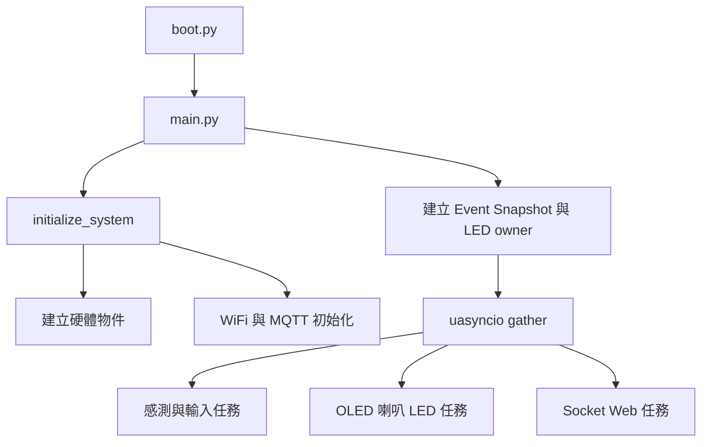
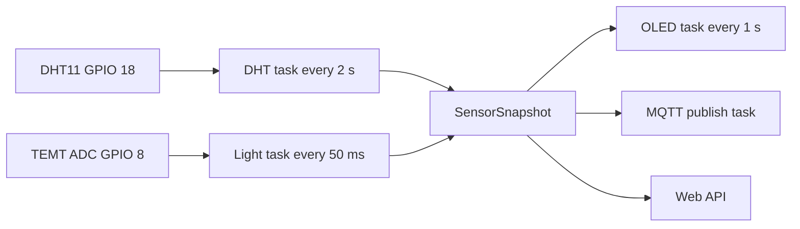
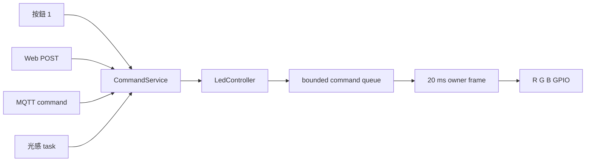
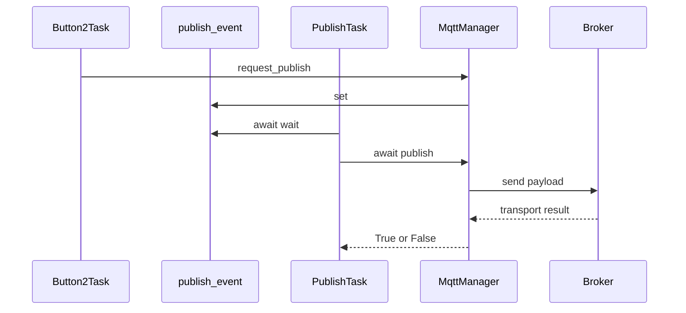

# `uasyncio` 學生操作手冊：ESP32 多感測器實作

**適用專案：**本專案目前的 ESP32／MicroPython 多感測器系統。<br>
**先修：**Python 基礎、GPIO 基礎、函式與類別、基本網路概念。<br>
**文件狀態：**操作步驟依目前專案程式與 `config.py` 整理；桌面測試不等於 ESP32 實機驗證。<br>
**整理時間：**2026-10-27 01:15:22 +08:00。

---

## 0. 使用規則

### 0.1 你要學會的不只是把程式跑起來

每一個實驗都要回答：

1. 這個 task 做什麼？
2. 它在哪裡 `await`？
3. 它與哪些 task 共用資料或硬體？
4. 它使用 Event、snapshot、queue 還是直接回傳值？
5. 如果硬體讀取失敗，狀態如何表示？
6. 如果 task 被取消，硬體如何回到安全狀態？

### 0.2 必須區分的三種結果

- **靜態檢查：**程式碼與文件內容符合預期。
- **桌面 fake 測試：**以替身驗證邏輯，不代表 GPIO 或網路實機。
- **ESP32 實機驗證：**實際開發板、接線、韌體、WiFi 與周邊共同運作。

報告不可把前兩者寫成第三者。

---

## 1. 課前安全與硬體檢查

### 1.1 先確認開發板

專案目前沒有在程式中指定完整 ESP32 開發板型號。開始前請記錄：

- 開發板製造商與型號。
- MicroPython 韌體版本。
- USB 序列埠名稱。
- 供電方式。
- GPIO 37、35、33、8 是否在該板可用。

如果開發板的 GPIO 編號、ADC 通道或周邊功能不同，先停止部署，更新接線或建立該板的公開設定，不要直接猜測。

### 1.2 接線表

| 元件 | 公開範例設定 | 操作前檢查 |
|---|---|---|
| RGB LED | R=37、G=35、B=33 | 確認 LED 電阻、共陽／共陰與輸出邏輯 |
| 按鈕 1 | GPIO 17 | 連接至輸入腳與 GND，使用內部上拉 |
| 按鈕 2 | GPIO 21 | 連接至輸入腳與 GND，使用內部上拉 |
| 按鈕 3 | GPIO 16 | 連接至輸入腳與 GND，使用內部上拉 |
| DHT11 | GPIO 18 | 確認供電、資料線與必要上拉 |
| TEMT 光感 | ADC GPIO 8 | 確認輸出電壓不超過 ADC 允許範圍 |
| PIR | GPIO 4 | 確認輸出高低電位與預熱狀態 |
| 無源喇叭 | PWM GPIO 6 | 確認不要直接超載 GPIO，依課堂電路接法使用 |
| OLED | I2C 0，SCL=7、SDA=5 | 確認電源電壓與共地 |
| RFID MFRC522 | SCK=12、MOSI=11、MISO=10、RST=9、CS=13 | 確認模組電壓與 SPI 接線 |

### 1.3 不要分享機密

- `config.py` 可能含私人 WiFi profiles。
- 不要把 `config.py` 上傳到公開 repository。
- 不要把 WiFi 密碼貼到課堂截圖、Issue、報告或聊天室。
- 公開範例使用 `config.example.py` 的 placeholder。
- 不要以公開範例覆蓋已有私人設定的 `config.py`。

---

## 2. 目前設定與觀察預期

### 2.1 輪詢與事件時間

| 功能 | 目前值 | 你要觀察的行為 |
|---|---:|---|
| 按鈕去彈跳 | 20 ms | 快速抖動不應形成多次有效按下 |
| 按鈕輪詢 | 30 ms | 等待按鈕時其他 task 仍可運作 |
| 光感輪詢 | 50 ms | ADC 快速更新，但不應直接寫 LED |
| DHT11 | 2 s | 慢速量測不應阻塞 OLED、PIR 或 Web |
| OLED | 1 s | 讀取 snapshot，不直接觸發 DHT |
| RFID | 500 ms | 無卡時持續輪詢，成功時保留最近資料 |
| PIR | 100 ms | 高電位穩定 200 ms 才觸發 |
| PIR 重新武裝 | 1500 ms 低電位 | 未完成低電位穩定前不接受下一次事件 |
| LED frame | 20 ms | owner 逐輪處理命令與閃爍狀態 |
| 低光警示 | 5 次，亮／滅各 300 ms | 完整警示後恢復原本狀態 |

### 2.2 光感門檻

公開基線與目前裝置的非機密控制設定：

```python
LIGHT_DARK_WHEN_HIGH = True
LIGHT_ALERT_TRIGGER_ADC = 2000
LIGHT_ALERT_RESET_ADC = 1500
```

控制語意：

- ADC 嚴格高於 2000，且已 armed：提交一次低光警示。
- ADC 在 1501～2000：維持目前 armed 狀態，不觸發新的警示。
- ADC 小於或等於 1500：重新 armed。
- 光感讀取失敗或值未知：不可提交低光控制命令。

不要把 2000／1500 當成所有光感模組的通用校正值；實際操作以裝置 `config.py`、模組方向與現場量測為準。

---

## 3. 檔案與部署邊界

### 3.1 主要執行檔

目前主流程的主要檔案包括：

```text
main.py
boot.py
tasks.py
web_server.py
config.py
hardware/
communication/
services/
lib/
index.html
assets/uplot/1.6.32/
```

`lib/` 內只部署目前主流程需要的實作，例如 `mqtt_as.py`、`mfrc522_async.py`、SSD1306 與字型等；Web Server 已由 `web_server.py` 的原生 Socket 實作提供，不需載入 Microdot。實際清單應依目前 import 與課堂部署版本確認。

### 3.2 不要部署的來源快照或封存檔

```text
mdy_01/
mdy_02/
lib_backup/
tests/
```

這些檔案可供比較、測試或回復，不是 ESP32 的最小部署內容。

### 3.3 啟動路徑



### 3.4 公開設定檢查

部署前檢查：

- 實機 `config.py` 是否存在。
- `config.py` 的 WiFi profiles 是否為自己的設定。
- 公開範例是否仍是 placeholder。
- 沒有把私人設定複製進教材或 Git。
- 開發板 GPIO 與設定表一致。

---

## 4. 實驗一：兩個協程交錯執行

### 4.1 目標

學會：

- `async def`
- `await`
- `uasyncio.sleep_ms()`
- `uasyncio.gather()`
- cooperative scheduling

### 4.2 操作程式

請先在暫存檔或 REPL 中執行，不要直接覆蓋主程式：

```python
import uasyncio

async def fast_task():
    for index in range(5):
        print('fast', index)
        await uasyncio.sleep_ms(200)

async def slow_task():
    for index in range(3):
        print('slow', index)
        await uasyncio.sleep_ms(500)

async def main():
    await uasyncio.gather(fast_task(), slow_task())
    print('all done')

uasyncio.run(main())
```

### 4.3 預期觀察

輸出不會是全部 `fast` 完成後才全部 `slow`；兩者會在等待期間交錯。

請記錄：

| 問題 | 你的觀察 |
|---|---|
| 哪一行讓 `fast_task()` 讓出控制權？ | |
| `slow_task()` 是否阻塞 200 ms 的任務？ | |
| `gather()` 何時返回？ | |

### 4.4 阻塞對照

將其中一個 `await uasyncio.sleep_ms(500)` 暫時改為：

```python
import time
time.sleep(0.5)
```

重新觀察輸出順序，說明另一個 task 為何停住。完成比較後還原為非同步等待。

### 4.5 驗收

- 能指出每一個 `await`。
- 能說明 `time.sleep()` 會阻塞整個事件迴圈。
- 能說明 `gather()` 是等待多個 coroutine 的組合，不是建立多個 CPU 執行緒。

---

## 5. 實驗二：三個按鈕與非同步去彈跳

### 5.1 目標

學會：

- `Pin.IN` 與 `Pin.PULL_UP`
- 低電位按下
- `wait_press()` 與 `wait_release()`
- `sleep_ms()`
- 去彈跳不應阻塞其他 task

### 5.2 目前程式路徑

```text
main.py
    → Button(config.BUTTON1_PIN)
    → tasks.button1_task()
    → await button1.wait_press()
    → CommandService.submit('cycle', 'button1')
    → await button1.wait_release()
```

按鈕 2 的路徑是：

```text
main.py
    → Button(config.BUTTON2_PIN)
    → tasks.button2_task()
    → await button2.wait_press()
    → mqtt_manager.request_publish(publish_event)
    → await button2.wait_release()
```

按鈕 3 的路徑是：

```text
main.py
    → Button(config.BUTTON3_PIN)
    → tasks.button3_task()
    → await button3.wait_press()
    → CommandService.submit('green_flash_alert', 'button3')
    → await button3.wait_release()
```

### 5.3 操作步驟

1. 依實機 `config.py` 確認按鈕 1、2、3 的 GPIO；公開範例分別是 17、21、16。
2. 部署主流程與正確 `config.py`。
3. 開機後觀察序列埠。
4. 按一下按鈕 1，記錄 LED 命令 receipt。
5. 放開按鈕 1，確認下一次按下前不會因持續低電位一直提交新命令。
6. 按一下按鈕 2，記錄 MQTT 發佈請求狀態。
7. 按一下按鈕 3，記錄綠閃命令 receipt；效果期間的新 LED 命令應依 busy 政策處理。
8. 同時觀察 PIR、OLED 或 Web 狀態是否仍更新。

### 5.4 觀察問題

- 按鈕按下時 GPIO 是高還是低？
- `debounce_read()` 為何要多次取樣？
- `wait_release()` 為何也是非同步函式？
- 按鈕 task 是否直接呼叫 `RgbLed.write()`？如果沒有，誰負責？
- 按住按鈕時，DHT、PIR 或 Web 是否仍有機會執行？

### 5.5 常見錯誤

| 現象 | 可能原因 |
|---|---|
| 一按就產生很多命令 | 沒有等待釋放、接線浮動或去彈跳太短 |
| 一直判定按下 | 上拉接線、按鈕方向或 GPIO 設定錯誤 |
| 其他功能停止 | 在按鈕迴圈使用同步長時間等待 |
| LED 命令被拒絕 | LED 正在低光警示、queue 滿或 controller stopped |

---

## 6. 實驗三：DHT11、光感與 OLED 的不同週期

### 6.1 目標

學會：

- 不同感測器使用不同輪詢週期。
- producer 更新 `SensorSnapshot`。
- OLED 與 Web 只讀 snapshot。
- 讀取失敗時保留 last-good value 並標記錯誤。

### 6.2 目前資料流



### 6.3 操作步驟

1. 啟動裝置並開啟 OLED。
2. 觀察 OLED 的溫度、濕度與時間。
3. 用手或光源改變光感輸入，觀察 ADC 值。
4. 開啟 Web `/api/data`，確認回應中有：
   - `temperature`
   - `humidity`
   - `light`
   - `sensor`
   - `light_thresholds`
5. 比較 OLED、Web 與序列埠的更新時間。
6. 暫時移除或干擾 DHT11 資料線，在安全條件下觀察 error 與 last-good value。

### 6.4 `SensorSnapshot` 欄位練習

請從 `/api/data` 或序列埠記錄一筆：

| 欄位 | 記錄值 |
|---|---|
| `value` | |
| `valid` | |
| `quality` | |
| `age_ms` | |
| `error` | |
| `updated_at_ms` | |

回答：

1. 為什麼讀取失敗時不能只把溫度改成 `-1`？
2. `age_ms` 對 Web 顯示有什麼用途？
3. OLED task 為什麼不應直接呼叫 `dht_sensor.measure()`？
4. 感測成功是否代表 LED 低光警示一定會觸發？還需要哪些條件？

### 6.5 驗收

- DHT 約每 2 秒更新，而不是每個 Web request 都重新讀取。
- 光感約每 50 ms 取樣。
- OLED 更新不會直接觸發新的 DHT 量測。
- 暫時失敗時可以看到錯誤狀態，不會把錯誤值冒充正常值。

---

## 7. 實驗四：PIR Event 與無源喇叭

### 7.1 目標

學會：

- `uasyncio.Event()`
- `set()`、`wait()`、`clear()`
- PIR 穩定高電位觸發
- 低電位重新武裝
- `finally` 確保喇叭靜音

### 7.2 目前流程

```text
PIR GPIO 4
    → pir_monitor_task()
    → high stable >= 200 ms
    → motion_event.set()
    → music_on_motion_task().wait()
    → Speaker.play_song()
    → await sleep(duration)
    → finally silence()
```

### 7.3 操作步驟

1. 確認 PIR 接到 GPIO 4。
2. 確認喇叭接到 GPIO 6，並使用課堂指定保護電路。
3. 啟動裝置後先等待 PIR 模組穩定。
4. 讓手在感測範圍內移動。
5. 觀察序列埠是否出現一次移動事件。
6. 觀察喇叭是否播放 `C4、E4、D4、G3、REST`。
7. 在播放期間再次移動，記錄事件是否合併。
8. 移動停止後保持低電位，等待至少 1500 ms，再測試下一次事件。

### 7.4 觀察表

| 測試 | 預期結果 | 實際結果 |
|---|---|---|
| 高電位短於 200 ms | 不應觸發完整事件 | |
| 高電位持續超過 200 ms | 觸發一次 | |
| 高電位維持不變 | 不應每 100 ms 重複計數 | |
| 低電位少於 1500 ms 後再次高 | 通常仍未重新武裝 | |
| 低電位至少 1500 ms 後再次高 | 可觸發下一次 | |
| 播放中取消 task | 喇叭應靜音 | |

### 7.5 重要區分

- `pir_high`：目前輸入高低。
- `detected`：網頁顯示保持狀態。
- `count`：已確認的事件數。
- `armed`：是否允許下一次事件。
- `motion_event`：task 間通知旗標。

`MOTION_DETECTED_HOLD_MS=5000` 不是 5 秒冷卻時間；它是狀態顯示保持時間。

---

## 8. 實驗五：RGB LED 單一 owner 與命令 receipt

### 8.1 目標

學會：

- 多個來源不直接寫同一個 GPIO。
- `CommandService` 是命令入口。
- `LedController.run()` 是唯一 LED owner。
- `accepted` 不等於 `executed`。
- bounded queue 與 busy 狀態。

### 8.2 LED 命令資料流



### 8.3 操作步驟

1. 啟動裝置。
2. 由按鈕 1 提交數次 `cycle`。
3. 由 Web POST `/api/led/toggle` 提交一次換色。
4. 在光線低於目前 trigger threshold 時觀察低光警示。
5. 警示期間嘗試按按鈕 1。
6. 記錄按鈕命令的 receipt：
   - `status`
   - `reason`
   - `request_id`
7. 警示完成後觀察 LED 是否恢復警示前的 desired color。
8. 觀察 `/api/data` 或 LED status 中的：
   - `alert_active`
   - `queue_depth`
   - `desired_color`
   - `applied_output`
   - `last_command`

### 8.4 目前命令政策

- 一般命令最多保留 8 筆。
- 每個 20 ms frame 最多處理 4 筆。
- 結果歷史最多保存 16 筆。
- 低光警示接受時立即保留 LED。
- 警示期間一般命令可能被拒絕為 `busy` 或 `alert_started`。
- `MANUAL` 模式下低光警示會被拒絕為 `manual_mode`。

### 8.5 禁止的修改

以下寫法違反目前 owner 設計：

```python
# 不要在按鈕 task 中直接做
rgb_led.write(4)

# 不要在光感 task 中直接做
rgb_led.write(4)
```

正確方向：

```python
receipt = command_service.submit('set_color', 'student', 4)
print(receipt)
```

### 8.6 驗收

- 按鈕、Web、MQTT、光感都經過共同命令入口。
- 實際 RGB GPIO 只有 owner 寫入。
- `accepted` 與 `executed` 可被區分。
- 警示完成後能恢復警示前狀態。
- busy 或 queue full 時有明確 reason，而不是靜默遺失。

---

## 9. 實驗六：MQTT 非同步發佈與訂閱

### 9.1 目標

學會：

- `await connect()`。
- `wait_connected()` 與 timeout。
- `await publish()`。
- `await subscribe()`。
- 同步 callback 與非同步 task 的橋接。
- accepted、publishing、published、failed 的差異。

### 9.2 公開 MQTT 設定

公開範例目前使用：

```text
Broker: broker.emqx.io
Port: 1883
Command topic: nuu/csie/iot1133/cmd01
Temperature topic: nuu/csie/iot1133/TempHumi
Subscribe topic: nuu/csie/iot1133/#
```

實際操作仍以正在部署的 `config.py` 與教師指定 Broker 為準。

### 9.3 按鈕 2 發佈流程



### 9.4 操作步驟

1. 確認 WiFi 設定為自己的網路，不要公開密碼。
2. 確認裝置可取得 IP。
3. 觀察 MQTT 初始化與連線訊息。
4. 按下按鈕 2。
5. 查詢 `/api/publish/status`。
6. 記錄狀態依序是否出現：
   - `accepted`
   - `publishing`
   - `published` 或 `failed`
7. 如果連線不存在，記錄是否為 `unavailable` 或 `failed`。

### 9.5 MQTT LED 指令

目前可測試的 payload 格式：

```text
led:4
```

或：

```text
led=4
```

裝置收到後會：

```text
同步 MQTT callback
    → handle_cmd()
    → 解析顏色索引
    → CommandService.submit('set_color', 'mqtt', value)
    → LedController
```

callback 不應直接寫 LED。

### 9.6 逾時實驗

在沒有可用 Broker 或暫時關閉網路的環境下測試：

- `wait_connected()` 是否在 timeout 後返回 False。
- 程式是否把逾時誤報成 published。
- 其他硬體任務是否仍能運作。
- Web 狀態是否顯示 unavailable 或 failed。

不要把公開 Broker 的瞬間成功或失敗當成永久網路特性；報告需記錄測試時間與網路條件。

---

## 10. 實驗七：RFID 非同步 SPI

### 10.1 目標

學會：

- SPI 周邊初始化。
- `await request()`。
- `await anticoll()`。
- 無卡、成功與例外的差異。
- 最近 5 筆 RAM 紀錄。

### 10.2 操作步驟

1. 確認 MFRC522 五條 SPI／控制線接線正確。
2. 開機觀察 RFID 初始化結果。
3. 不放卡，觀察讀卡 task 是否持續運行。
4. 放入一張卡，記錄 UID 與時間。
5. 連續讀取 6 次不同或相同卡片。
6. 查詢 Web `/api/data` 中的 `rfid.recent_reads`。
7. 確認最多只保留最近 5 筆。
8. 重新開機，確認 RAM 紀錄清空。

### 10.3 觀察問題

- 無卡是否被當成程式致命錯誤？
- `read_uid()` 為什麼是 `async def`？
- 驅動在哪裡使用 `await sleep_ms(1)`？
- 讀卡錯誤與「沒有卡」是否完全相同？目前程式有什麼限制？
- 紀錄重啟後為何消失？

---

## 11. 實驗八：Timeout、錯誤注入與安全清理

### 11.1 目標

學會：

- `uasyncio.wait_for()`。
- `TimeoutError`。
- task 例外隔離。
- `finally`。
- 硬體安全狀態。

### 11.2 測試案例

| 測試 | 操作 | 應觀察 |
|---|---|---|
| DHT 失敗 | 暫時中斷資料線 | last-good 與 error 狀態分開 |
| RFID 未接 | 不接或關閉模組 | 主流程依政策降級或標示錯誤 |
| OLED 失敗 | 暫時移除模組 | 其他任務仍可執行，畫面 task 記錄錯誤 |
| MQTT 斷線 | 關閉網路或指定不可用環境 | timeout／failed，不假裝 published |
| 喇叭取消 | 播放中停止 task | `finally` 後 PWM 靜音 |
| LED 停止 | 要求 controller stop | LED 寫成 0，`wait_stopped()` 返回 |

### 11.3 報告格式

對每個案例記錄：

```text
測試名稱：
硬體／網路條件：
觸發方式：
序列埠輸出：
Web 狀態：
其他任務是否繼續：
安全狀態：
是否需要重啟：
未驗證項目：
```

### 11.4 不可接受的結果

- 逾時被顯示為成功。
- 喇叭停止後仍持續發聲。
- LED 停止後仍保持不安全輸出。
- 一個感測器錯誤使所有非相關功能無限重啟。
- 錯誤被空白 catch 完全吞掉，沒有狀態或日誌。

---

## 12. 實驗九：任務取消與資源釋放

### 12.1 目標

學會：

- task 的停止條件。
- `finally` 的責任。
- stop request 與 stopped confirmation。
- 為什麼 cleanup 必須在例外與取消路徑都執行。

### 12.2 觀察目前設計

LED owner：

```text
request_stop()
    → _stopping = True
    → 清除待處理命令
    → run() 離開迴圈
    → finally 寫 LED 0
    → _stopped.set()
    → wait_stopped() 返回
```

Speaker：

```text
play_song()
    → await 音符時間
    → 正常結束或取消
    → finally silence()
```

### 12.3 學生練習

請新增一個簡單的可停止示範 task，不要先修改正式主流程：

```python
import uasyncio

async def worker(stop_event):
    try:
        while not stop_event.is_set():
            print('working')
            await uasyncio.sleep_ms(200)
    finally:
        print('cleanup')
```

回答：

1. 如果沒有 `finally`，硬體清理可能漏在哪些路徑？
2. `stop_event.set()` 後 task 是否一定立刻停止？
3. 為什麼需要等待 stopped confirmation？

---

## 13. 實驗十：Web 狀態與非同步控制

### 13.1 目標

學會：

- 原生 Socket async route。
- Web API 讀 snapshot。
- Web 命令提交與硬體完成分離。
- `no-store` 狀態查詢。
- 快速控制狀態與慢速感測展示分流。

### 13.2 重要路由

| 路由 | 用途 | 非同步／狀態重點 |
|---|---|---|
| `/api/data` | 感測、RFID、PIR、LED 綜合資料 | 讀 RAM snapshot，不重新量測硬體 |
| `/api/motion/status` | PIR／喇叭狀態 | 不等待 DHT、ADC、SPI；`no-store` |
| `/api/led/toggle` | 提交 cycle 命令 | 受理不等於完成 |
| `/api/led/commands` | 提交標準 LED 命令 | 後端檢查 busy、mode、queue |
| `/api/publish/status` | 查 MQTT 最近結果 | `accepted`／`published`／`failed` 分開 |
| `/api/status` | 基本服務狀態 | 不是完整硬體健康證明 |

### 13.3 操作步驟

1. 從序列埠取得 ESP32 IP。
2. 以瀏覽器開啟 `http://裝置IP/`。
3. 開啟瀏覽器開發者工具的 Network 面板。
4. 觀察 `/api/data` 與 `/api/motion/status` 的請求頻率。
5. 移動手臂，確認 motion 狀態不必等待完整感測 API。
6. 點擊 LED 按鈕，觀察 HTTP 狀態碼與 JSON receipt。
7. 對照 LED 實際輸出與 API 的 `accepted`／`executed`。

### 13.4 分析問題

- 如果 DHT 量測變慢，為什麼 `/api/motion/status` 仍應保持輕量？
- 為什麼前端顯示「已受理」不能寫成「LED 已完成」？
- `/api/data` 內的 `light_thresholds` 是從哪裡來？
- 重整瀏覽器後，最近 RFID 與 PIR 記錄是否仍存在？為什麼？

---

## 14. 桌面測試與實機報告

### 14.1 專案桌面測試

教師或助教可在桌面環境執行：

```powershell
python -B -m unittest discover -s tests -v
```

若系統沒有 `python`，使用課堂已確認可用的 Python 執行檔。這些測試可能使用 fake GPIO、fake MQTT 或 TestClient；測試通過只能證明替身路徑，不代表 ESP32 實機通過。

### 14.2 學生實機報告最少內容

```text
開發板型號：
MicroPython 韌體版本：
程式版本／Git commit：
config.py 非機密設定摘要：
接線照片或接線表：
執行時間：
測試項目：
觀察結果：
失敗與重現方式：
尚未驗證項目：
```

不要把 WiFi SSID／密碼、token 或私有裝置資訊放入報告。

---

## 15. 綜合實作題

選擇一題，先提交設計，再修改程式：

### 題目 A：長按按鈕

要求：

- 不破壞現有短按流程。
- 說明長按判定需要的狀態與時間。
- 不在硬體 driver 內寫 LED 業務政策。
- 由 `CommandService` 提交命令。
- 實作取消與按鈕釋放邊界。

### 題目 B：OLED 狀態頁輪播

要求：

- 只讀 `SensorSnapshot` 與 RAM 狀態。
- 不直接觸發 DHT、ADC、RFID。
- 每一頁使用非同步等待。
- 顯示資料過期或錯誤時要明確表示。

### 題目 C：MQTT 週期發佈

要求：

- 使用獨立 task。
- 連線狀態未知時不可宣稱已發佈。
- 不能建立無限堆積的 task。
- 明確處理 timeout 與失敗。
- 說明與按鈕 2 的 Event 語意有何不同。

### 題目 D：PIR 事件 Queue

要求：

- 說明為什麼 Event 會合併事件。
- 設計有限容量與滿載策略。
- 說明每筆事件的 timestamp 與順序。
- 不能讓 queue 無限制增加。

### 題目 E：LED 命令結果查詢

要求：

- 使用 request ID。
- 分開 accepted、executing、executed、rejected、failed。
- 不讓前端快照取代後端 busy／mode 檢查。
- 提供可觀察的錯誤 reason。

---

## 16. 綜合題提交格式

```text
題目：
問題定義：
硬體與設定：
新增或修改的 task：
使用的 await 邊界：
Event／Snapshot／Queue 選擇理由：
共享資源與 owner：
錯誤與 timeout 政策：
取消與 cleanup 政策：
桌面測試結果：
ESP32 實機結果：
未驗證項目：
回復方式：
```

另附：

- 任務流程圖。
- 修改前後差異。
- 至少一個正常案例。
- 至少一個失敗案例。
- 至少一個邊界時間案例。

---

## 17. 故障排除索引

### `ImportError: no module named uasyncio`

- 確認程式是在 MicroPython 韌體上執行，不是普通桌面 Python。
- 確認韌體版本提供 `uasyncio`。
- 不要直接把桌面 `asyncio` 套件複製到 ESP32 取代韌體模組。

### `NameError` 或設定欄位不存在

- 確認使用的是正確 `config.py`。
- 不要用公開範例覆蓋私人設定。
- 檢查本次程式與設定是否來自同一版本。

### 按鈕沒有反應

- 依實機 `config.py` 確認三個按鈕 GPIO；公開範例為 17／21／16。
- 確認共地與內部上拉接線。
- 確認按下是低電位。
- 確認 task 已啟動。
- 確認是否仍在等待釋放或被去彈跳拒絕。

### LED 一直紅閃或無法換色

- 讀取 LED status 的 `alert_active`、`busy`、`queue_depth`。
- 確認光感方向設定；目前高值越暗模式要檢查 ADC 是否嚴格高於 2000。
- 確認 ADC 是否降至 1500（含）以下重新 armed。
- 確認目前是否為 AUTO 模式。
- 不要由其他 task 直接寫 GPIO。

### PIR 重複或不觸發

- 觀察高電位是否穩定 200 ms。
- 觀察低電位是否穩定 1500 ms。
- PIR 模組可能需要預熱。
- `detected` 顯示保持不等於已重新 armed。
- 記錄實機波形或輸出，不要只修改數字猜測。

### MQTT 顯示已受理但沒有訊息

- `accepted` 不等於 `published`。
- 查 `/api/publish/status`。
- 確認 `wait_connected()` 成功。
- 檢查 Broker、topic、WiFi 與 timeout。
- 不要把 callback 收到當成 Broker 已確認。

### OLED 顯示空白

- 確認 I2C 0、SCL 7、SDA 5。
- 確認供電與共地。
- 確認 `ssd1306.py` 在裝置上。
- 觀察初始化與更新錯誤。
- 其他 task 是否仍在運作。

### RFID 讀不到卡

- 確認 SPI 五條控制線。
- 確認模組電壓。
- 確認 `mfrc522_async.py` 在 `lib/` 且 import 路徑正確。
- 區分「無卡」與「初始化／通訊錯誤」。
- 記錄 `rfid_state.status` 與 `error`。

---

## 18. 最終驗收清單

### 非同步概念

- [ ] 能解釋 coroutine、task、event loop。
- [ ] 能指出所有永久迴圈的 `await`。
- [ ] 能說明 `time.sleep()` 為何會阻塞。
- [ ] 能區分 Event、Snapshot 與 Queue。
- [ ] 能說明 timeout、accepted 與 executed 的差異。

### 硬體功能

- [ ] 按鈕 1 可提交 LED 命令。
- [ ] 按鈕 2 可提交 MQTT 發佈請求。
- [ ] DHT11 可更新溫濕度 snapshot。
- [ ] 光感可更新 ADC snapshot。
- [ ] PIR 可在穩定高電位後觸發一次。
- [ ] 喇叭播放完成或取消後會靜音。
- [ ] OLED 可讀 snapshot 顯示。
- [ ] RFID 可讀取並保留最近 5 筆 RAM 紀錄。
- [ ] Web API 可查詢狀態。

### 架構與安全

- [ ] LED 只有單一 owner 寫 GPIO。
- [ ] 感測失敗不把錯誤值冒充正常值。
- [ ] MQTT 失敗不被宣稱為成功。
- [ ] task 停止時硬體進入安全狀態。
- [ ] 報告不包含私人 WiFi、token 或密碼。
- [ ] 報告明確區分桌面測試與 ESP32 實機結果。

---

## 19. 課後反思

請用自己的話回答：

1. 為什麼單一事件迴圈仍然可以同時處理按鈕、感測器與網路？
2. 為什麼非同步不等於平行執行？
3. 哪一種工作最不適合直接放在 callback 中？
4. 在這個專案中，為什麼 LED 使用 single owner 比所有 task 共用一把 Lock 更容易維護？
5. 什麼時候 Event 不夠用？
6. 為什麼 snapshot 要同時保存 value、valid、quality、age 與 error？
7. `MOTION_DETECTED_HOLD_MS` 與 `PIR_LOW_REARM_MS` 的責任有何不同？
8. 如果 Web 回傳 HTTP 202，哪些事情仍可能尚未發生？
9. 如何證明一個修改真的在 ESP32 上安全，而不是只在桌面測試通過？
10. 如果要把新功能加入本專案，哪一個 task 或 owner 應該負責它？為什麼？
