# 物聯網軟體架構講義：Web 畫面、按鈕與資料生命週期

**適用案例：**本專案目前的 ESP32／MicroPython、Microdot、HTML／CSS／JavaScript、uPlot 本機資產與 MQTT 實作。**整理日期：**2026-10-11 23:23:20 +08:00。這是獨立講義，不是變更紀錄；若程式行為改變，應同步修正文中的對應說明。

本講義依目前程式逐步追蹤。圖中成功情境不代表已做實機驗證；現有缺陷另列在各節，避免把預期設計當成已實現功能。行號以整理當時為準，之後可依函式名稱查詢。

## 1. 學習目標與畫面對照

閱讀每條流程時，回答六個問題：誰發起？誰接收？呼叫哪個函式？參數從何處來？結果存在哪裡？何時更新或失去？

| 畫面元件 | HTML 位置／ID | 發起方式 | 實際來源或作用 |
|---|---|---|---|
| 標題、說明、單位、頁尾 | `index.html` 固定文字 | 載入 HTML | 靜態字串，沒有專屬 API |
| 狀態區的溫度 | `temp`，第 195 行 | `updateData()` | `data.temp` |
| 溫度卡片 | `tempCard`，第 210 行 | 同上 | 同一個 `data.temp`，不是第二次量測 |
| 狀態區的濕度 | `humidity`，第 199 行 | 同上 | `data.humidity` |
| 濕度卡片 | `humidityCard`，第 215 行 | 同上 | 同一個 `data.humidity` |
| 光照目前值 | `lightCard`，第 220 行 | 同上 | `data.light`，原始 ADC 值 |
| 光照歷史圖 | `lightChart`，uPlot Canvas | `updateLightChart()` | 最近 80 次有效 ADC；一般 Y 軸 0～2048，超過 2048 時擴展至 4095 |
| 狀態文字 | `status`，第 203 行 | 初始 HTML／資料更新例外 | 初始為正常；catch 時改為連接失敗 |
| 移動偵測與喇叭狀態 | `motionMessage`、`motionHistory`、`motionCount`、`musicStatus` | `updateMotionStatus()` | `GET /api/motion/status`，只讀PIR／喇叭RAM快照，不等待DHT、ADC或SPI |
| 按鈕 1：切換 LED | 第 226 行，`onclick="toggleLED()"` | 使用者 click | `POST /api/led/toggle`，循環下一個色碼 |
| 按鈕 2：發布資料 | 第 227 行，`onclick="publishData()"` | 使用者 click | `POST /api/publish`，受理後設定發佈事件 |
| 發佈狀態視窗 | JavaScript `alert()` | 發佈按鈕處理 | 解析 JSON `accepted`／`published`／錯誤；不把 `accepted` 宣稱為 MQTT 已完成 |

畫面目前沒有 LED 色碼欄位或裝置時間欄位；光照卡片使用本機部署的 uPlot 顯示最近 80 次歷史折線。OLED 顯示時間，但它不參與 Web DOM 更新。頁尾「每 1 秒」是固定文字，真正的計時來自 JavaScript 的輪詢排程。

## 2. 先分清楚兩個執行世界

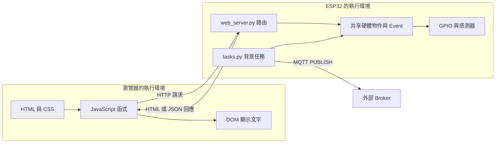

瀏覽器不能直接呼叫 ESP32 的 Python 函式。`fetch('/api/data')` 送出 HTTP 訊息，Microdot 收到後才呼叫 `api_data(request)`；回程也必須先把 Python 資料轉成 JSON 文字，瀏覽器再解析成自己的 JavaScript 物件。

**三種「物件」要分開：**ESP32 的 `dht_sensor` 是 Python 物件；HTTP JSON 是序列化字元／位元組；瀏覽器的 `data` 是解析後的新 JavaScript 物件。它們不是跨電腦共享的同一份記憶體。

## 3. 開機準備：後面的呼叫為何找得到硬體？

### 3.1 初始化與啟動順序

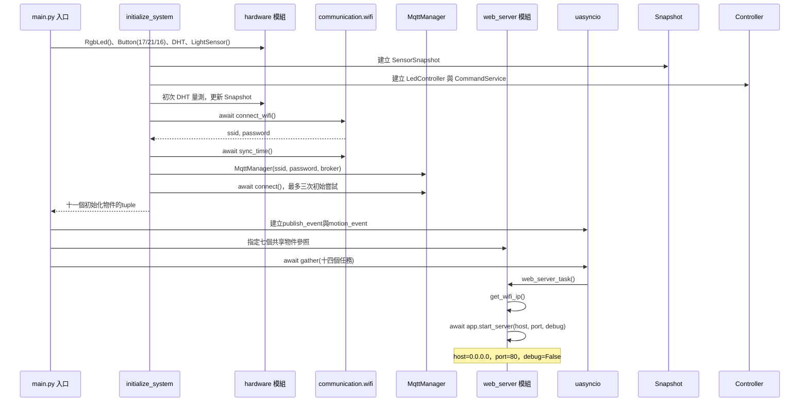

圖中 `Entry` 代表 `main.py` 內的主流程。具體呼叫與參數如下。

| 呼叫位置 | 被呼叫的程式 | 實際參數／來源 | 產生的狀態 |
|---|---|---|---|
| `main.py` | `uasyncio.run(main())` | `main()` 產生的 coroutine | 主事件迴圈執行主協程 |
| 初始化 | `RgbLed()` | 類別讀 `config` 的 GPIO 37／35／33 | 三個 Pin，初始由 owner 控制 |
| 初始化 | `Dht11Sensor()` | 內部讀 `config.DHT11_PIN=18` | DHT driver；last-good 初值為 `None` |
| 初始化 | `LightSensor()` | 內部讀 `TEMT_ADC_PIN=8` | ADC；last-good 初值為 `None` |
| 初次量測 | `dht_sensor.measure()` | 無外加參數；使用 `self.sensor` | 成功更新 SensorSnapshot，失敗保留空值並記錄 error |
| 初始化網路 | `connect_wifi()` | 內部將 WiFi profiles 傳給工具 | WiFi 連線；回傳 SSID／密碼 |
| 初始化 MQTT | `MqttManager(...)` | SSID／密碼與 Broker 由 main 指定 | client、連線旗標與連線 Event |
| 主組裝 | `SensorSnapshot()` | 沒有硬體參照 | 感測 value、valid、quality、age、error |
| 主組裝 | `LedController()`、`CommandService()` | RGB driver 與 controller 參照 | 唯一 LED owner 與共用命令入口 |
| `web_server_task()` | Web 路由 | 讀main注入的共享參照 | SocketApp路由、Flash靜態檔串流與SensorSnapshot、LED／MQTT API |

WiFi 失敗時包裝函式可能只回傳預設 profiles；拿到 SSID／密碼不保證已連網。MQTT 初始嘗試完成後才啟動 gather，因此 Web 啟動時間受初始化等待影響。Web 感測查詢只讀 Snapshot，不直接重新量測。

### 3.2 相依物件如何傳給 Web 與任務

```python
publish_event = uasyncio.Event()
sensor_snapshot = SensorSnapshot()
led_controller = LedController(rgb_led)
command_service = CommandService(led_controller)
web_server.sensor_snapshot = sensor_snapshot
web_server.command_service = command_service
```

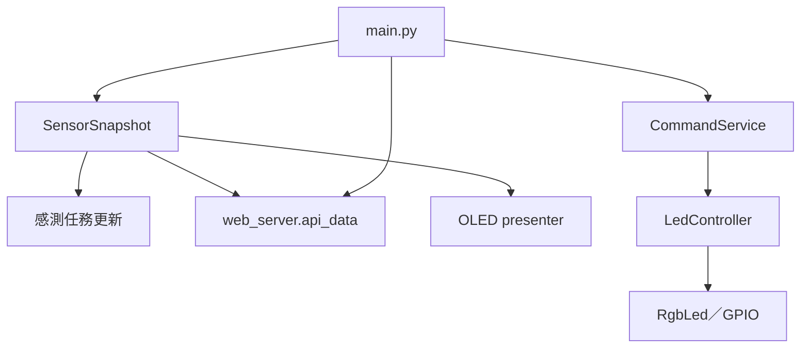

這些指定傳遞的是物件參照，不會複製硬體或快照；但 Web 只讀 `SensorSnapshot.snapshot()` 的資料副本，不直接呼叫 DHT／ADC。

## 4. 第一次開啟網頁：Flash 檔案如何串流成畫面？

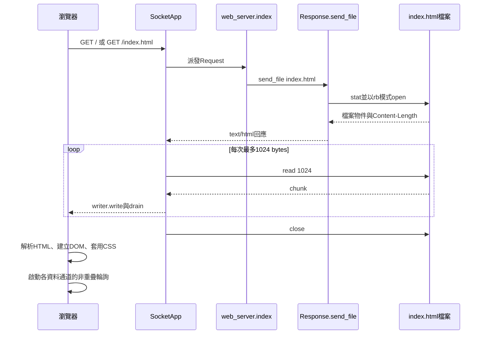

| 步驟 | 程式與參數 | 來源與存放 |
|---|---|---|
| 路由註冊 | `@app.route('/')`／`@app.route('/index.html')` | 匯入模組時把URL與handler登記於`SocketApp` |
| 回應建立 | `Response.send_file('index.html', content_type='text/html; charset=utf-8')` | 只開啟Flash檔案並設定長度，不建立完整HTML字串 |
| 分塊傳送 | `_write_response()`呼叫`read(1024)` | 每塊寫入Socket後`drain()`，完成或失敗都關閉檔案 |
| 瀏覽器解析 | HTML→DOM，CSS→樣式 | 建立瀏覽器記憶體中的元素與初始文字 |
| 程式啟動 | `pollSensorData()`、`pollMotionStatus()`、`pollLedStatus()` | 每個通道完成一筆後才安排下一筆 |

首頁不再使用`HTML_PAGE`或`f.read()`。這避免啟動時配置約31 KB字串，也避免回應時把同一字串再encode成另一份大型bytes。代價是每次首頁請求都會重新開啟Flash檔案，但RAM峰值只包含小型header與目前的1024-byte chunk。

頁面另外請求兩個本機資產：`/assets/uplot/1.6.32/uPlot.iife.min.js`與`/assets/uplot/1.6.32/uPlot.min.css`。首頁與兩個資產都使用`Response.send_file()`串流；uPlot資產另使用長效快取。

### 4.1 uPlot 如何整合進 `index.html` 與 `web_server.py`

本專案採「HTML頁面與圖表函式庫分離部署」：`index.html`保留頁面結構、樣式與應用JavaScript；uPlot JavaScript／CSS放在`assets/`並由同源路由提供。三個檔案都直接從Flash分塊傳送，不建立模組全域的大型字串，也不需要CDN。

#### A. `index.html` 的載入順序

`index.html` 有兩個 uPlot 入口：

```html
<head>
    <link rel="stylesheet" href="/assets/uplot/1.6.32/uPlot.min.css">
</head>
...
<body>
    ...
    <script src="/assets/uplot/1.6.32/uPlot.iife.min.js"></script>
    <script>
        // 本頁應用程式 JavaScript
    </script>
</body>
```

瀏覽器處理順序如下：

1. 先向 ESP32 的 `/` 或 `/index.html` 取得整份 HTML。
2. 解析 `<link>` 時，再向同一個 ESP32 請求 `uPlot.min.css`；這個檔案提供 `.uplot`、Canvas 外框與內部元素的基本樣式。
3. 解析到 body 底部的 `<script src=...>` 時，請求並執行 `uPlot.iife.min.js`。IIFE 版本會在瀏覽器建立全域 `uPlot` 建構函式。
4. uPlot 載入完成後，才執行下一個 inline script；該 script 才能在 `createLightChart()` 中呼叫 `new uPlot(...)`。
5. 頁面啟動 `updateData()`，之後以既有輪詢流程取得 `/api/data`。

因此，uPlot 檔案不能只存在開發電腦，也不能只修改 HTML 的 `<script>` 路徑；ESP32 檔案系統與 `web_server.py` 路由必須同時存在。若 JavaScript 資產遺失、路徑拼錯或函式庫未成功執行，`typeof uPlot !== 'function'`，`createLightChart()` 會回傳失敗，畫面顯示「圖表元件載入失敗」；感測文字仍可能更新，因為文字資料與圖表初始化是兩條前端流程。

#### B. 光照資料如何進入 uPlot

光照圖不是由 ESP32 產生圖片，也不是由 `/api/data` 回傳 SVG。ESP32 只回傳數字，瀏覽器保留短期歷史並交給 uPlot 繪製：

```text
GET /api/data
  → response.json().light
  → updateLightChart(value)
  → lightHistory（瀏覽器 RAM，最多80筆）
  → getLightChartData()
  → uPlot.setData()
  → Canvas 折線
```

`updateLightChart(value)` 的資料邊界是：

| 步驟 | 實作 | 目的 |
|---|---|---|
| 數字化 | `Number(value)`，非有限值直接不新增樣本 | 避免 `null`、文字或 `NaN` 污染圖表 |
| ADC 限制 | `Math.max(0, Math.min(4095, numeric))` | 將前端顯示限制在 ADC 合理範圍 |
| 加入歷史 | `lightHistory.push(...)` | 保存本頁瀏覽期間的有效樣本 |
| 滑動視窗 | 超過 `LIGHT_HISTORY_LIMIT = 80` 時 `shift()` | 限制瀏覽器 RAM 與 Canvas 資料量 |
| 組合 uPlot 資料 | X 軸為 `0...n-1`，Y 軸為歷史 ADC 複本 | 符合 uPlot 的 `[xValues, yValues]` 格式 |

歷史只存在瀏覽器 RAM；重新整理、關閉頁面或重新開啟另一個分頁都會重新從空陣列開始，不寫入 ESP32 Flash，也不改變 `/api/data` 契約。

#### C. uPlot 圖表設定與兩個 Y／X 軸邊界

`createLightChart()` 只建立一次 `lightChart`。建立時設定 Canvas 寬度、280 px 高度、光照序列顏色、隱藏點標記、隱藏 legend／cursor，以及 Y 軸刻度與水平虛線。資料更新時不重建 DOM，而是呼叫 `setData()` 和 `setScale()`：

```javascript
const chartData = getLightChartData();
lightChart.setData(chartData, false);
lightChart.setScale('x', {
    min: 0,
    max: Math.max(1, chartData[0].length - 1)
});
lightChart.setScale('y', {
    min: 0,
    max: getLightChartMax()
});
```

X 軸使用 `auto: false` 與 identity `range` 函式，再由 `renderLightChart()` 明確設定目前的 `0～n-1`。這個細節很重要：若只使用 `setData(..., false)` 而讓 X 軸停留在初始 `0～1`，新增資料會落在可視區域外，畫面看起來就像只連了前兩個點。資料超過 80 筆後，陣列移除最舊值，X 軸仍維持 `0～79`，因此畫面是最近 80 筆的滑動視窗。

Y 軸則故意不採資料自動縮放：

- 所有歷史值都不大於 2048：範圍固定為 `0～2048`，刻度為 `0、512、1024、1536、2048`。
- 任一歷史值大於 2048：範圍擴展為 `0～4095`，刻度為 `0、1024、2048、3072、4095`。
- 新樣本若超過 4095，先限制到 4095；因此不會破壞圖表比例。

`setScale('y')` 的明確範圍與 `getLightAxisSplits()` 的刻度函式分工不同：前者決定可視數值上下限，後者決定水平網格線與文字刻度位置。這就是「常態聚焦 2048 以下，但高值出現時仍看得到完整 ADC 範圍」的實作。

#### C.1 亮暗遲滯線

圖表另外使用 uPlot 的 `hooks.draw` 在 Canvas 上畫兩條紅色實線；門檻不是前端自行決定，而是由同一輪 `/api/data` 的 `light_thresholds` 傳入：

| 圖線 | API 欄位 | 目前裝置／範例值 | 控制意義 |
|---|---|---:|---|
| `暗 <trigger>` | `data.light_thresholds.trigger` | 裝置 `config.py`：500；公開範例：1000 | ADC 嚴格低於 trigger 時，允許提交一次低光 LED 警示。 |
| `亮 <reset>` | `data.light_thresholds.reset` | 目前裝置與公開範例：1100 | ADC 回升至 reset 以上時，重新 armed，允許下一次低光警示。 |

前端收到門檻後，`updateLightThresholds()` 保存數字；`drawLightThresholds()` 使用 `chart.valToPos(value, 'y', true)` 把 API 值轉為目前 Y 軸的 Canvas 座標，再畫完整寬度的紅色實線，並在右側動態標示實際數字。當 Y 軸切換到 4095 時，兩條線仍依 API 回傳的 ADC 值重新定位，不會跟著資料平均或移動。若初次回應尚未包含有效門檻，圖表不繪製門檻線；後續成功回應取得門檻後才顯示，既有門檻則在暫時缺欄位時保留。

因此亮暗緩衝區不是固定寫死的 `1000～1099`；目前裝置設定為 `500～1099`，公開設定範例則為 `1000～1099`。圖線只提供操作邊界的視覺提示，不會取代後端 LED owner 的低光遲滯判斷。

#### D. 更新與縮放生命週期

1. `updateData()` 成功解析 JSON 後，先執行 `updateLightThresholds(data.light_thresholds)`，再更新溫度、濕度、光照目前值與 `updateLightChart(data.light)`。
2. 第一次有效光照值會建立 uPlot；等待資料時顯示 `lightChartEmpty`。
3. 後續值使用 `setData()` 更新既有圖表，避免每秒重新建立 Canvas。
4. `window.resize` 事件呼叫 `resizeLightChart()`，依容器寬度執行 `setSize()`；不重新建立 uPlot，也不清除歷史資料。
5. uPlot 載入失敗時只停用圖表，不會把感測文字輪詢或 LED／RFID／移動偵測流程改成依賴圖表。

#### E. `web_server.py` 如何提供 HTML 與 uPlot 檔案

首頁與uPlot資產共用`Response.send_file()`；首頁不設長效快取，版本化uPlot路徑則使用一年快取：

```python
@app.route('/')
async def index(request):
    return Response.send_file(
        'index.html',
        content_type='text/html; charset=utf-8')

@app.route('/assets/uplot/1.6.32/uPlot.iife.min.js')
async def uplot_javascript(request):
    return Response.send_file(
        'assets/uplot/1.6.32/uPlot.iife.min.js',
        content_type='application/javascript; charset=utf-8',
        max_age=31536000)
```

這裡有四個設計重點：

1. **同源路徑：**HTML、資產與JSON API使用同一個ESP32 origin，不需要CORS或外部網路。
2. **分塊串流：**首頁、JavaScript與CSS都以1024-byte chunk傳送，不配置完整檔案大小的RAM字串。
3. **正確MIME type：**HTML、JavaScript與CSS分別使用對應Content-Type。
4. **長效快取與版本路徑：**只有版本化uPlot資產使用`max_age=31536000`；升級時必須建立新版本目錄並同步修改HTML與路由。

#### F. ESP32 部署檢查表與故障定位

最小檔案集合如下：

```text
index.html
web_server.py
assets/uplot/1.6.32/uPlot.iife.min.js
assets/uplot/1.6.32/uPlot.min.css
assets/uplot/1.6.32/LICENSE
```

瀏覽器開發者工具可依下表定位問題：

| 現象 | 優先檢查 |
|---|---|
| 頁面完全不是新版本 | 裝置上的`index.html`是否已更新；瀏覽器是否仍保留舊頁面或需要強制重新整理 |
| 感測文字正常、圖表顯示「圖表元件載入失敗」 | uPlot JavaScript 路由、檔案路徑、檔案是否真的上傳；Network 是否取得 HTTP 200 |
| 圖表有框但樣式異常 | `uPlot.min.css` 路由與 MIME type；瀏覽器是否被舊快取污染 |
| 圖表只顯示兩點 | 確認使用目前 `renderLightChart()` 的 X 軸明確 `setScale()` 邏輯，而不是只呼叫 `setData(..., false)` |
| 圖表超過 2048 被截斷 | 確認 Y 軸歷史資料有使用 `getLightChartMax()` 切換至 4095，且前端未錯誤固定在 2048 |

這個整合的責任邊界是：`web_server.py` 負責把 HTML／uPlot 靜態資產與 JSON API 送到瀏覽器；`index.html` 負責保存光照短期歷史、決定刻度與呼叫 uPlot；uPlot 只負責在瀏覽器 Canvas 中繪圖，不讀 GPIO、不直接呼叫 MicroPython，也不保存裝置端歷史。

`request` 在目前這些 handler 中沒有被讀取；URL 路由負責選函式。`0.0.0.0` 是伺服器綁定所有 IPv4 介面的地址，不是學生應在瀏覽器輸入的目的 IP；實際目的 IP 由 WiFi 取得並印在序列日誌。

**HTML的生命週期：**Flash原始檔持續存在；每次`GET /`或`GET /index.html`都重新開檔並串流，請求結束即關閉，不在ESP32模組RAM保留頁面副本。已開啟的瀏覽器頁面仍不會自動替換，部署後應重新整理。

檔案不存在或無法開啟時，`send_file()`在序列埠記錄檔名與例外並回HTTP 404小型文字，不再嘗試配置替代的大型HTML。路由與Socket串流是本專案自有`SocketApp`／`Response`實作，不依賴Microdot。

### 4.2 2026-10-21 記憶體事件紀錄與防回歸規則

#### 已確認證據

| 項目 | 數值／結果 | 能支持的結論 |
|---|---:|---|
| 首次ESP32錯誤要求配置 | 31,232 bytes | 失敗是大型連續RAM配置，不是單純找不到檔案 |
| 加入網頁按鈕3之前的`mdy_05/index.html` | 31,308 bytes | 與錯誤配置量同一尺度；首次失敗時網頁按鈕3尚未加入 |
| 加入網頁按鈕3後的`index.html` | 32,675 bytes | 頁面增加1,367 bytes，會惡化整檔載入，但不是首次事件的起因 |
| 實體按鈕3回合的首頁Git blob | 與原基線相同 | 實體按鈕3沒有直接修改`index.html` |
| 串流修正前的`web_server.py` Git blob | 與原基線相同 | 實體按鈕3沒有直接改壞Web讀檔程式 |
| 受限檔案TCP smoke | 32,675 bytes、33次`read(1024)` | 修正後不需要整檔read；最後一次read用來取得EOF |

**直接根因：**舊`load_html()`先以`f.read()`配置完整HTML字串，回應時又可能encode成另一份大型bytes；配置需要足夠大的連續heap。

**觸發因素判定：**實體按鈕3新增`Button`／`Pin`物件、`button3_task` coroutine與效果狀態，而且這些物件在`web_server_task()`舊版呼叫`load_html()`之前已建立。它們可能使剩餘或連續heap低於約31 KB，讓既有缺陷首次浮現；但當時沒有保存`gc.mem_free()`與heap fragmentation資料，因此這是有程式順序支持的推論，不是唯一原因的實機量測證明。後續網頁按鈕3增加HTML大小，只會進一步降低舊設計的成功機率。

#### 不可破壞的記憶體規則

1. `/`、`/index.html`與大型靜態資產必須使用`Response.send_file()`；每次檔案`read`不得超過1024 bytes。
2. 裝置端不得重新加入`HTML_PAGE`、無參數`read()`、`read_bytes()`，或先把完整靜態檔案組成`str`／`bytes`再回應。
3. `test_index_stream_never_reads_the_whole_file`必須保留：測試檔案物件遇到整檔read會直接拋出`MemoryError`。
4. HTML增長不得以提高單次配置量處理；應維持串流，並確認HTTP `Content-Length`與實際完整body一致。
5. 新增硬體、driver或長駐task的ESP32實機驗收，應在初始化完成及Web開始服務前後記錄`gc.mem_free()`；只看總free heap仍不能證明存在31 KB連續區塊。
6. 部署時`index.html`與`web_server.py`必須維持相容版本；不得只回復到會整檔載入的舊`web_server.py`。
7. 多頁面同時連線會各自保有file、writer與chunk；目前尚無ESP32多客戶端壓力數據，不得把單連線smoke當成並發容量證明。

#### 發佈檢查門檻

- 桌面：完整Python測試、兩組前端測試、受限檔案TCP smoke與`git diff --check`通過。
- 文件：任何靜態檔傳輸變更都同步更新本節與`SYSTEM_ARCHITECTURE.md`。
- ESP32：序列埠不得再出現約31 KB的HTML配置失敗；`GET /`應完成HTTP 200。未觀察實機前只能標示桌面驗證。


## 5. 溫度／濕度：背景量測與網頁查詢是兩條流程

### 5.1 第一條：背景任務產生快取

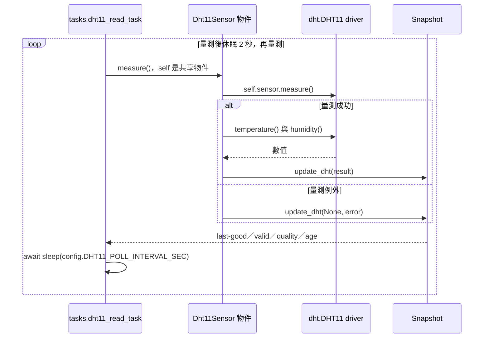

| 呼叫 | 參數怎麼拿到 | 回傳／寫入 |
|---|---|---|
| `tasks.dht11_read_task(dht_sensor, sensor_snapshot)` | main 注入兩個共享物件 | 一直執行的協程 |
| `dht_sensor.measure()` | 無外加參數；從 self 找到 driver | tuple 或 `None`；保留 last-good |
| `sensor_snapshot.update_dht(...)` | task 將結果與 error 傳入 | 更新 value、valid、quality、age、error |
| `sleep(config.DHT11_POLL_INTERVAL_SEC)` | 設定值 2 | 讓出執行權，等待下一輪 |

這裡是**最新有效值快取**，由 `SensorSnapshot` 保存 last-good value 與品質欄位。量測失敗不覆寫有效值，而是將該欄位標為 `valid=false`、`quality=error`，並更新 `error`／`age_ms`。


### 5.2 第二條：瀏覽器取快取，更新兩組顯示

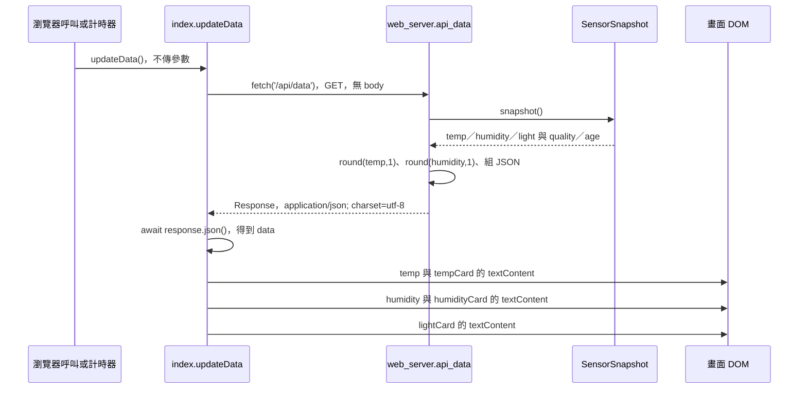

`api_data()` 只讀 `SensorSnapshot`，不呼叫 DHT 或 ADC。感測任務負責更新值；Web 回應同時提供舊有 `temp`／`humidity`／`light` 欄位，以及 `sensor` 內的 `valid`、`quality`、`age_ms` 與 `error`。

成功回應範例（假設當次數值）：

```json
{"temp":26,"humidity":60,"light":0,"sensor":{"status":"ready","sample_seq":42},"light_thresholds":{"trigger":500,"reset":1100},"status":"ready"}
```
其中`light_thresholds`由`web_server.py`讀取`config.LIGHT_ALERT_TRIGGER_ADC`與`config.LIGHT_ALERT_RESET_ADC`後序列化；前端不得直接讀取Python設定檔。

### 5.1 LED、RFID、移動偵測的最近紀錄

同一份`/api/data`也帶回控制與輸入的RAM快照；`/api/led/status`則提供LED的快速、不快取版本。這些歷史不是資料庫，裝置重啟後會清空：

為避免完整`/api/data`讀取DHT／ADC等慢感測時延遲移動提示，`index.html`另以`MOTION_POLL_MS = 1000`獨立輪詢`GET /api/motion/status`。此路由只複製`motion_state`的RAM快照，設定`Cache-Control: no-store`；前端每一通道一次只保留一筆在途請求，完成後才排下一筆。

| API欄位 | 內容 | 上限與畫面用途 |
|---|---|---|
| `led.alert_flash_count` | 已完成的低光警示事件次數 | 每完成一組`LIGHT_ALERT_BLINK_COUNT`次閃紅才加1；警示尚未完整閃完時不增加。 |
| `led.alert_flash_total` | 一個警示事件內的閃紅次數 | 來源為`config.LIGHT_ALERT_BLINK_COUNT`，目前通常為5；不是事件次數。 |
| `led.alert_flash_log` | 每個已完成事件的`{"sequence": 1, "time": "YYYY-MM-DD HH:MM:SS"}`紀錄 | 裝置RAM保留最近5個事件；時間是整組閃紅完成時間，LED區以`閃紅序號：時間`逐行顯示。 |
| `rfid.recent_reads` | `{"uid": "...", "read_at": "YYYY-MM-DD HH:MM:SS"}`格式的成功讀卡紀錄 | 只保留最近5次；RFID卡區顯示`卡號：讀卡時間`。 |
| `motion.recent_detections` | PIR經非同步防抖後的有效移動時間字串 | 以`PIR_HIGH_DEBOUNCE_MS`確認穩定高電位、以`PIR_LOW_REARM_MS`確認穩定低電位；只保留最近5次，移動偵測卡區逐行顯示`移動序號：時間`。 |

目前設定為`PIR_POLL_INTERVAL_MS = 100` ms、`PIR_HIGH_DEBOUNCE_MS = 200` ms、`PIR_LOW_REARM_MS = 1500` ms。一次偵測觸發後，持續高電位或短暫低／高抖動不會重複計數；只有低電位穩定達重新武裝時間後，下一次穩定高電位才會形成新事件。`MOTION_DETECTED_HOLD_MS = 5000`只控制網頁`detected`顯示保持時間，不是事件去重時間。1500 ms是目前在避免同一次手部靠近重複觸發與縮短再次偵測等待之間的折衷值。

例如回應中的相關部分可為：

```json
{
  "led": {
    "alert_flash_count": 1,
    "alert_flash_total": 5,
    "alert_flash_log": [
      {"sequence": 1, "time": "2026-10-12 12:00:05"}
    ]
  },
  "rfid": {
    "recent_reads": [
      {"uid": "0102030404", "read_at": "2026-10-12 12:00:02"}
    ]
  },
  "motion": {
    "recent_detections": ["2026-10-12 12:00:03"]
  }
}
```

`index.html`不自行累積這三類事件；LED以`/api/led/status`、RFID以`/api/data`、移動／喇叭以`/api/motion/status`成功快照重繪`ledFlashHistory`、`rfidHistory`與`motionHistory`。因此前端顯示的5筆上限與裝置端RAM上限一致，也不會因瀏覽器重新整理而保留舊資料。
前端 `index.html:238` 的核心程式：

```javascript
const response = await fetch('/api/data');
const data = await response.json();
const temp = data.temp || '--';
document.getElementById('temp').textContent = temp;
document.getElementById('tempCard').textContent = temp;
```

| 參數／變數 | 來源 | 作用／保存範圍 |
|---|---|---|
| `'/api/data'` | JavaScript 固定路徑 | 依目前頁面 URL 的 origin 發出請求，沒有指定外部 Broker |
| Python `request` | Microdot | 代表這次 HTTP；handler 不使用其中參數 |
| `temp`／`humidity` | `SensorSnapshot` 欄位 | API 的區域名稱，沒有反向修改感測快照 |
| `1` | `round(value,1)` 的常數 | 四捨五入到一位小數，不代表提高感測精度 |
| `response_json` | Python 字串串接 | 這次回應正文 |
| JS `response` | fetch Promise 完成值 | 瀏覽器 Response，與 Python Response 是不同物件 |
| JS `data` | `response.json()` | JSON 解析產生的 JavaScript 物件 |
| `'temp'`／`'tempCard'` | HTML 中相對應的 ID | `getElementById()` 查找節點 |
| `textContent = temp` | 解析到的值／替代字串 | 修改節點文字，瀏覽器後續重繪 |

濕度重複同一模式，使用 `data.humidity` 與兩個濕度 ID。因此畫面上四個溫濕度數字，只需要一次 `/api/data` 回應，不是四次 HTTP 或四次量測。正文只有數值；°C／% 是 HTML 已有的固定單位。

**更新不等於清空：**一次 fetch 結束後，JS 區域物件在沒有其他參照時可被垃圾回收；DOM 中已寫入的文字仍保留，直到下一次更新或頁面被替換。ESP32 快取也不因查詢被清除。HTTP 請求結束後，框架不再需要的 request／response 可釋放，確切時點由版本及 GC 決定。

## 6. 光照：背景任務更新 Snapshot，API 只讀快照

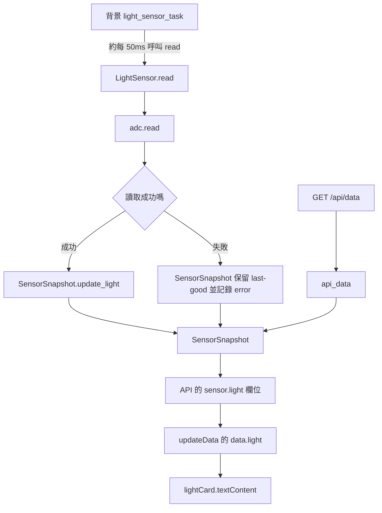
成功時 `SensorSnapshot.update_light()` 更新 light value、valid、quality 與 updated time；失敗時保留 last-good value 並記錄 error。`api_data()` 只讀快照，不會為了 HTTP 請求再觸發 ADC。

網頁顯示的是 raw ADC，不是 lux。此專案以 0～4095 解讀 ADC；實際量測範圍與校正須依板型／韌體確認。`get_brightness_percent()` 未被 Web 呼叫，沒有將資料轉成百分比。

圖表只在瀏覽器 RAM 保存最近 80 筆資料，重新整理頁面後清空；它不寫入 ESP32 Flash，也不改變 `/api/data` 的資料契約。

`LED_CONTROL_MODE='AUTO'` 時，背景光感任務可提交 `low_light_alert`；`MANUAL` 時該命令被拒絕，但光照資料仍照常更新。


## 7. 一秒輪詢與「正常／連接失敗」如何運作

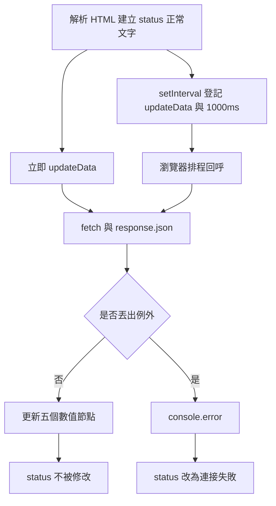

| 操作 | 實際參數 | 機制 |
|---|---|---|
| `updateData()` | 無參數 | 畫面載入後立即取資料 |
| `setInterval(updateData,1000)` | 函式參照與 1000 毫秒 | 登記未來回呼；不是此處直接執行函式 |
| `await fetch(...)` | URL | 該協程暫停等待網路，不阻止所有瀏覽器工作 |
| `await response.json()` | 無參數 | 讀取正文並解析 JSON；解析失敗也會進 catch |
| catch 修改 status | 固定 ID／固定失敗字串 | 只顯示「資料更新流程丟出例外」 |

現行程式有四個重要限制：

1. **「正常」是 HTML 初始值。**`data.status` 沒有被前端使用，也沒有查 `/api/status`。正常不證明 MQTT 在線或 DHT 健康。
2. **失敗後不會自動改回正常。**下次成功只更新數字，status 可能一直顯示失敗。
3. **`value || '--'` 將 0 視為缺值。**空值替代與合法零值被混淆；-1 則仍會顯示。若教學示範改善，可以討論 `??`，但目前程式未修改。
4. **`updateData()` 沒有檢查 `response.ok`。**fetch 收到 HTTP 404／500 通常仍回傳 Response；是否進 catch 還取決於網路與 JSON 解析，不能把 catch 等同 HTTP 失敗。[Fetch API 說明](https://developer.mozilla.org/en-US/docs/Web/API/Fetch_API/Using_Fetch)

`setInterval` 不等待先前那次 async `updateData()` 完成，慢網路可能有重疊請求，甚至較舊回應晚到而蓋掉新畫面。1000ms 是排程間隔，不是精確更新或完成保證；瀏覽器背景節流也會影響執行。[setInterval 機制](https://developer.mozilla.org/en-US/docs/Web/API/Window/setInterval)

瀏覽器回呼、Promise 與 ESP32 的 uasyncio 是**兩個獨立的排程系統**，以網路訊息溝通。持續的 coroutine 在 await 期間保留必要執行狀態，並非每次等待都從函式第一行重跑。

## 8. 按鈕 1：由 click 一路到三個 GPIO

### 8.1 呼叫時序

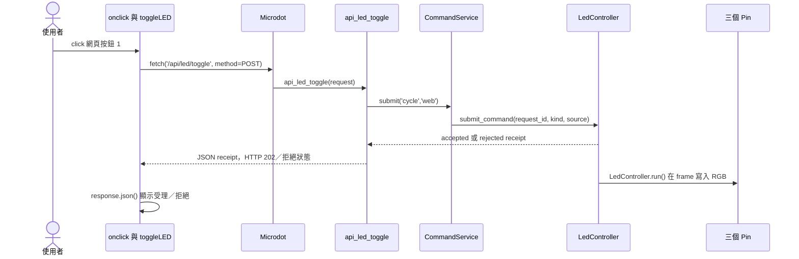

HTTP handler 只提交命令；LED 的 queue、AUTO／MANUAL、busy 與 GPIO 寫入都由 `CommandService`／`LedController` 負責。`accepted` 代表進入有界記憶體，不代表已完成 GPIO 寫入。

### 8.2 逐層參數與資料

| 順序 | 程式位置／呼叫 | 代入的參數 | 參數來源／結果 |
|---|---|---|---|
| 1 | `index.html` 的 onclick | `toggleLED()` 不傳參數 | HTML 指定 callback；沒有讀輸入欄位 |
| 2 | `index.html` 的 fetch | 路徑、`{method:'POST'}` | 固定 POST；沒有 body，也沒有色碼 |
| 3 | Microdot→`web_server.py` | `request` | 框架依 POST／path 生成並派發 |
| 4 | `api_led_toggle()` | `kind='cycle'`、`source='web'` | Web adapter 轉成內部命令 |
| 5 | `CommandService.submit()` | kind、source、value | 產生 request ID，呼叫 `LedController` |
| 6 | `LedController.submit_command()` | normalized command | 驗證模式、顏色、busy 與 queue 容量 |
| 7 | `LedController.run()` | 20 ms frame | 套用命令、更新 desired／applied、呼叫 RGB driver |
| 8 | Python Response | receipt JSON 與 HTTP status | `202` 只代表 accepted；拒絕回傳原因 |
| 9 | `response.json()` | 瀏覽器 Response 的 JSON | 前端顯示受理／拒絕；狀態另由 `/api/led/status` 查詢 |

### 8.3 位元理論與具體例子

```python
index = desired_color
r = (index >> 2) & 1
g = (index >> 1) & 1
b = index & 1
```

色碼共有三個 bit，對應 8 種組合：

| 索引 | 二進位 RGB | 顏色 | GPIO R/G/B |
|---|---|---|---|
| 0 | 000 | 黑／全滅 | 0／0／0 |
| 1 | 001 | 藍 | 0／0／1 |
| 2 | 010 | 綠 | 0／1／0 |
| 3 | 011 | 青 | 0／1／1 |
| 4 | 100 | 紅 | 1／0／0 |
| 5 | 101 | 紫 | 1／0／1 |
| 6 | 110 | 黃 | 1／1／0 |
| 7 | 111 | 白 | 1／1／1 |

若開機目前為 7，click 會算 `(7+1)%8=0`，三個 GPIO 熄滅；再 click 得 1，藍色持續；再 click 得 2，綠色持續。GPIO 暫存器保持所寫電位，不需要 HTTP 持續連線來保持顏色。

**名稱不要混淆：**JavaScript 仍叫 `toggleLED()`，HTTP path 仍叫 `/api/led/toggle`，但 Python 現在先呼叫 `CommandService.submit('cycle', 'web')`，再由 `LedController.run()` 在 frame 中套用命令。

`LedController` 分離 `desired_color`、`enabled`、`mode` 與 `applied_output`。`AUTO` 可由光感提交低光警示並在完成後恢復 desired state；`MANUAL` 會拒絕光感覆蓋命令。實體按鈕與 Web 都只產生命令，不直接寫 RGB GPIO。

## 9. 按鈕 2：HTTP 觸發事件，背景任務發佈 MQTT

### 9.1 前半段：接受觸發與畫面提示

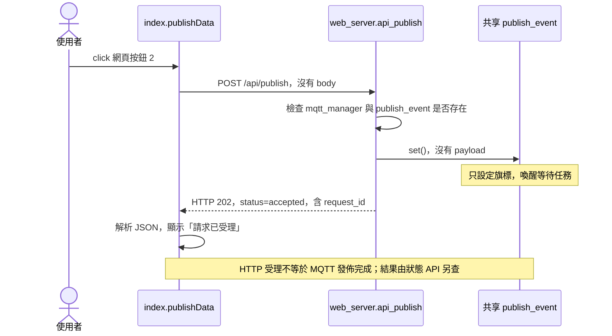

路由現在檢查 `mqtt_manager`、`publish_event` 與連線狀態；不可用時回 JSON `status=unavailable` 與 HTTP 503。可用時 `request_publish()` 產生 request ID、設定 Event，回 HTTP 202／`status=accepted`。`GET /api/publish/status` 讀取最近狀態；前端目前只顯示受理或錯誤，不持續輪詢最終狀態。

### 9.2 後半段：誰真的讀資料與發送？

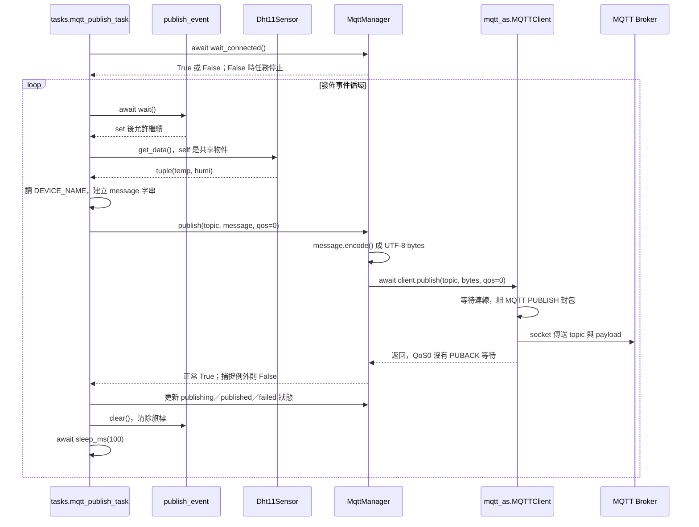

兩張時序圖是兩條獨立工作的路徑，**不得串成「HTTP 一定先回覆，然後 MQTT 才開始」**。set 後任務可在事件迴圈下一個排程機會繼續，實際網路完成先後依排程與 I/O 決定。HTTP 只確認請求已受理；`/api/publish/status` 才提供背景任務最近觀察到的結果。

### 9.3 參數追蹤到函式庫

| 層級 | 呼叫與參數 | 來源 | 保存／結果 |
|---|---|---|---|
| Browser | `publishData()` | click；無自訂參數 | 解析 `/api/publish` JSON；`accepted` 顯示已受理 |
| HTTP | `fetch('/api/publish',{method:'POST'})` | 固定值 | HTTP 202 表示受理；503 表示 unavailable |
| Route | `api_publish(request)` | Microdot 解析該請求 | `request_publish()` 檢查連線、產生 request ID、設定 Event |
| 狀態 | `GET /api/publish/status` | Browser 目前未持續輪詢 | 讀最近一次發佈狀態與 request ID |
| 通知 | `publish_event.set()` | manager 受理請求後設定 | 設定一個待處理條件 |
| 取值 | `sensor_snapshot.snapshot()` | 取最近快照；不重新 measure |
| 組文 | `message = f'{config.DEVICE_NAME}：溫度：{temp}℃, 濕度：{humi}%'` | 裝置名稱來自 config，數值來自 get_data | task 區域字串 |
| 主題 | `config.MQTT_TOPICS['temp_humi']` | bytes 設定 `b'nuu/csie/iot1133/TempHumi'` | 模組配置，可重用 |
| 品質 | `qos=0` | task 固定傳入 | 不等待 QoS1 的 PUBACK |
| 管理器 | `MqttManager.publish(topic,message,qos=0)` | task 的三個參數 | str 若需要則 `.encode()`，最後回 bool |
| Client | `MQTTClient.publish(topic,msg,retain=False,qos=0)`，`lib/mqtt_as.py:797` | manager 沒指定 retain，故使用預設 False | 等待連線／必要時重連再發送 |
| 基底 | `MQTT_base.publish(...)`，`:409` | 以相同 topic/msg/retain/qos 往下 | 取得寫入 lock，呼叫 `_publish()` |
| 封包 | `_publish(...,dup=0,pid)`，`:430` | 基底產生 pid；此 QoS0 不將 packet ID 放入封包 | 建立 MQTT header，topic 長度／topic／payload |
| Socket | `_send_str(topic)`、`_as_write(msg)`，`:255`／`:232` | topic 與已編碼 bytes | 分段寫入 socket；等待時讓出事件迴圈 |

Broker 地址來自開機的 `MqttManager`，Browser 不需要知道它。現有函式庫預設 SSL=False，port=0 時取 TCP 1883；講義僅說明此專案路徑，不建議把這些預設當作所有部署的安全配置。

中文 message 由 UTF-8 編碼成 bytes；byte 長度不等於字元數。JSON 只用於 Web 回應；這個 MQTT payload 是人類可讀文字，不是 JSON。

### 9.4 Event 的資料與生命週期

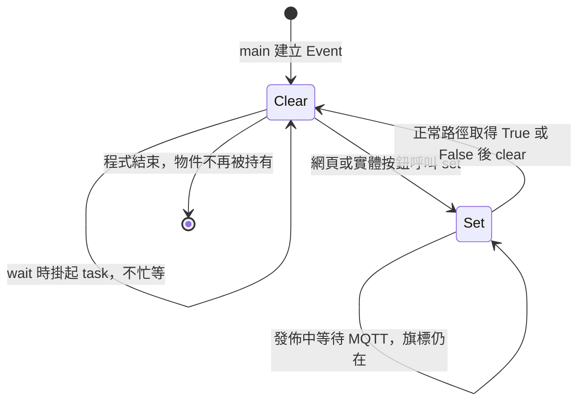

Event 不是資料佇列，內部不保存每一次點擊、溫濕度或 request ID。它只表示「需要發佈」；message 是 task 在真正處理時讀取快取才產生。所以發送值可能與使用者點擊當時的畫面略有差異。

多次 set 會合併；發佈期間另一次 set，也可能被後續 clear 一起清除。這是通知機制的限制，不代表全部點擊都有一筆消息。`clear()` 清的是條件旗標，不清感測快取、不刪 message 字串，也不清 Broker 資料。

task 會在 loop／await 間保存區域變數；message 常在下一次建立新字串時才被取代。只有舊物件不再被 task／client 等參照時，才能由 GC 回收，不能說「clear 後 message 立即消失」。

正常呼叫取得 False 也會 clear；若例外在其他步驟跳到外層 catch，clear 可能未執行，旗標可繼續維持 set。若 client 在斷線中持續等待／重連，該 task 的這次 publish 也可能長時間沒有返回。

Event 的 wait 是協程等待，沒有在 Python 無限輪詢旗標；它讓其他任務執行。官方 API 的任務內 set／clear／wait 規約見 [MicroPython asyncio](https://docs.micropython.org/en/latest/library/asyncio.html)。本專案兩種 set 來源皆為 asyncio 任務，沒有從硬體 IRQ 直接 set。

### 9.5 發佈完成要區分四個層次

| 層次 | 此程式觀察到什麼 | 能否保證下一層？ |
|---|---|---|
| HTTP 回應 accepted | 路由確認請求可進入 RAM／Event，回 `request_id` | 不能保證 MQTT 已完成 |
| manager／task 狀態 published | client 的 publish 正常返回；可由 `/api/publish/status` 觀察 | QoS0 不能保證 Broker 確認接收 |
| Broker 收到並轉送 | 需要另觀察 Broker／訂閱者 | 不保證訂閱應用保存或處理完成 |
| 訂閱者處理完成 | 需應用層確認／外部觀察 | 目前網頁沒有追蹤 |

QoS0 是協定的 at-most-once 交付層級，不包含 PUBACK；本地 client 的重連重試策略也不能提升成「應用動作一定恰好一次」。retain=False 不要求 Broker 保留這次消息作為新訂閱者的最新值；Broker 是否額外寫日誌／資料庫是外部配置，不可由此推斷。相關語意見 [MQTT 3.1.1 規範](https://docs.oasis-open.org/mqtt/mqtt/v3.1.1/mqtt-v3.1.1.html)。

前端在 `accepted` 時只顯示「發布請求已受理」；`published` 只有在其他客戶端查詢 `/api/publish/status` 或未來加入輪詢時才可觀察。用外部訂閱者收訊才可驗證消息確實抵達該訂閱者。實體按鈕 2 同樣只產生共用發佈事件，但不觸發網頁 alert。

## 10. 失敗分支：畫面提示不等於所有故障都被偵測

| 情境 | ESP32／Browser 實際路徑 | 使用者可能看見 |
|---|---|---|
| DHT 量測失敗 | 目前 task 依既有感測器回傳值組 payload | 仍需依資料品質文件補強，不把本次 MQTT 修正當成 DHT 品質修正 |
| 光照為 0 | Browser 的 `data.light || '--'` | 顯示 `--` 而不是 0 |
| LED 物件不存在／沒有方法 | route 不執行 GPIO，回錯誤狀態 | 前端顯示發布／控制未完成 |
| LED handler 拋例外 | 回 HTTP 500 | `response.ok=False`，toggleLED 目前沒有 else 提示 |
| 發佈 handler 拋例外 | 回 HTTP 500 JSON | `publishData` 解析錯誤並顯示失敗 |
| 發佈物件未初始化或未連線 | route 回 HTTP 503／`status=unavailable` | 顯示 MQTT 狀態不可用 |
| MQTT publish 等待／失敗 | 狀態 API 回 `publishing`／`failed` | `accepted` alert 不代表最終成功 |
| fetch 網路例外 | 該 JavaScript catch 執行 | 發佈按鈕顯示失敗 alert |
| 資料請求恢復成功 | 數字重新寫入，未重置 status | 新數值搭配舊失敗文字 |

伺服器 MQTT 發佈回應現在以 JSON 序列化，避免手動拼接錯誤正文；前端發佈按鈕解析 JSON。`/api/publish` 仍不等待背景 MQTT 結果，`/api/publish/status` 也只代表裝置本地 task 的最近觀察，不代表 QoS0 的 Broker ACK。

`/api/status` 雖然有 `api_status(request)`，目前僅回固定 `{"status":"ok","message":"System running"}`，沒有 uptime，也沒有被網頁呼叫；`sensor_monitor_task()` 每 10 秒休眠，尚未做實際健康檢查。不要將兩者畫成現有狀態欄的資料來源。

## 11. 資料存放、產生、覆寫與消失總表

「消失」至少分成三種：名稱被新值覆寫、物件變成無參照可回收、輸出／訊息的外部效果結束。三者的時間不相同。

| 資料／狀態 | 在哪裡 | 如何產生 | 如何更新或清除 | 持久性與注意 |
|---|---|---|---|---|
| `index.html`／Python 原始檔 | ESP32 Flash 檔案系統 | 上傳部署 | 再上傳／刪檔才改變 | 斷電通常仍在；不是瀏覽器執行狀態 |
| `config` 常數／topics | ESP32 模組記憶體，來源為檔案 | import 時執行指定 | 改值或重啟重新匯入 | 改 RAM 不自動寫回 Flash |
| `SocketApp`與route mapping | ESP32 RAM | 建立`SocketApp()`與decorators | 程式結束／重建app | 登記handler，不等於已執行HTTP |
| `index.html`串流檔案物件 | 單次HTTP handler／Flash | `Response.send_file()`逐請求open | 傳送完成或錯誤時close | 不保留`HTML_PAGE`；每次最多讀1024-byte chunk |
| DHT／ADC／LED 物件參照 | main、task 與 web 模組 | 初始化與注入 | 無參照／程式結束後可回收 | Web 只讀 Snapshot／controller snapshot |
| `SensorSnapshot` | `services/sensor_snapshot.py` | 感測任務更新 last-good 與品質 | 重啟重建；欄位在 RAM | 包含 value、valid、quality、age、error |
| LED controller state | `LedController` | CommandService 命令與 owner frame | 重啟重建；結果保留有界筆數 | desired／enabled／mode／applied 分離 |
| GPIO 輸出電位 | MCU 硬體暫存器／腳位 | `LedController.run()` 呼叫 driver | 下一次寫入、重設、失去供電等 | 與 Python receipt 生命周期不同 |
| Python HTTP request／Response／當前chunk | ESP32 handler | 每次請求解析、開檔與分塊回應 | 完成且無參照後可回收 | 首頁不建立完整RAM字串 |
| 瀏覽器 Response／data | Browser JS | fetch 與 JSON 解析 | 協程結束且無參照後可回收 | 與 ESP32 物件不同 |
| DOM 五個數值／status | Browser DOM | HTML 初值／textContent | 下次指定、重新載入／離開頁面 | 資料請求結束不會清文字 |
| 各輪詢通道的setTimeout計時器 | Browser執行環境 | 前一筆完成後安排下一筆 | clearTimeout或頁面環境結束 | 不用setInterval累積重疊請求 |
| `publish_event` 的旗標 | ESP32 RAM | 初始 clear，set 改變 | task 正常路徑 clear，或重建 | 不保存 payload／次數 |
| `_connected_event`／`_connected` | MqttManager | 初始化後連線 callback 設定 | 與 publish_event 獨立 | 不代表每次發佈完成；斷線旗標處理仍有限 |
| MQTT `message`／bytes／packet | task、manager、client 執行狀態 | 讀快取、組字串、encode、組包 | 下一輪覆寫或無參照後回收 | await 期間可能仍被持有 |
| Browser console／alert、序列日誌 | 各執行環境／外部工具 | log／print／alert | 依工具保存策略；alert 可關閉 | 本程式未提供持久日誌資料庫 |
| Broker／訂閱者的消息 | 外部系統 | 收到 MQTT PUBLISH | 依外部配置與消费方式 | 此專案無法決定外部是否保存歷史 |

RAM 回收由 runtime／GC 決定，無參照不等於立即擦除記憶體。重啟會重建應用狀態，但 Flash 原始檔留存；瀏覽器重新載入只重建頁面，不會重啟 ESP32 或清除 LED 色碼。

## 12. 理論對照：從此案例學到什麼？

| 觀念 | 在本案的具體位置 | 能解釋的現象 |
|---|---|---|
| Client／Server 與序列化 | fetch→HTTP→Python→JSON→JS | 跨機器只能交換訊息，不能共享物件指標 |
| 路由／控制反轉 | `@app.route` 登記 handler | 使用者請求到來，由框架呼叫函式並給 request |
| 相依注入與快照 | `web_server.sensor_snapshot=sensor_snapshot` | 背景任務寫入後，Web 讀到同一 Snapshot 的新值 |
| 取樣與快取 | DHT 約每 2 秒量測，Web 約每 1 秒查詢 | 兩次網頁刷新可能顯示相同 DHT 值 |
| 命令與查詢 | GET data、POST LED／publish | 查詢輸出資料，命令要求改變狀態／觸發工作 |
| 共同命令入口 | Button／Web／MQTT／光感 → `CommandService` → `LedController` | 所有來源共用 request ID、驗證、queue 與結果語意 |
| 協同多工 | uasyncio 的 await | 等網路／事件時其他任務仍可工作，同步長操作仍可阻塞 |
| 位元／模數 | RGB 色碼與 `%8` | 8 色組合與 7→0 循環 |
| 局部狀態與硬體状態 | LED 屬性／GPIO 寫入 | HTTP 結束後顏色仍保持 |
| 通知與佇列不同 | Event set／clear | 連點可能合併，沒有每點一筆保證 |
| 分散系統確認層級 | HTTP 回應、MQTT 返回、訂閱者接收 | 成功提示無法直接證明最終處理 |
| 資料品質與可觀測性 | -1／舊 ADC／固定正常 | 画面有數字不等於資料健康 |

`textContent` 寫的是文字，不將回傳值當 HTML 標籤解析；本案例更新現有 DOM，沒有重新取得整頁。[DOM textContent](https://developer.mozilla.org/en-US/docs/Web/API/Node/textContent)

### uPlot 本機資產部署

更新網頁圖表時，必須與 `index.html`、`web_server.py` 同步上傳：

```text
assets/uplot/1.6.32/uPlot.iife.min.js
assets/uplot/1.6.32/uPlot.min.css
assets/uplot/1.6.32/LICENSE
```

瀏覽器會從 ESP32 的固定 `/assets/uplot/1.6.32/` 路徑讀取資產，不使用 CDN。若只上傳 `index.html` 而漏掉資產，頁面仍可能顯示感測文字，但光照圖會顯示「圖表元件載入失敗」。更新版本時使用新的版本目錄與路由，避免長效快取繼續使用舊檔案。

## 13. 上課操作與討論題

### 實驗 A：觀察顯示資料流

1. 確認板上程式啟動、取得 WiFi IP，再由同網段 Browser 開 `/`。
2. 開啟開發者工具 Network，過濾 `api/data`，比較每次請求與 Response 正文。
3. 對照 DOM：同一溫度更新兩個 ID；濕度也相同；光照目前值更新 `lightCard`，歷史資料同步更新 `lightChart` 的 uPlot Canvas。
4. 觀察 DHT 兩秒取樣與一秒查询的差異；改變光線，對照 ADC。實際間隔以觀察結果為準。

### 實驗 B：觀察 LED 路徑

1. 確認光感自動控制開關為 False，開機白色 7。
2. 按網頁按鈕 1，查看 Network 的 POST，確認沒有色碼 request body。
3. 觀察 GPIO 顏色 7→0→1→2，與 Python 物件的索引計算對照。
4. 查 Browser console 與 ESP32 序列日誌，區分網頁操作與實體按鈕日誌。

### 實驗 C：觀察發佈觸發與最終收訊

1. 使用外部 MQTT 訂閱者監聽 `nuu/csie/iot1133/TempHumi`；此為目前設定，教室共用需避免其他組消息混入。
2. 按網頁按鈕 2，對照 HTTP 回應、alert、序列發佈日誌與訂閱者消息。
3. 討論是否能僅憑 alert 宣稱消息抵達；斷開 Broker 情境時，本地 HTTP 仍可成功嗎？
4. 快速多次點擊，觀察次數與消息數是否相同，解釋 Event 合併與 clear 時機。此實驗僅觀察現有行為，不要求每次點擊必然丟失或必然保留。

### 討論題

- 網頁為何不必知道 DHT GPIO，也不必傳入新色碼？
- `self`、Python `request`、JS `data` 三者的來源是否相同？
- 若瀏覽器刷新，LED 是否回到白色？若 ESP32 重啟呢？
- `publish_event.clear()` 為何不會清掉感測值？
- 為何兩秒量測／一秒刷新不代表資料一定小於兩秒？
- 如果需要每次點擊均有完成回覆，應加入哪些資料與契約？

最後一題可延伸有界 queue、request ID、結果查詢／ack，但那些是改進方案，不是現有實作。

## 14. 程式定位索引與參考

以下連結是本機專案的絕對路徑；講義移到其他電腦時可依檔名／函式名定位。

| 閱讀目的 | 程式起點 |
|---|---|
| 系統物件建立 | [main.py:29](G:/AsusWebStorage/2025/00_Teaching/114-1-csie@nuu/114-1-物聯網軟體架構/99_All_07_refactor/main.py:29) |
| 物件注入與任務啟動 | [main.py:90](G:/AsusWebStorage/2025/00_Teaching/114-1-csie@nuu/114-1-物聯網軟體架構/99_All_07_refactor/main.py:90) |
| HTML 載入 | [web_server.py:29](G:/AsusWebStorage/2025/00_Teaching/114-1-csie@nuu/114-1-物聯網軟體架構/99_All_07_refactor/web_server.py:29) |
| 感測資料 API | [web_server.py:131](G:/AsusWebStorage/2025/00_Teaching/114-1-csie@nuu/114-1-物聯網軟體架構/99_All_07_refactor/web_server.py:131) |
| LED API | [web_server.py:163](G:/AsusWebStorage/2025/00_Teaching/114-1-csie@nuu/114-1-物聯網軟體架構/99_All_07_refactor/web_server.py:163) |
| 發佈 API | [web_server.py:189](G:/AsusWebStorage/2025/00_Teaching/114-1-csie@nuu/114-1-物聯網軟體架構/99_All_07_refactor/web_server.py:189) |
| 前端定時更新 | [index.html:238](G:/AsusWebStorage/2025/00_Teaching/114-1-csie@nuu/114-1-物聯網軟體架構/99_All_07_refactor/index.html:238) |
| 前端兩個按鈕 | [index.html:264](G:/AsusWebStorage/2025/00_Teaching/114-1-csie@nuu/114-1-物聯網軟體架構/99_All_07_refactor/index.html:264) |
| 感測值如何產生 | [hardware/sensors.py:11](G:/AsusWebStorage/2025/00_Teaching/114-1-csie@nuu/114-1-物聯網軟體架構/99_All_07_refactor/hardware/sensors.py:11) |
| LED 色碼如何套用 | [hardware/led.py:25](G:/AsusWebStorage/2025/00_Teaching/114-1-csie@nuu/114-1-物聯網軟體架構/99_All_07_refactor/hardware/led.py:25) |
| 背景量測 | [tasks.py:71](G:/AsusWebStorage/2025/00_Teaching/114-1-csie@nuu/114-1-物聯網軟體架構/99_All_07_refactor/tasks.py:71) |
| 背景發佈 | [tasks.py:173](G:/AsusWebStorage/2025/00_Teaching/114-1-csie@nuu/114-1-物聯網軟體架構/99_All_07_refactor/tasks.py:173) |
| MQTT adapter／編碼 | [communication/mqtt_client.py:91](G:/AsusWebStorage/2025/00_Teaching/114-1-csie@nuu/114-1-物聯網軟體架構/99_All_07_refactor/communication/mqtt_client.py:91) |
| MQTT client 發佈入口 | [lib/mqtt_as.py:797](G:/AsusWebStorage/2025/00_Teaching/114-1-csie@nuu/114-1-物聯網軟體架構/99_All_07_refactor/lib/mqtt_as.py:797) |
| 可公開的設定範本 | [config.example.py](G:/AsusWebStorage/2025/00_Teaching/114-1-csie@nuu/114-1-物聯網軟體架構/99_All_07_refactor/config.example.py) |

框架說明以官方文件為參考，實際 API 依裝置已安裝版本確認。`lib/mqtt_as.py` 為此專案隨附實作，應優先閱讀它來理解此裝置行為。講義中的示例數值不代表實際量測結果。
